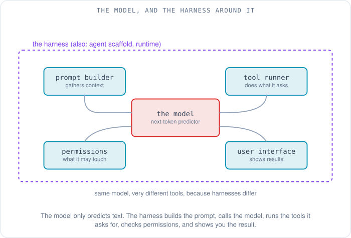
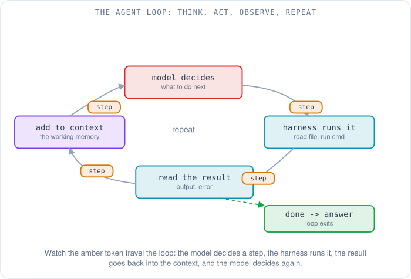
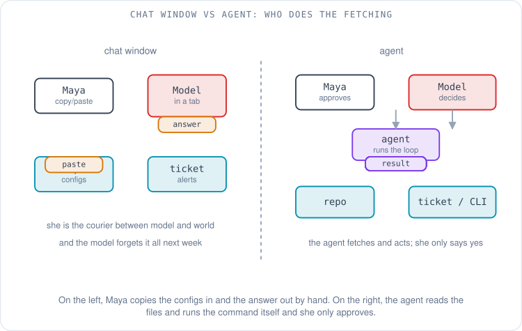
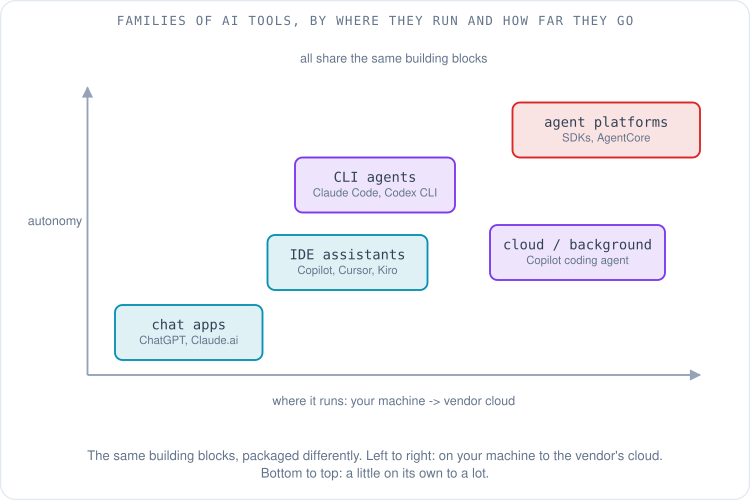
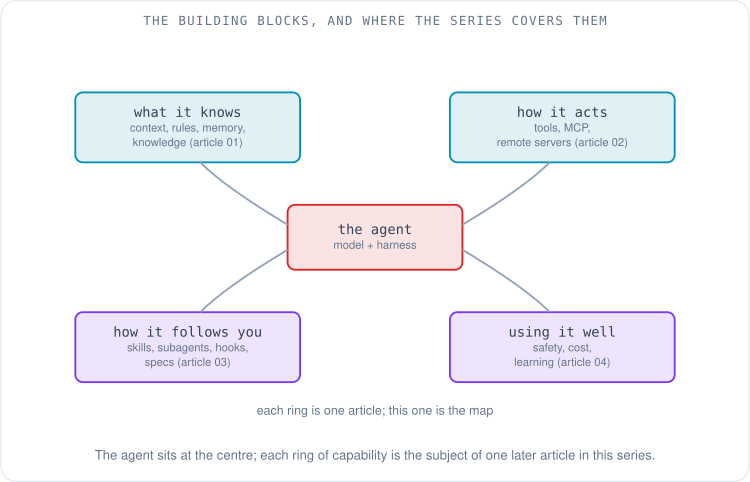

# From Chatbot to Agent: What an AI Tool Actually Is

Maya has a leaf switch that will not behave. One BGP session on it keeps flapping — coming up, dropping, coming back a minute later — and the alerts for it are piling up in her ticket system while the device configs sit in a Git repo she has open in another window. She does what most of us do now: she pastes the log lines into a chat window and asks what is wrong.

The answer comes back fast and sounds right. It lists the usual causes of a flapping session — a timer mismatch, an MTU problem, a flaky link — and suggests commands to check each one. It is a good answer to a generic question. It is not an answer to *her* question, because the thing in the chat window cannot see her configs, cannot run `show bgp neighbor` on the switch, and will have forgotten the entire exchange by next week. So Maya becomes a courier. She copies a config stanza in, reads a suggestion out, runs a command herself, pastes the output back, and waits for the next guess. The intelligence is real; the arrangement is clumsy.

That clumsiness is the subject of this whole series, and it comes down to three gaps. The thing in the chat window **can't see** — it has no access to her repo or her tickets. It **can't act** — it cannot run a command and read the result. And it **doesn't follow her team's way of working** — their naming conventions, their checklists, the order they do things in. Closing the first gap is about *context*; the second is about *tools*; the third is about *rules, skills and workflows*. Everything that turns a chat window into something that could actually fix Maya's switch is one of those three, and the rest of this series is a tour of them. This article is the map: by the end you will know what an AI tool actually is, what makes one an **agent**, and what every later article is about.

## What is the thing answering you?

Start by splitting one word that usually gets used for two different things. When people say "ChatGPT" or "Claude" they tend to mean the whole experience — the window, the memory of the conversation, the ability to search the web. But underneath sits something much narrower.

The **model** is a next-token predictor: given the text so far, it computes what word-fragment is likeliest to come next, and that is the entire thing it does. It has no memory between requests, no ability to open a file, no awareness of the clock. An [earlier article](../hpc/07-what-happens-when-you-ask-a-chatbot.md) follows one question all the way to a data-center GPU and back and shows exactly how that prediction is made, so this series takes the model as given and looks at everything built around it.

That "everything built around it" has a name worth learning, because it is where the differences between tools live. It is the **harness** — also called the agent scaffold or the runtime — the program that gathers your request and whatever else the model should see, packages it into a prompt, calls the model, carries out whatever the model asks for, and shows you the result. Kiro's documentation describes its own as "one unified agent harness" shared across its editor, command line and web surfaces, so that the same configuration behaves identically everywhere [1]. The model is the engine; the harness is the car built around it. Two tools can use the identical model and feel completely different because their harnesses are different — one can touch your files and run commands, another can only talk.

So the honest answer to "what is answering me?" is: a model you cannot see, wrapped in a harness you interact with. A plain chat window is a very thin harness — it builds a prompt from your messages and streams back the reply, and that is nearly all. The interesting tools are the ones whose harness does more.

## What makes it an agent?

The word **agent** gets stretched to cover everything from a glorified macro to a science-fiction fantasy, so it helps to use the distinction the people building these tools use. Anthropic, in its guide *Building effective agents*, draws the line at who is in control of the steps. A **workflow** is a system where "LLMs and tools are orchestrated through predefined code paths" — a person wrote the sequence, and the model fills in each step. An **agent** is a system where the model "dynamically direct[s its] own processes and tool usage", deciding what to do next as it goes [2]. The difference is not how smart the model is; it is who owns the control flow.

The mechanism that lets a model own the control flow is a loop, and it is simpler than it sounds. The model looks at everything it has been given and decides on one next step — "read the config for this neighbor". The harness carries that step out and puts the result back in front of the model. The model looks again, now with the config in hand, and decides the next step — "the hold timer is 90 on one side and 30 on the other; run `show bgp neighbor` to confirm". The harness runs it, feeds back the output, and the model decides again. Round and round until the model judges the task done and stops. Each turn, the model is choosing; the harness is only executing and reporting.

This pattern was named before the current tools existed. In 2022 a group of researchers published **ReAct**, short for *reason + act*, showing that a language model does markedly better when it is allowed to interleave short reasoning steps with real actions in an environment rather than being forced to answer in one shot [3]. That interleaving — think a little, act, observe what happened, think again — is the loop every agent harness runs today, whether it calls it ReAct or not. OpenAI describes the run of its own command-line agent in the same terms: the agent prepares instructions for the model, the model requests an action, the harness performs it, the outcome goes back, and the cycle continues until the work is finished [4].

Hold onto the contrast with a workflow, because both are useful and the series will keep meeting them. A workflow is predictable and cheap: a person decided the steps, so it does the same thing every time. An agent is flexible and more expensive: it figures out the steps, so it can handle a problem nobody scripted — but it also costs more model calls and can wander. Anthropic's advice is the sensible default: reach for the simplest thing that works, and only add agent-style autonomy when the task genuinely needs the model to decide [2]. For Maya's flapping session, which might turn out to be any of a dozen things, letting the model choose what to check next is exactly the case where an agent earns its cost.

## What the agent is working from: the context window

There is one more idea to put in place before the tour, because every later article leans on it. When the model runs a turn of the loop, everything it knows at that instant is the block of text the harness just sent it — the request, the earlier steps, the files and command output gathered so far. That block is the **context window**, and it is the agent's only working memory. There is no separate place the model "remembers" things between turns; if a fact is not in the context window this turn, the model is not working from it.

Two things follow, and both cost money and attention. The window has a size limit, measured in **tokens** (the word-fragments the model reads and writes; the [chatbot walkthrough](../hpc/07-what-happens-when-you-ask-a-chatbot.md) shows how text is cut into them). The limit is large on current models — Anthropic's platform documentation lists context windows "up to 1M tokens" depending on the model, as of 2026 [5] — but it is still a ceiling, and the harness pays, per token, for everything it puts in. So a good harness is careful about what it loads into the window and when, and that careful management of the window — rules, memory, retrieval, summarising when it fills up — is the entire subject of [the next article](01-context-rules-memory-and-knowledge.md).

## The families of AI tools

With the model, the harness, the loop and the context window in hand, the sprawl of products on offer as of October 2026 sorts into a few families. They are not rival technologies so much as the same building blocks packaged for different places and different amounts of autonomy. Two questions separate them: **where does it run**, on your own machine or in the vendor's cloud, and **how much does it do on its own** before it needs you.

**Chat apps** are the thin end — ChatGPT, Claude.ai, Google's Gemini app. A conversation in a browser or on a phone, a model that answers, and more recently a few built-in tools like web search. The harness is light and the autonomy is low; this is where Maya started. **IDE assistants** live inside your code editor and can see the files you have open and propose edits in place: GitHub Copilot in VS Code, Cursor, and Kiro, which presents itself as an editor built around spec-driven development [1][6]. **CLI agents** run in your terminal, in your working directory, and will read and edit files and run shell commands as part of the loop — Anthropic's Claude Code, OpenAI's Codex CLI, Google's Gemini CLI, and Kiro's command-line surface are all of this shape [7]. These are the first family where the agent routinely acts on the world rather than only talking about it.

Further toward the cloud sit **background agents**, which take a task and go away to do it while you are not watching. GitHub's Copilot coding agent is the clearest example: you assign it an issue and it works in the background in a cloud environment, opening a pull request for you to review when it is done [8]. And at the far end are **agent platforms and SDKs** — toolkits for building your own agent rather than using a packaged one, such as the OpenAI Agents SDK, the Claude Agent SDK, and Amazon Bedrock AgentCore, which supply the loop, tool handling and session management so you can wrap them around your own model and tools [2][9]. The thing to carry away is not the roster, which changes monthly, but the shape: every one of these is a model inside a harness running the same loop, and what differs is the packaging, how far it will go on its own, and whether it runs on your laptop or someone else's servers.

Autonomy, in particular, is better thought of as a dial than a category. The same tool often offers several settings: *suggest*, where it only proposes and you type everything; *edit with approval*, where it makes changes but waits for your yes; and *act on its own*, where it runs commands and edits files and only stops to ask when something looks risky. Where to set that dial — and how to keep an agent that can act from doing something you did not want — is its own topic, covered in [the last article](04-using-ai-tools-well.md).

## The map of the series

That is the whole picture in one frame: a model, a harness, a loop, a context window, and a dial for how much the thing does on its own. Everything else this series covers is a capability that a harness bolts on to make the agent more useful, and each one gets its own article.

The quickest way to see where you are headed is a table. Each row is a concept the rest of the series explains, the question it answers, and where to find it.

| Concept | The question it answers | Article |
|---|---|---|
| Context window, system prompt, rules | What does the agent see right now? | [01](01-context-rules-memory-and-knowledge.md) |
| Memory, knowledge bases, retrieval | What can it recall or look up beyond the window? | [01](01-context-rules-memory-and-knowledge.md) |
| Tool and function calling, MCP | How does it act on the world? | [02](02-tools-mcp-and-remote-servers.md) |
| Local vs remote servers, transports | Where do its tools live and how does it reach them? | [02](02-tools-mcp-and-remote-servers.md) |
| Skills, reusable prompts, slash commands | How does it follow your repeatable procedures? | [03](03-skills-subagents-hooks-and-workflows.md) |
| Subagents, hooks, specs, background agents | How does it run bigger, structured, or scheduled work? | [03](03-skills-subagents-hooks-and-workflows.md) |
| Permissions, sandboxes, cost, verifying output | How do you use it safely and well? | [04](04-using-ai-tools-well.md) |

## Back to the flapping session

Give Maya an agent instead of a chat window and the courier work disappears. She describes the problem once — "this session on this leaf keeps flapping, configs are in the repo, alerts are in the ticket". The agent reads the two neighbors' configs itself, notices the hold timers disagree, runs `show bgp neighbor` through a tool to confirm the session is tearing down on the timer, and proposes the one-line fix to align them. Maya reads the proposal, sees it is right, and approves it. She never pasted a thing. The model doing the reasoning is the same model that gave the generic answer at the start; what changed is the harness around it — one that could see her repo, act on her switch, and run the loop until the problem was actually found.

What it still could not do on its own is know her team's conventions, remember this switch's history, or reach for the right internal runbook — and that starts with what the agent is allowed to see and remember. [The next article](01-context-rules-memory-and-knowledge.md) opens up the context window and the ways a harness fills it: system prompts, project rules, memory, and the knowledge bases an agent searches when the answer is not already in front of it.

## References

1. *Docs: how Kiro works* (one unified agent harness shared across IDE, CLI, Web and Mobile surfaces). Kiro. https://kiro.dev/docs/how-kiro-works/
2. *Building effective agents* (workflows orchestrate LLMs and tools through predefined code paths; agents let the model direct its own process; frameworks and SDKs supply the plumbing). Anthropic, December 19, 2024. https://www.anthropic.com/engineering/building-effective-agents
3. *ReAct: Synergizing Reasoning and Acting in Language Models* (interleaving reasoning traces with actions in an environment). Yao et al., 2022, arXiv:2210.03629. https://arxiv.org/abs/2210.03629
4. *Unrolling the Codex agent loop* (the agent prepares a prompt, the model requests an action, the harness runs it, the result returns, repeat until done). OpenAI, 2026. https://openai.com/index/unrolling-the-codex-agent-loop/
5. *Context windows* (context window up to 1M tokens depending on the model; holds the conversation plus the new output). Anthropic platform documentation. https://platform.claude.com/docs/en/build-with-claude/context-windows
6. *Kiro* (an environment for spec-driven development across IDE and CLI). Kiro. https://kiro.dev/
7. *What's new in V3* (the Kiro command-line surface and its spec agent). Kiro CLI documentation. https://kiro.dev/docs/cli/v3/
8. *About assigning tasks to Copilot* (the Copilot coding agent works independently in the background and opens a pull request). GitHub documentation. https://docs.github.com/en/copilot/using-github-copilot/using-copilot-coding-agent-to-work-on-tasks/about-assigning-tasks-to-copilot
9. *Amazon Bedrock AgentCore* (a managed harness that runs the loop between model and tools, keeps the session, and works with multiple model providers and MCP servers). Amazon Web Services documentation. https://docs.aws.amazon.com/bedrock-agentcore/latest/devguide/
