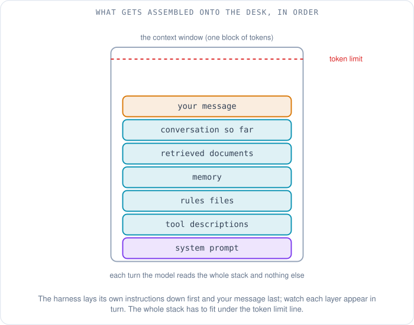
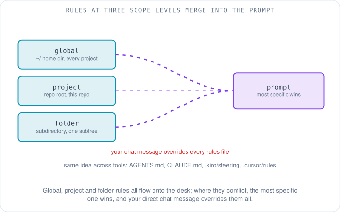
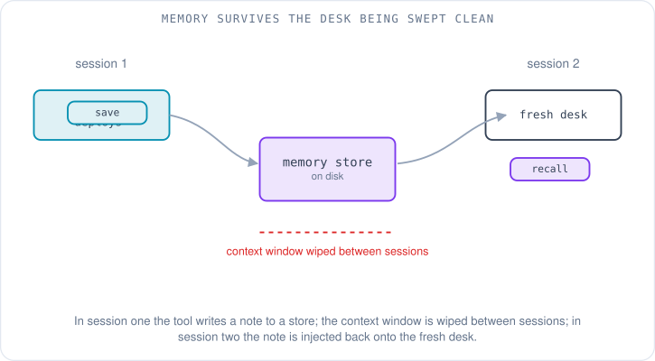
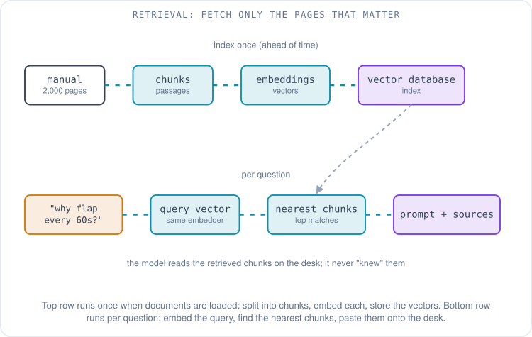
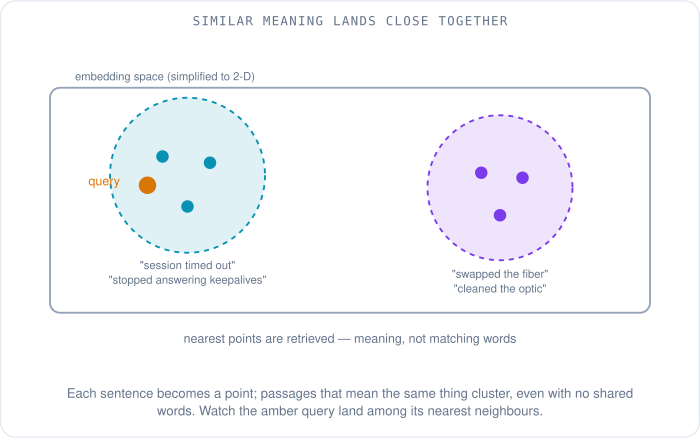
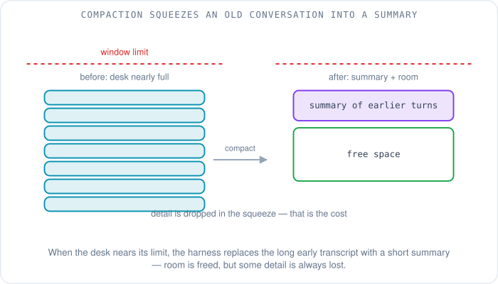

# What the AI Knows: Context, Rules, Memory and Knowledge Bases

Maya has an AI assistant wired into her editor, and on a good day it feels like a sharp teammate. On a bad day it feels like a teammate with no memory. This morning it is the bad day. She is chasing a BGP session that keeps flapping on a leaf switch — the neighbor comes up, holds for a minute, drops, and comes back — and the assistant keeps getting the small things wrong. It writes the interface config in a style her team abandoned a year ago. It suggests pushing the fix straight to the routers, on a Friday, when her team's rule is that nothing goes to production on a Friday. And when she asks it to follow the team runbook for flapping sessions, it cheerfully invents steps, because it has never seen the runbook.

None of this is the model being unintelligent. It is the model being *blind*. An AI assistant knows exactly one thing: the block of text handed to it this turn. It has no standing knowledge of Maya, her team, her repo, or the conversation she had with it yesterday, unless something put those into this turn's text. The whole craft of using these tools well is the craft of controlling what lands in that block — and this article is about the four mechanisms that fill it: the **context window** itself, the **rules** you write, the **memory** the tool keeps, and the **knowledge bases** it can search. Get those right and the assistant stops guessing. Keep the question in mind the whole way: *how does the right information get in front of the model at the right moment?*

## What is the context window?

Think of the model as a brilliant consultant who works at a desk with no filing cabinet. Everything they are allowed to use for a task has to be laid out on the desk, in view, right now. When the task is done the desk is swept clean and the next client's papers go down. The consultant remembers nothing between clients. The desk is the **context window**: the single block of text the model reads to produce its next response. The reason the model forgets is explained in an [earlier article](../hpc/07-what-happens-when-you-ask-a-chatbot.md) — each request is answered by a stateless server, so the only "memory" is whatever text the application re-sends.

What goes on the desk is not just your question. Before your words ever reach the model, the application around it — the **harness**, the program that builds the prompt and runs the loop, introduced in [the series opener](00-from-chatbot-to-agent.md) — assembles a stack of text in a particular order. First the **system prompt**: the harness's own standing instructions, written by the tool's makers, telling the model who it is, how to behave, and how to format tool calls. Then the descriptions of every tool the model is allowed to call. Then any rules files from your project. Then relevant memory. Then documents retrieved for this question. Then the conversation so far. And finally, at the end, your new message. All of it is concatenated into one long input, measured in **tokens** — the chunks of text, each a number from the model's vocabulary, that the model actually reads (the [chatbot walkthrough](../hpc/07-what-happens-when-you-ask-a-chatbot.md) shows how text becomes tokens, and why the whole transcript is re-sent and re-charged every turn).



The desk has an edge. Each model has a maximum number of tokens it can take in at once, and as of October 2026 the frontier of general-purpose models has converged on a window of roughly one million tokens: Anthropic put Claude Sonnet 4 at a one-million-token window in August 2025 [1], Google documents a one-million-token (and larger) window for Gemini models [2], and the coding tool Cursor lists Anthropic, Google and OpenAI models at a one-million-token maximum in its model table [3]. A million tokens is a lot — on OpenAI's rule of thumb that a token is about three-quarters of an English word, it is roughly 750,000 words, several long books [4]. It is also not infinite, and it is not free. Every token on the desk is re-read and re-billed on every single turn, which costs money and adds latency, so a window stuffed to the brim is a slow, expensive window.

Worse, a full window is not even a *reliable* window. A model's accuracy does not stay flat as the desk fills. In a widely-cited study, "Lost in the Middle," researchers found that models retrieve a fact best when it sits at the very start or very end of a long input, and measurably worse when it is buried in the middle [5]. Anthropic describes the same effect as **context rot**: as the token count climbs, the model's ability to recall any particular detail degrades, because its attention is a finite budget spread across everything on the desk [6]. The lesson is counterintuitive and it is the single most useful idea in this article: more context is not better. The skill is putting the *smallest set of the most relevant* tokens in front of the model — a discipline Anthropic calls **context engineering**, "curating and maintaining the optimal set of tokens during inference" [6]. The three mechanisms that follow — rules, memory, knowledge bases — are all tools for doing that curation well.

## How do rules files teach the AI your conventions?

The first and simplest fix for Maya's wrong-config-style problem is to stop re-explaining her conventions in chat and write them down once, where the tool will read them every session. Nearly every coding assistant now supports the same idea under different names: a plain **rules file** (also called a steering file or an instructions file) — ordinary markdown you keep in your repo or home directory, which the harness loads into the context window automatically at the start of each session. You are not programming anything. You are writing the briefing you would give a new teammate, and the harness pastes it onto the desk for you.

The generic concept is now concrete enough to have a cross-tool convention. **AGENTS.md** is an open, vendor-neutral format — a plain markdown file at the root of a repository, described by its spec as "a README for agents," holding build steps, test commands and conventions; it is stewarded under the Linux Foundation and read by a long list of tools including OpenAI Codex, Cursor, Gemini CLI, Aider and GitHub Copilot's coding agent [7]. On top of that shared idea, individual tools also look for their own filenames, and the differences are only naming:

- **CLAUDE.md** for Anthropic's Claude Code, loaded at the start of every session; Claude Code can also read a repository's `AGENTS.md` in its place [8].
- **`.kiro/steering/`** for Kiro, a folder of markdown files in the project (or `~/.kiro/steering/` for rules that apply to every project) [9].
- **`.github/copilot-instructions.md`** for GitHub Copilot, a repository-wide instructions file in the `.github` directory [10].
- **`.cursor/rules`** for Cursor, a directory of rule files in the project (with user-level rules for personal preferences) [11].

A rules file for Maya's team might be a dozen lines, and it would have saved her whole morning:

```markdown
# Team conventions for the network-configs repo

## Interface config style
- Use the `interfaces { ... }` block syntax, not the legacy per-line `set` form.
- Every BGP neighbor needs an explicit `description` and a `peer-group`.

## Deployment rules
- Never push to the production routers on a Friday.
- All changes go through a dry-run (`commit check`) before `commit`.

## Runbook pointers
- For a flapping BGP session, follow docs/runbooks/bgp-flap.md step by step.
```

Rules apply at **scope levels**, and understanding the levels is most of using them well. A *global* file in your home directory follows you across every project (your personal preferences). A *project* file lives in the repo and travels with it, so every teammate and every agent working on that repo gets the same conventions. A *folder-level* file applies only within its part of the tree — a stricter rule for the `tests/` directory, say — and when files conflict, the convention across tools is that the most specific one wins, with your direct chat instructions overriding everything [7]. Two cautions carry across every tool. Keep rules short: they sit on the desk every turn, so a bloated rules file spends your context budget and courts context rot. And never put secrets — API keys, passwords, tokens — in a rules file; it is plain text, it gets committed to the repo, and it ends up in the model's input. Secrets belong in a secret manager, never on the desk.



## What is the difference between rules and memory?

Rules are instructions *you* write. **Memory** is the mirror image: notes the *tool* writes about you, on its own, and feeds back to itself later. Claude Code draws the line crisply — its CLAUDE.md files hold "instructions and rules" that *you* author, while its auto memory holds "learnings and patterns" that *Claude* writes based on your corrections and preferences; both are loaded into every session [8]. The mechanism is the same underneath: the tool saves a short note to durable storage, then, in a future session, injects it back into the context window (or searches it when relevant) so the knowledge survives the desk being swept clean.

You meet the same feature in consumer chat apps. ChatGPT's memory, which OpenAI expanded in April 2025, works in two ways: **saved memories**, which are details you explicitly ask it to remember, and a broader ability to **reference your past chats** so later conversations feel continuous — you like Thai food, so it factors that into a lunch question weeks later [12]. The convenience is real: Maya tells her assistant once that the team never deploys on Fridays, and a good memory system means she never has to say it again.



Memory earns its own cautions, and they are sharper than the ones for rules precisely because *you* did not write the notes. A memory can be **stale** — it recorded that Maya's team used vendor X six months ago, and now acts on a fact that is no longer true. A memory can be simply **wrong** — the tool misread an offhand comment as a standing preference. And memory is a **privacy** surface: it is a persistent store of things you said, which is why every serious implementation lets you see, edit and delete what it kept. OpenAI exposes memory controls in settings, where you can review the memory summary, delete individual entries, or turn the feature off [12]. The habit worth building is to treat memory as a notebook someone else keeps about you: useful, but worth auditing, because it will act on whatever is written there whether or not it is still true.

## How does a knowledge base let the AI use documents it was never trained on?

Rules and memory handle small, stable facts. They fall apart the moment Maya's problem needs the team's 2,000-page network operations manual. You cannot paste 2,000 pages onto the desk — it would blow past the window, cost a fortune, and drown the model in context rot. And the model was never trained on that manual; its built-in knowledge is **frozen at a training cutoff**, a snapshot of public text from some date in the past, with nothing about Maya's company in it. The answer to both problems is a **knowledge base** backed by a technique called **retrieval-augmented generation (RAG)**: instead of putting the whole manual on the desk, you fetch only the few passages that bear on the current question and put *those* on the desk, with their sources. RAG was introduced by Lewis and colleagues in 2020 as a way to combine a model's built-in "parametric memory" with an external, searchable "non-parametric memory" of documents [13], and it is now the standard pattern behind enterprise document assistants — AWS, for instance, describes its Bedrock Knowledge Bases as using RAG to "improve the relevancy and accuracy of generated responses" from your own data [14].

The pipeline has two halves, and it is worth following each as a small story. The first half happens once, ahead of time, when the manual is loaded in. Each document is split into **chunks** — passages of a few hundred words, small enough to be useful on their own. Each chunk is run through an **embedding** model, which turns the passage into a long list of numbers (a vector) with a special property: passages that *mean* similar things get numbers that land close together, even when they share no words. "The neighbor stopped responding to keepalives" and "the BGP session timed out" use different vocabulary but point to nearly the same place. All those vectors are stored in a **vector database**, an index built to answer the question "which stored vectors are nearest to this one?" quickly.



The second half happens every time Maya asks a question. Her question — "why would a BGP session flap every sixty seconds?" — is run through the *same* embedding model, producing a query vector. The vector database finds the handful of stored chunks whose vectors sit nearest to it: in Maya's case, the runbook section on hold-timer expiry and a troubleshooting page on one-way link failures. Those chunks, and *only* those, are pasted onto the desk alongside her question, usually with their source citations, and the model generates its answer from them. The model did not "know" the runbook. A retrieval step looked it up and laid it on the desk, and the model read it there like any other input. This is the same distinction the [chatbot article](../hpc/07-what-happens-when-you-ask-a-chatbot.md) draws between an answer that is *looked up* and one that is *generated* — RAG is looked-up pages feeding a generated answer.



Two refinements and two failure modes round out the picture. Pure vector search can miss an exact term — a specific error code, a device hostname — because it matches on meaning, not spelling, so most production systems use **hybrid search**, blending classic keyword matching with vector similarity to catch both. The failure modes are the things to watch for. If the chunking or the embedding is poor, the retriever hands the model the *wrong* passage, and the model will answer confidently from an irrelevant page. And a knowledge base is only as current as its last ingestion: if the manual was indexed before last week's policy change, RAG will faithfully retrieve the **stale** version. Retrieval moves the staleness problem from the model's frozen training into your document pipeline, where at least you control it. One more option is worth a sentence: an agent does not always need a vector index at all — if the documents are just files in a repo, the agent can read and search them directly with tools like `grep`, which [the next article](02-tools-mcp-and-remote-servers.md) covers.

## What happens when the desk overflows?

Even with rules kept short and knowledge fetched on demand, a long working session fills the desk. A debugging conversation that runs for an hour, with dozens of tool calls and their output, will eventually approach the window's edge. Harnesses handle this with **compaction**: when the context nears its limit, the tool summarizes the older part of the conversation into a compact note and continues with that summary in place of the full transcript, freeing room while trying to keep the thread. Anthropic describes compaction as a core context-engineering technique for long-horizon agents, and warns of its cost — a summary necessarily drops detail, so something is always lost in the squeeze [6]. The two neighboring tactics belong to later articles: when a sub-task would flood the main desk, an agent can hand it to a **subagent** with its own fresh window and get back only the result, and instead of loading every instruction up front, a tool can load a procedure only when it is needed — both covered under [skills and subagents](03-skills-subagents-hooks-and-workflows.md). The through-line is always the same: protect the budget, and keep the highest-signal tokens on the desk.



## Putting it together

Here is the whole toolkit for controlling what the model sees, as one picture:

| Mechanism | Who writes it | When it loads | Best for |
|---|---|---|---|
| **Context window** | The harness, each turn | Assembled fresh every request | The model's entire working memory for this turn |
| **Rules / steering** | You | Every session, automatically | Stable conventions, standards, "always / never" rules |
| **Memory** | The tool | Every session (or searched) | Preferences and corrections the tool picks up over time |
| **Knowledge base (RAG)** | You (indexed once) | Per question, only matching chunks | Large or private document sets the model can't hold |
| **Compaction** | The harness | When the window nears its limit | Keeping a long session alive at the cost of detail |

By the end of the day Maya's setup looks very different. A project `AGENTS.md` carries her team's config style and the no-Friday-deploy rule, so the assistant stops writing legacy syntax and stops suggesting Friday pushes. Memory holds the small preferences she used to repeat. The runbook and the ops manual sit in a knowledge base, so when she asks about the flapping session the assistant retrieves the hold-timer page, reads it on the desk, and proposes the right first check — a one-way link, exactly what the runbook says to rule out first. The assistant is no smarter than it was this morning. It can simply *see* now.

Seeing is only half of it. An assistant that can read Maya's configs and her runbook still cannot run `show bgp neighbor` on the switch, open the ticket, or push the fix — it can only talk about them. Giving it hands, not just eyes, means letting it call tools, and the cleanest way tools get connected is a protocol called MCP. That is where [the next article](02-tools-mcp-and-remote-servers.md) goes.

## References

1. *Claude Sonnet 4 now supports 1M tokens of context.* Anthropic, 2025. https://www.anthropic.com/news/1m-context
2. *Long context.* Google AI for Developers (Gemini API documentation), 2026. https://ai.google.dev/gemini-api/docs/long-context
3. *Cursor Documentation: Models.* Cursor (Anysphere), 2026. https://docs.cursor.com/
4. *What are tokens and how to count them?* OpenAI Help Center. https://help.openai.com/en/articles/4936856-what-are-tokens-and-how-to-count-them
5. *Lost in the Middle: How Language Models Use Long Contexts.* Liu, Lin, Hewitt, Paranjape, Bevilacqua, Petroni and Liang, TACL 2023. arXiv:2307.03172. https://arxiv.org/abs/2307.03172
6. *Effective context engineering for AI agents.* Anthropic, September 2025. https://www.anthropic.com/engineering/effective-context-engineering-for-ai-agents
7. *AGENTS.md* (the open cross-tool instruction-file format; nearest-file precedence; chat overrides). Agentic AI Foundation / Linux Foundation. https://agents.md/
8. *How Claude remembers your project* (CLAUDE.md files you write vs auto memory Claude writes; both loaded every session; can read AGENTS.md instead). Anthropic, Claude Code documentation, 2026. https://docs.anthropic.com/en/docs/claude-code/memory
9. *Steering* (`.kiro/steering/` workspace files and `~/.kiro/steering/` global files; workspace overrides global). Kiro documentation, 2026. https://kiro.dev/docs/steering/
10. *Adding repository custom instructions for GitHub Copilot* (`.github/copilot-instructions.md` in the repository). GitHub Docs. https://docs.github.com/en/copilot/how-tos/configure-custom-instructions/add-repository-instructions
11. *Rules.* Cursor Documentation (project `.cursor/rules` and user rules). https://docs.cursor.com/context/rules
12. *Memory and new controls for ChatGPT* (saved memories and referencing past chats; review and delete in settings). OpenAI, April 2025. https://openai.com/index/memory-and-new-controls-for-chatgpt/
13. *Retrieval-Augmented Generation for Knowledge-Intensive NLP Tasks.* Lewis, Perez, Piktus, Petroni, Karpukhin, Goyal, Küttler, Lewis, Yih, Rocktäschel, Riedel and Kiela, NeurIPS 2020. arXiv:2005.11401. https://arxiv.org/abs/2005.11401
14. *Retrieve data and generate AI responses with Amazon Bedrock Knowledge Bases* (RAG over your own data sources). Amazon Web Services documentation, 2026. https://docs.aws.amazon.com/bedrock/latest/userguide/knowledge-base.html
