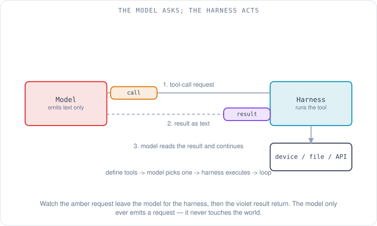
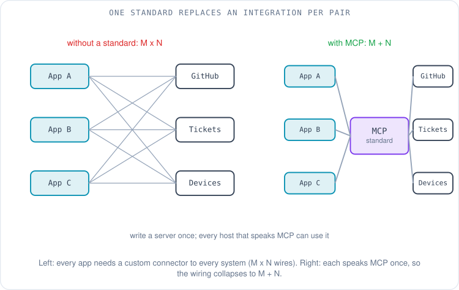
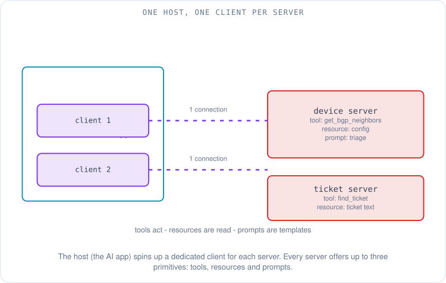
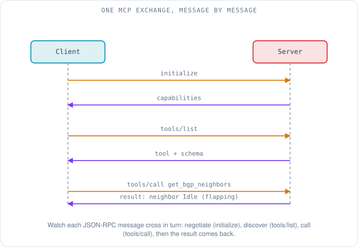
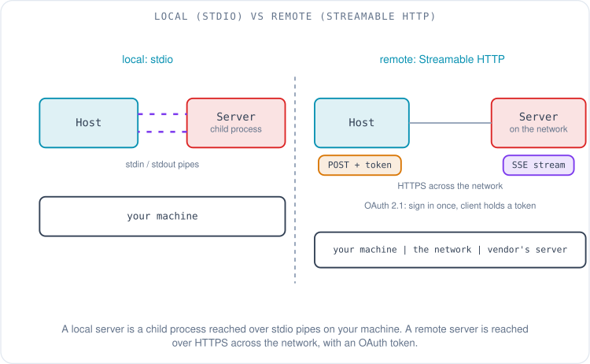

# Giving the AI Hands: Tools, MCP and Remote Servers

Maya has an assistant open in her editor, and it has just told her, confidently and in detail, how to debug the BGP session that keeps flapping on one of her leaf switches. The advice is fine. It is also useless, because the assistant cannot see the switch. It cannot open the device config in her Git repo, cannot run `show bgp neighbor`, cannot read the alert sitting in her ticket system. It can only produce text, and so she is back to being the courier: copy the config out, paste it in, copy the suggested command out, run it in a terminal, paste the output back. The model is articulate and completely cut off from the world it is talking about.

The [first article](00-from-chatbot-to-agent.md) named this as one of the three gaps between a chatbot and an agent: it cannot *act*. This article is about closing that gap — how an AI model, which can only emit text, comes to run a command, read a file, or query a device. The mechanism has two layers. The first is **tool calling**, the trick that lets a model ask for an action. The second is **MCP**, a protocol that standardizes how those tools are offered, including the "remote servers" the industry keeps mentioning. By the end you will be able to read the actual messages that cross the wire when Maya's agent asks her switch for its BGP neighbors, and you will know exactly where each piece runs.

## How can a model that only outputs text run a command?

Start with the hard constraint. A language model takes text in and produces text out; that is the whole of what it does, as the [walkthrough of a chatbot request](../hpc/07-what-happens-when-you-ask-a-chatbot.md) laid out. It has no hands. So the harness around it — the program that calls the model and shows you results — plays a specific game with it, and the game is called **tool calling** (also, interchangeably, **function calling**): a way for the model to *request* an action in structured form, which the harness then carries out on its behalf [1].

It works like a contract agreed up front. Before the model ever sees Maya's question, the harness includes in the request a list of the tools available, and each tool is described by three things: a **name**, a **description** in plain English of what it does and when to use it, and a **JSON Schema** — a machine-readable spec of the arguments it takes and their types [1][2]. JSON Schema is just a standard way to say "this function wants an object with a string field called `device` and an optional string called `vrf`." The model reads those descriptions the same way it reads everything else: as text in its context.

When the model decides a tool is the right next step, it does not run anything. It emits a structured block naming the tool and the arguments it chose — for OpenAI's API, the response carries a `tool_calls` entry with the function name and a JSON string of arguments, and the finish reason is reported as `tool_calls` rather than a normal stop [3]. The harness parses that block, actually executes the function (opens the file, runs the command, calls the API), and feeds the result back into the conversation as more text. The model reads the result and continues — maybe answering Maya, maybe calling another tool. That cycle — the model proposes a call, the harness executes it, the result returns to the context, repeat — is the agent loop from the opening article, and tool calling is the single step inside it where the model reaches outside itself.



Two properties of this design matter for everything that follows. The model never touches your file system or your network directly; it only ever produces a *request*, and the harness is free to inspect it, refuse it, or ask you to approve it first. And the shapes are the same across vendors even though the field names differ: OpenAI uses a `tools` array of function definitions, Anthropic's tool-use API describes each tool with an `input_schema`, Google uses `functionDeclarations`, and the loop — define schemas, detect the call, execute, return the result — is identical in all three [4]. Here is a tool definition in OpenAI's shape, the kind the harness would offer for Maya's switch:

```json
{
  "type": "function",
  "function": {
    "name": "get_bgp_neighbors",
    "description": "Return the BGP neighbors and their session state for one device.",
    "parameters": {
      "type": "object",
      "properties": {
        "device": { "type": "string", "description": "Device hostname, e.g. leaf-07" }
      },
      "required": ["device"]
    }
  }
}
```

That solves one tool for one app. The trouble starts when you want many.

## Why does every tool need its own integration?

Tool calling tells a model how to *request* an action, but it says nothing about where the tool definitions come from or who runs them. In the first wave of agents, every application built every integration by hand. If you wanted your editor's assistant to read from GitHub, someone wrote a GitHub integration for that editor. If you wanted it to read your tickets, someone wrote a ticket integration for that editor. Then a different editor appeared and all of it had to be written again. With *M* applications and *N* systems to connect, the industry was staring at *M* × *N* bespoke integrations — the combinatorial problem that connectors have always created [5].

This is the problem **MCP (the Model Context Protocol)** was built to collapse. MCP is an open standard that defines one common way for an AI application to connect to external tools and data, so that any compliant application can talk to any compliant integration without custom glue. Anthropic open-sourced it on 25 November 2024, shipping it with a specification and SDKs rather than as a product [5][6]. Adoption was unusually fast: it is now supported across OpenAI's tools, GitHub Copilot in VS Code, Google's tooling, and editor and CLI agents such as Cursor and Kiro, among many others [4][7]. In December 2025 Anthropic donated MCP to the Agentic AI Foundation under the Linux Foundation, moving its governance to a neutral body [8] — a sign the standard is meant to outlive any single vendor.

The usual analogy is a USB-C port for AI: one connector shape, so a tool built once plugs into any application that speaks the protocol. For a network engineer, the cleaner analogy is a routing protocol. Nobody writes a special integration so that a Juniper router can exchange routes with an Arista one; they both speak BGP, and the shared protocol is what makes any vendor's box interoperate with any other. MCP is that idea applied to AI tools: write a server once against the standard, and every host that speaks MCP can use it. The *M* × *N* explosion becomes *M* + *N* — each application implements MCP once, each system exposes an MCP server once.



## What are hosts, clients, and servers?

MCP's own architecture names three roles, and they are easy to blur, so it is worth pinning each one to something concrete [9]. The **host** is the AI application itself — Maya's editor, or Claude Desktop, or VS Code. The host is what the user interacts with and what talks to the model. Inside the host runs one **client** for every server it connects to: a client is the component that maintains a single dedicated connection to one server. And a **server** is a separate program that exposes capabilities — tools, data, templates — over the protocol. If Maya's editor connects to a device server and a ticket server, the editor is the host, and it has spun up two clients, one bonded to each server. One host, many clients, many servers.

What a server can offer is defined by three **primitives**, and the spec is precise about them [9]. **Tools** are executable functions the model can invoke to *do* something — query a device, create a ticket, run a search. **Resources** are data the host can read for context — a file's contents, a database schema, a config snapshot — exposed for reading rather than action. **Prompts** are reusable templates, pre-written instructions a server offers so a user can trigger a known-good interaction (for example, a "summarize this incident" prompt). Maya's device server might expose a `get_bgp_neighbors` tool, a resource holding the running config, and a prompt that frames a "triage a flapping session" workflow. The protocol also lets the *client* offer capabilities back to the server — sampling (the server asks the host to run a model completion), elicitation (the server asks the user for more input), and logging — but tools, resources, and prompts are the three to remember [9].



The discovery mechanism is what makes this dynamic. A client does not need to be told in advance what a server offers. It asks: each primitive has a `list` method, so the client calls `tools/list` to find out what tools exist, reads the names and schemas that come back, and hands them to the model as the tool definitions from the first section [9]. New tool on the server tomorrow? The client lists again and the model simply sees it. That hand-off is the join between the two halves of this article: MCP's `tools/list` is where the tool definitions that tool calling needs actually come from.

## What crosses the wire in one MCP call?

For a network engineer the most satisfying way to understand MCP is to watch a single exchange on the wire, the way you would read a protocol trace. MCP's data layer is **JSON-RPC 2.0** — a long-established, lightweight convention for remote procedure calls in which each message is a small JSON object. A request carries `"jsonrpc": "2.0"`, a `method` name, a `params` object, and an `id` to match the reply to the request; a response carries the same `id` and a `result` [9]. If you have read a BGP OPEN exchange, the rhythm will feel familiar: both sides announce what they support before any real work happens.

The connection opens with an `initialize` handshake, and its purpose is **capability negotiation** — each side states which protocol version it speaks and which features it supports, exactly as two BGP speakers negotiate capabilities in their OPEN messages before exchanging routes. The client sends:

```json
{
  "jsonrpc": "2.0",
  "id": 1,
  "method": "initialize",
  "params": {
    "protocolVersion": "2025-11-25",
    "capabilities": { "elicitation": {} },
    "clientInfo": { "name": "mayas-editor", "version": "1.0.0" }
  }
}
```

The server replies with its own version and the capabilities it offers — here, that it supports tools and can notify the client when its tool list changes [9]:

```json
{
  "jsonrpc": "2.0",
  "id": 1,
  "result": {
    "protocolVersion": "2025-11-25",
    "capabilities": { "tools": { "listChanged": true } },
    "serverInfo": { "name": "lab-device-server", "version": "1.0.0" }
  }
}
```

With the session established, the client discovers the tools (`tools/list`), gets back the `get_bgp_neighbors` tool and its schema, and offers it to the model. When the model asks to call it, the client sends a `tools/call` naming the tool and the arguments the model chose:

```json
{
  "jsonrpc": "2.0",
  "id": 3,
  "method": "tools/call",
  "params": {
    "name": "get_bgp_neighbors",
    "arguments": { "device": "leaf-07" }
  }
}
```

The server runs whatever it runs — an SSH session to the switch, a call to a network API — and returns the result as content the host can feed back to the model [9]:

```json
{
  "jsonrpc": "2.0",
  "id": 3,
  "result": {
    "content": [
      { "type": "text",
        "text": "leaf-07: neighbor 10.0.0.1 Established; neighbor 10.0.0.5 Idle (flapping)" }
    ]
  }
}
```

That is the whole loop in four messages: negotiate, discover, call, result. Everything an MCP integration does, however elaborate, is built from this pattern.



## What is a "remote server," and how does it differ from a local one?

"Remote MCP server" is the phrase that keeps turning up, and it is a statement about the **transport** — the channel the JSON-RPC messages travel over. MCP defines two [9].

The first is **stdio**. The host launches the server as a child process on your own machine and talks to it over standard input and output — the same pipes a shell uses. Nothing goes near the network. This is ideal for anything that needs direct access to your laptop: reading your files, running a local CLI, driving a tool that is already installed. When people say "local server," they mean a server reached over stdio, running on the same machine as the host [9].

The second is **Streamable HTTP**. Here the server runs somewhere on the network — a server inside your company, or a vendor's hosted endpoint — and the client reaches it over HTTP: the client sends requests as HTTP POSTs and the server can stream its responses back using server-sent events for long-running work [9]. This is the "remote server," and it is what lets a SaaS vendor publish one MCP server that thousands of users connect to without installing anything. Streamable HTTP was introduced in the 2025-03-26 revision of the spec, replacing an earlier HTTP+SSE transport from the original 2024-11-05 version [10]; by late 2026 it is the standard way to reach a networked server, and the older transport survives only for backward compatibility.

A remote server raises a question a local one does not: who are you, and are you allowed in? Over stdio the answer is implicit — it is your machine, your process. Over HTTP the server needs **authorization**, and MCP's spec builds this on **OAuth 2.1**, the current revision of the standard web authorization framework [11]. In practice you sign in once through your browser, the authorization server issues the client a short-lived access **token**, and the client attaches that token (as a bearer token in the HTTP `Authorization` header) to every request thereafter; the MCP server validates it and never sees your password [11]. The HTTPS underneath is the same encrypted web transport described in [what happens when you type a URL](../fundamentals/09-when-you-type-a-url.md) — the token rides inside TLS, so it is not exposed on the wire.



Configuring these is mostly a few lines of JSON that tell the host how to reach each server. The exact shape differs slightly per application. In VS Code, servers live under a top-level `servers` object, each with an explicit `type` [12]; a local stdio server names the command to launch, and a remote one gives a URL and any headers:

```json
{
  "servers": {
    "lab-device-server": {
      "type": "stdio",
      "command": "python",
      "args": ["-m", "lab_device_server"]
    },
    "ticket-system": {
      "type": "http",
      "url": "https://mcp.example-tickets.com/mcp"
    }
  }
}
```

The stdio entry is a program on Maya's machine that the editor runs; the HTTP entry is a URL the editor connects to, with the OAuth sign-in happening the first time she uses it. Same protocol, two different places the work happens.

## When should Maya reach for MCP at all?

MCP is not the only way an agent acts, and treating it as the default is a common mistake. Most agents ship with **built-in tools** — reading and writing files, running shell commands, searching the web — wired straight into the harness with no MCP involved. For many tasks those are enough: if Maya's agent can already run shell commands, it can read a config file or run a `vtysh` command without any server at all. MCP earns its place when a capability is worth packaging and reusing — a connection to a specific system (her ticket platform, a device inventory API) that she wants available across every tool she uses, or that a vendor maintains so she does not have to. The honest comparison is this: a built-in shell tool or a plain API call is simpler when the need is one-off and local; MCP is worth it when the same capability should be portable across applications and shared with others.

A few habits keep MCP useful rather than a liability. Start with official servers from the vendor whose system you are connecting to, discoverable through the official MCP registry, which launched in preview in September 2025 as a central catalog of public servers [13] — a maintained server is less likely to misbehave than a hand-rolled one. Resist adding every server you find: each tool's name and description is injected into the model's context, and too many crowded descriptions both cost tokens and make the model worse at choosing the right tool, for the context reasons covered in [the article on context and rules](01-context-rules-memory-and-knowledge.md). Prefer read-only tools first — a server that can only *read* your devices cannot break them while you build trust in it. And treat installation as a trust decision: an MCP server runs with your permissions and can act on your behalf, so an untrusted or malicious one is a real risk, including through instructions hidden in the data it returns — the subject of [using these tools well](04-using-ai-tools-well.md).

Here is the vocabulary in one place, since every vendor's documentation assumes you already have it:

| Term | What it is | In Maya's setup |
|---|---|---|
| **Tool calling** | The model emits a structured request to run a function; the harness runs it | The model asks to run `get_bgp_neighbors` |
| **MCP** | An open standard for connecting AI apps to tools and data | The protocol her editor and servers both speak |
| **Host** | The AI application the user runs | Her editor |
| **Client** | One connection inside the host, bonded to one server | One per server the editor connects to |
| **Server** | A program exposing capabilities over MCP | The device server, the ticket server |
| **Tool / resource / prompt** | A server's three primitives: action, readable data, template | `get_bgp_neighbors`; the running config; a triage prompt |
| **stdio (local)** | Transport: host runs the server as a child process | The device server on her laptop |
| **Streamable HTTP (remote)** | Transport: host reaches the server over HTTP | The hosted ticket server |
| **Authorization** | OAuth 2.1 sign-in that gives the client a token | Her one-time login to the ticket server |

Maya's assistant is no longer stranded. Her editor, as host, holds a client bonded to a local device server reached over stdio and another bonded to her ticket system over Streamable HTTP. When she asks why the session on `leaf-07` keeps flapping, the model calls `get_bgp_neighbors`, reads back that one neighbor is stuck in `Idle`, pulls the matching ticket through the second server, and proposes the fix — all without her copying a single line between windows. The model can now act. What it still cannot do is follow her team's way of working: its runbook, its review steps, the processes it should repeat the same way every time. Giving it those is where [the next article](03-skills-subagents-hooks-and-workflows.md) goes.

## References

1. *Function calling.* OpenAI, 2026. https://developers.openai.com/api/docs/guides/function-calling/
2. *Tool use with Claude.* Anthropic API documentation, 2026. https://docs.anthropic.com/en/docs/build-with-claude/tool-use
3. *How to call functions with chat models* (the response carries a `tool_calls` object with the function name and arguments; the finish reason is `tool_calls`). OpenAI Cookbook. https://developers.openai.com/cookbook/examples/how_to_call_functions_with_chat_models
4. *AI Function Calling: OpenAI, Anthropic, Google* (OpenAI uses a `tools` array, Anthropic `input_schema`, Google `functionDeclarations`; the define/detect/execute/return loop is identical). Digital Applied, 2026. https://www.digitalapplied.com/blog/ai-function-calling-guide-openai-anthropic-google
5. *Introducing the Model Context Protocol* (an open standard open-sourced to connect AI assistants to external systems; the N×M connector problem). Anthropic, November 25, 2024. https://www.anthropic.com/news/model-context-protocol
6. *Model Context Protocol* (introduced by Anthropic in November 2024; open standard with SDKs). Wikipedia. https://en.wikipedia.org/wiki/Model_Context_Protocol
7. *What is MCP?* / Architecture overview (adoption across hosts such as VS Code; one client per server). Model Context Protocol documentation, version 2025-11-25. https://modelcontextprotocol.io/docs/2025-11-25/getting-started/intro
8. *The 2026 Enterprise MCP Reset: The Model Context Protocol Playbook* (Anthropic donated MCP to the Agentic AI Foundation under the Linux Foundation on December 9, 2025). Practical Logix, 2026. https://www.practicallogix.com/the-2026-enterprise-mcp-reset-the-model-context-protocol-playbook/
9. *Architecture overview* (host/client/server participants; tools, resources, prompts; JSON-RPC 2.0 data layer; the initialize, tools/list and tools/call messages; stdio and Streamable HTTP transports). Model Context Protocol documentation, version 2025-11-25. https://modelcontextprotocol.io/docs/2025-11-25/learn/architecture
10. *Transports* (Streamable HTTP introduced in protocol version 2025-03-26, replacing the HTTP+SSE transport from 2024-11-05). Model Context Protocol specification, version 2025-06-18. https://modelcontextprotocol.io/specification/2025-06-18/basic/transports
11. *Authorization* (authorization at the transport level for HTTP-based transports, built on OAuth 2.1; clients obtain and send access tokens). Model Context Protocol specification, version 2025-11-25. https://modelcontextprotocol.io/specification/2025-11-25/basic/authorization
12. *MCP configuration reference* (servers defined under a top-level `servers` object with an explicit `type`; stdio uses `command` and `args`, remote uses `url`). Visual Studio Code documentation, 2026. https://code.visualstudio.com/docs/copilot/reference/mcp-configuration
13. *Introducing the MCP Registry* (a primary source of truth for publicly available MCP servers; launched in preview September 8, 2025). Model Context Protocol blog, September 8, 2025. https://blog.modelcontextprotocol.io/posts/2025-09-08-mcp-registry-preview/
