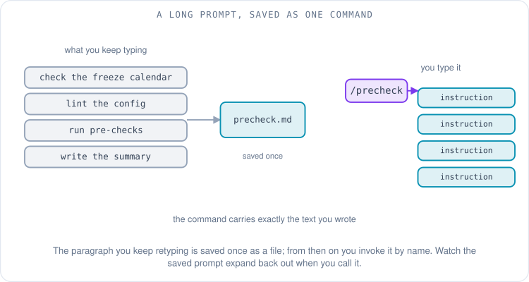
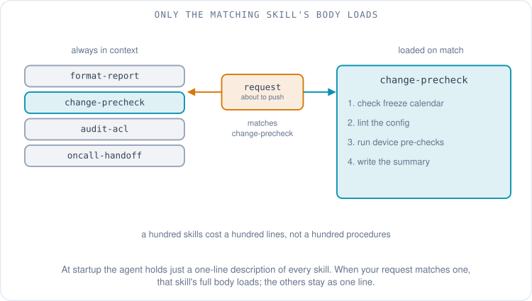
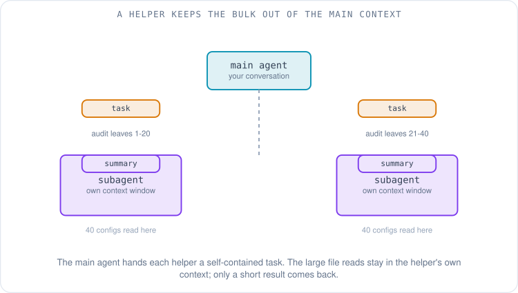
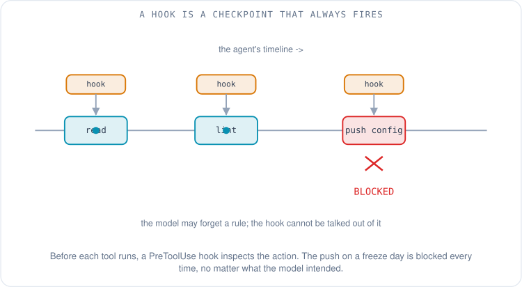
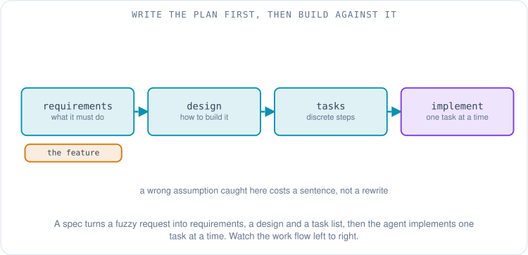

# Teaching the AI Your Way of Working: Skills, Subagents, Hooks and Workflows

Maya has a good agent now. It can read her switch configs because she pointed it at the repository, and it can run `show bgp neighbor` because she wired up a tool for the ticket-and-device side of her world. The two earlier articles in this series got her there: the first was about what the agent can [see](01-context-rules-memory-and-knowledge.md), the second about what it can [do](02-tools-mcp-and-remote-servers.md). And yet, every time a change goes out, she types the same long message:

> Before you touch anything: check the change calendar for a freeze, lint the candidate config, run the pre-checks against the device, and write the change summary in our team's format — problem, blast radius, rollback.

She has typed some version of that sentence a hundred times. It is correct, it works, and it is pure friction. The repetition is the signal. When you find yourself re-explaining your own process to a capable assistant, the process itself is the thing worth saving — not in your head, but in a file the agent can pick up on its own. This article is about the features that do exactly that: how you package know-how, enforce the steps that must never be skipped, and let one agent become several when the work is bigger than one conversation.

## How do you stop retyping the same instructions?

The smallest fix is the oldest one: save the prompt and give it a name. A **reusable prompt** — often called a **slash command**, because you invoke it by typing `/` and a name — is a saved block of instructions the harness drops into the conversation when you call it. Maya writes her pre-check instructions once, saves them as `precheck`, and from then on types `/precheck` instead of the paragraph.

The mechanism is deliberately plain. In Claude Code, a custom slash command is a single Markdown file: drop `precheck.md` in `.claude/commands/` in the project (or `~/.claude/commands/` for every project), and `/precheck` runs its contents [1]. GitHub Copilot calls the same idea a **prompt file**: a `.prompt.md` file whose name becomes a `/`-command you can run from any repository [2]. The naming differs, the shape does not — a prompt you'd otherwise paste, stored in a file, triggered by name.



A slash command is a shortcut you pull. It does nothing until you type it, and it carries only the text you wrote. That is fine for "run my pre-check," but it does not scale to "know how to do the forty different procedures my team follows," because you would have to remember which command fits which situation. The next step up fixes that.

## What is a skill?

A **skill** is a folder that teaches the agent a procedure, which the agent loads *on its own* when the task calls for it. In its simplest form it is a directory with one file, `SKILL.md`, that begins with two required fields — a `name` and a one-line `description` — followed by the full instructions in plain Markdown [3]. The folder can also hold scripts the agent may run and reference files it may read, but the heart of it is the instructions.

The idea that makes skills more than "a prompt in a folder" is **progressive disclosure**, and it is worth slowing down on because it is the whole point. When a session starts, the agent loads only the `name` and `description` of every installed skill into its context — a line or two each, cheap to carry [3]. The long body stays on disk. When your request matches a skill's description, and only then, the agent reads the full `SKILL.md` into context. If the skill bundles extra files, it opens those only when it actually needs them [3]. Anthropic, which introduced Agent Skills on October 16, 2025, describes this as three levels: metadata always loaded, the body loaded on match, bundled files loaded on demand [3]. The effect is that you can give an agent a hundred procedures without spending a hundred procedures' worth of context on every message — the agent pays only for the one it uses.

Here is a realistic `SKILL.md` for Maya's change pre-check. Notice that the `description` is written for a reader who is deciding whether this is the right skill — it names the trigger, not just the topic.

```markdown
---
name: change-precheck
description: >
  Run before any production network change. Checks the change-freeze
  calendar, lints the candidate config, runs device pre-checks, and
  writes the change summary in the team format (problem, blast radius,
  rollback). Use whenever the user is about to push a config change.
---

# Change pre-check

1. Read `change-calendar.md`. If today is inside a freeze window, STOP
   and tell the user the window and its end date.
2. Lint the candidate config with `scripts/lint_config.py <file>`.
   Treat any ERROR as blocking; report WARNINGs but continue.
3. Run the device pre-checks in `reference/precheck-commands.md` and
   capture the output.
4. Write the change summary using `reference/summary-template.md`:
   problem, blast radius, rollback plan. Do not invent a rollback.
```

The contrast with the earlier articles is the clearest way to hold these apart. [Rules and steering files](01-context-rules-memory-and-knowledge.md) are *always on* — background standards that apply to every turn. A skill is *on demand* — know-how that loads only when its description matches. [MCP](02-tools-mcp-and-remote-servers.md) gives the agent new *abilities* (a way to reach your ticket system). A skill gives it the *know-how* to use the abilities it already has, in your particular way. Skills are deliberately portable, too: the open standard Anthropic published on December 18, 2025 is meant to let the same skill folder work across tools [3], and others — Kiro among them, which documents Agent Skills as a feature [4] — have adopted the same `SKILL.md` shape.



Watch, in that diagram, how only the matching skill's body expands into the context while the rest stay as one-line descriptions. That is the saving, and it is also the reason the `description` field earns so much care: it is the only part the agent reads before deciding.

## When should the agent hand work to another agent?

Skills keep one conversation on-process. But some tasks are too big for one context window, or want a fresh pair of eyes. Suppose Maya's agent, mid-change, needs to audit all forty leaf switches for a specific misconfiguration. Reading forty configs into the main conversation would bury the actual task — the change she is making — under a mountain of device output.

A **subagent** solves this. The main agent hands a self-contained task to a helper that runs in its *own fresh context window*, does the work, and returns a short result; the mountain of intermediate output stays in the helper and never touches the main conversation [5]. Claude Code's documentation puts the benefit plainly: a subagent handles the research in its own separate context window, so the large file reads stay out of yours, and only the summary comes back [6]. A subagent can also be given a different role, a different set of tools, or tighter permissions than the main agent [5] — which is why an independent code review is a natural fit: a reviewer that never saw your reasoning can judge the result on its merits.



The cost is real and worth stating, because it is easy to miss on a dashboard that only shows latency. Running helpers means running more model calls, so you spend more tokens overall. Anthropic measured this on its own multi-agent research system: a single agent uses roughly four times the tokens of a plain chat, and a multi-agent setup around fifteen times [7]. That system beat single-agent Claude on their internal research evaluation, but the gain came largely from spending more compute, not from magic [7]. The rule of thumb that falls out of this: reach for a subagent when the work is genuinely separable (parallel audits, an isolated research dig, an independent review), not to split a task that one agent would handle more cheaply in one pass.

## How do you guarantee a step actually happens?

Everything so far — rules, skills, a well-worded prompt — is still *advice to a model*. The agent usually follows it. "Usually" is the problem. If the one thing you cannot allow is a config pushed during a change freeze, "I told it to check the calendar" is not a guarantee; it is a strong suggestion, and a model under a long prompt can forget a suggestion.

A **hook** turns the suggestion into a guarantee. A hook is ordinary code the harness runs *automatically* at a fixed point in the session — not when the model decides to, but every single time the event fires. Claude Code runs hooks at named lifecycle events and passes the event's details to your handler as JSON; the common ones are `PreToolUse` (just before a tool runs), `PostToolUse` (just after one returns), plus events for session start, session end, and more [8]. A `PreToolUse` hook can inspect what the agent is about to do and *block it* — the determinism is the feature. Kiro describes hooks the same way: they run shell commands or agent prompts automatically when an event happens, such as the agent modifying a file or completing a task, with you defining the trigger and the action [9].

So Maya writes a `PreToolUse` hook that fires before any command that pushes a config. The hook runs its own small check against the change calendar; if today is a freeze day, it returns a block, and the push never happens — regardless of what the model intended. The difference from the skill is exact and important: the skill *tells* the agent to check the calendar, and the agent almost always does; the hook *is* the check, and it cannot be talked out of it. Use a skill for the procedure; use a hook for the line that must never be crossed.



## How do you steer the agent through bigger work?

A pre-check is one procedure. A feature — "add a config-drift detector to the toolchain" — is many, and handing a big fuzzy request to an agent in one go tends to produce confident code that solves the wrong problem. **Spec-driven development** addresses this by writing the plan down first and making the agent build against it.

The pattern is three artifacts in order: **requirements** (what the system must do), a **design** (how it will be built), and a **task list** (the work broken into discrete, checkable steps) — then the agent implements one task at a time against that plan. Kiro's specs feature generates exactly these three files — `requirements.md`, `design.md`, and `tasks.md` — and runs the tasks with live status tracking [10]. GitHub's open-source **Spec Kit** installs the same idea as a pipeline of slash commands into whatever coding agent you use — write a spec, produce a plan, generate tasks, then implement — to put intent and structure ahead of code [11]. The reason it helps on larger work is that it moves the expensive mistakes earlier: a wrong assumption caught in a requirements document costs a sentence to fix, while the same assumption caught after implementation costs a rewrite.



## What about work you aren't watching?

Everything so far happens while Maya is at her keyboard. Two more patterns let the work outrun her attention.

The first is **background and scheduled agents**: agents that run without you watching — often on a cloud machine rather than your laptop — and report back through a pull request or a message. GitHub's Copilot coding agent is an asynchronous one: you assign it an issue, it works in the background, and it opens a draft pull request for your review [12]. OpenAI's Codex offers a cloud mode in the same spirit, taking a task and working on it in a detached environment rather than holding your editor open [13]. The shape is always the same — hand off a well-scoped task, get back something reviewable later — which makes the quality of the hand-off (a clear issue, a tight spec) the thing that decides whether the result is any good.

The second is **multi-agent** systems, where several agents coordinate on one goal, and it raises a plumbing question: how do agents built by different vendors talk to each other? MCP, from the last article, connects an agent to its *tools*. A separate standard, **A2A** (Agent2Agent), aims to connect an agent to other *agents*. Google introduced A2A in April 2025 and donated it to the Linux Foundation in June 2025, which now governs it as a vendor-neutral project with backers including AWS, Cisco, Microsoft, Salesforce, SAP and ServiceNow [14]. The one-line way to keep them straight: MCP is agent-to-tool, A2A is agent-to-agent. Both are young, and most teams will meet multi-agent coordination inside a single tool long before they wire two vendors' agents together over A2A.

## The toolkit, in one table

Each feature in this article answers a different question — "how do I not retype this," "how do I guarantee a step," "how do I split big work" — and the honest way to choose between them is to know when each one loads or runs, and whether it is a suggestion to the model or a certainty.

| Feature | What it is | When it loads or runs | Model-driven or deterministic | Reach for it when |
|---|---|---|---|---|
| Slash command / prompt | A saved prompt you invoke by name | When you type it | Model-driven | You retype the same instructions |
| Skill | A folder of know-how the agent loads itself | On its own, when the task matches | Model-driven | You have many procedures to teach |
| Subagent | A helper with its own context window | When the agent delegates | Model-driven | Work is separable or needs fresh eyes |
| Hook | Code the harness runs at a fixed event | Automatically, every time | Deterministic | A step must never be skipped |
| Spec workflow | Requirements, design, tasks, then build | Across a whole feature | Model-driven, structured | The work is big and underspecified |
| Background / scheduled agent | An agent that runs while you're away | On a trigger or a schedule | Model-driven | A task can be handed off and reviewed later |

The pattern underneath the table is simple once you see it. The model-driven features are flexible and occasionally forgetful; the one deterministic feature, the hook, is rigid and reliable. You build a dependable agent by using each for what it is good at — skills and specs to shape the common case, hooks to nail down the cases you cannot afford to get wrong.

## Back to Maya

It is Friday afternoon. Maya types `/precheck` and her agent, now carrying the `change-precheck` skill, reads the change calendar, lints the config, runs the device pre-checks, and drafts the summary in her team's format — all of it from one short command. Then she tells it to push. The `PreToolUse` hook fires before the push command runs, sees that Friday is inside the team's change freeze, and blocks it with a one-line explanation. The agent relays the block; nothing goes out. The procedure was advice the agent followed on its own, and the freeze was a wall it could not walk through — which is exactly the division of labor you want.

She has taught the agent her process and fenced off her mistakes. What is left is the part no feature settles for her: whether to trust what the agent produces, how much it costs to run this way, and how to keep her footing as the tools keep changing. That is where the [last article](04-using-ai-tools-well.md) goes — permissions and sandboxes, prompt injection, verifying output, cost, and a way to learn any new tool as it arrives.

## References

1. *Slash commands.* Anthropic (Claude Code documentation), 2026. https://docs.claude.com/en/docs/claude-code/slash-commands
2. *Use prompt files in VS Code.* Microsoft (Visual Studio Code documentation), 2026. https://code.visualstudio.com/docs/copilot/customization/prompt-files
3. *Equipping agents for the real world with Agent Skills* (SKILL.md with required name and description; progressive disclosure in three levels; introduced October 16, 2025; published as an open standard December 18, 2025). Anthropic, 2025. https://www.anthropic.com/engineering/equipping-agents-for-the-real-world-with-agent-skills
4. *Agent Skills.* Kiro documentation, 2026. https://kiro.dev/docs/skills/
5. *Create custom subagents* (each subagent runs in its own context window with a custom system prompt, specific tool access, and independent permissions). Anthropic (Claude Code documentation), 2026. https://code.claude.com/docs/en/subagents
6. *Explore the context window* (a subagent handles research in its own separate context window; only the summary comes back). Anthropic (Claude Code documentation), 2026. https://code.claude.com/docs/en/context-window
7. *How we built our multi-agent research system* (agents use about 4x the tokens of a chat; the multi-agent system about 15x). Anthropic, June 2025. https://www.anthropic.com/engineering/multi-agent-research-system
8. *Hooks reference* (lifecycle events including PreToolUse and PostToolUse; a PreToolUse hook can block a tool call). Anthropic (Claude Code documentation), 2026. https://docs.claude.com/en/docs/claude-code/hooks
9. *Hooks* (run shell commands or agent prompts automatically when events happen, such as the agent modifying a file or completing a task). Kiro documentation, 2026. https://kiro.dev/docs/hooks/
10. *Specs* (every spec generates requirements.md, design.md and tasks.md; a three-phase requirements, design, tasks workflow). Kiro documentation, 2026. https://kiro.dev/docs/specs/
11. *Spec-driven development with AI: Get started with a new open source toolkit* (Spec Kit installs a slash-command pipeline: spec, plan, tasks, implement). GitHub, September 2025. https://github.blog/ai-and-ml/generative-ai/spec-driven-development-with-ai-get-started-with-a-new-open-source-toolkit/
12. *About GitHub Copilot coding agent* (assign an issue; it works in the background and opens a draft pull request). GitHub documentation, 2026. https://docs.github.com/en/copilot/concepts/coding-agent/coding-agent
13. *Codex* (cloud mode runs a task in a detached environment). OpenAI, 2026. https://openai.com/codex/
14. *Linux Foundation Launches the Agent2Agent Protocol Project* (A2A created by Google for agent-to-agent communication, launched as a Linux Foundation project June 23, 2025, with AWS, Cisco, Google, Microsoft, Salesforce, SAP and ServiceNow). The Linux Foundation, June 2025. https://www.linuxfoundation.org/press/linux-foundation-launches-the-agent2agent-protocol-project-to-enable-secure-intelligent-communication-between-ai-agents
