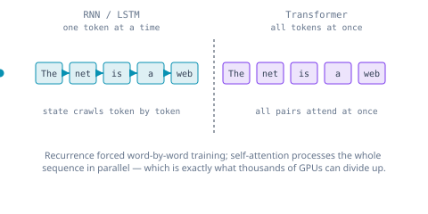
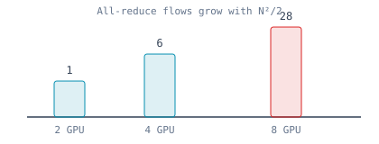
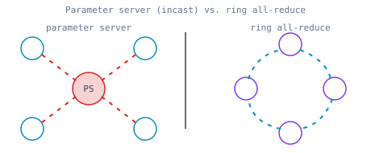
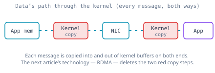

# The Network Was Always the Bottleneck: How AI Outgrew Its Own Plumbing

Ask most people what made ChatGPT possible and you will hear one word: GPUs. The story goes that NVIDIA built chips fast enough to do the math, and once the math was fast enough, the chatbot that could read half the internet simply fell out. It is a clean story. It is also wrong — or at least, it is missing the part that engineers actually fought over.

The real answer is less glamorous and more interesting. ChatGPT became possible when the industry finally fixed the part of the system nobody outside the data center was looking at: **the network between the GPUs**. Not the GPU. The wires, the switches, and the software stack that move data from one GPU to the next. For most of the last decade, that network was the thing holding everything back — and the history of large-scale AI is really the history of the data center network being torn down and rebuilt to keep up.

This article sets the stage for the rest of this series. Before we talk about RDMA, InfiniBand, or RoCEv2 — the technologies that eventually won — it is worth understanding *why the industry needed them at all*. Because the first version of the AI data center did not use any of them. It used the same boring Ethernet and TCP/IP that serves web pages. And it fell apart.

## First, the spark: what turned ordinary ML into generative AI

Before the network ever became the bottleneck, something had to make models worth scaling to thousands of GPUs in the first place. That something was a model architecture, and it is only fair to give it its due: the **Transformer**, introduced in a 2017 Google paper with the now-famous title *Attention Is All You Need* [1]. Hardware did not hand us ChatGPT on its own, and neither did the network. The Transformer is what made "read half the internet and answer anything" a tractable thing to train at all.

To see why it mattered, look at what came before it. The previous generation of language models — **RNNs** and **LSTMs** — read text the way you read a sentence out loud: one word at a time, left to right, each word's processing depending on the hidden state left behind by the word before it. That sequential dependency was a quiet catastrophe for training. Because word *N* could not be processed until word *N−1* finished, you could not spread a single sentence across many processors. The math was inherently serial, and serial math does not care how many GPUs you own.

The Transformer threw out recurrence entirely. Its key idea, **self-attention**, lets every token in a sequence look at — "attend to" — every other token *simultaneously*, in a single parallel operation, instead of waiting for information to crawl down a chain [1]. The authors showed the result was not just higher quality but "more parallelizable and requiring significantly less time to train" [1]. That parallelism is the whole game. A model you can process in parallel is a model you can split across thousands of GPUs; a model trapped in a sequential loop is not.

There is one more piece to the "what made it *generative*" question, and it is easy to miss because it sounds almost too simple. The Transformer gave us a model that could be trained in parallel — but what were we training it to *do*? The answer the field landed on was deceptively plain: **predict the next token**. Show the model trillions of words of text and ask it, over and over, to guess the word that comes next, correcting it every time it is wrong. Nothing about that objective says "write poetry" or "explain a bug." Yet when you make the model large enough and feed it enough of the internet, the ability to *continue* text well turns into the ability to *generate* text that answers questions, writes code, and holds a conversation. Generation is just prediction run forward, one token at a time, each new token fed back in as context for the next. That is the quiet trick behind the whole generative-AI era: a model that is only ever trying to predict the next word, trained at a scale that turns prediction into something that looks a great deal like understanding. And "at a scale" is the operative phrase — it is what forces the model onto thousands of GPUs, and the network back into the story.

So the honest version of "what made ChatGPT possible" has two halves, and they are inseparable. The **Transformer** made models that *could* absorb internet-scale data and *could* be trained in parallel. And that very parallelism is what made it worth building clusters of thousands of GPUs — which is precisely what dragged the data center network into the spotlight. The architecture lit the fire; scaling it is what set the network ablaze. The rest of this article is about the second half: once you have a model worth distributing across thousands of GPUs, *moving the data between them* becomes the hardest problem in the building.

## The accident of timing: hardware that was ready before anyone asked

There is a detail in the usual GPU story that gets skipped, and it is the best part. NVIDIA did not build the GPU for artificial intelligence. It built it for *video games*. The first chip the company ever called a "GPU" was the **GeForce 256**, released in October 1999 [12], and its job was to draw triangles for 3D graphics faster than the CPU could — the name "GeForce" was short for "Geometry Force," because its headline feature was offloading geometry and lighting math from the CPU [12]. Transformers were eighteen years away. Nobody at NVIDIA in 1999 had heard of self-attention, because it did not exist.

So why did a graphics chip turn out to be the perfect engine for AI? Because of *what graphics math actually is*. Rendering a scene means doing the same small arithmetic operation — multiply, add, blend — across millions of pixels at once, all independent of each other. To do that well, NVIDIA built a chip with a very particular shape: not a few powerful cores, but thousands of simple ones, all running the same instruction over different data in parallel. That shape, it turned out, is exactly the shape of a neural network. Training a model is also "do the same small arithmetic across enormous arrays of numbers, all at once" — it is **matrix multiplication** by the trillion, and matrix multiplication is embarrassingly parallel [13].

The industry noticed this almost by accident. In 2006 NVIDIA released **CUDA**, a way to program the GPU for general-purpose math without pretending your problem was a graphics problem [14] — turning a gaming card into a general parallel computer. Then in 2012, a neural network called **AlexNet** won the ImageNet image-recognition contest by a stunning margin, trained on a pair of consumer NVIDIA gaming GPUs [15]. That was the moment the two worlds collided: the hardware built for *Quake* turned out to be the hardware that could train deep neural networks, and it had been sitting on desks the whole time. When the Transformer arrived in 2017, the engine it needed to run on was already mature, already programmable, and already in every data center.

## Why not just use the CPU?

It is a fair question — a modern server CPU is a marvel, with dozens of cores running at high clock speeds. Why can it not just do the training? The answer is that a CPU and a GPU are optimized for opposite things, and training wants the thing the CPU is worst at.

A CPU is a **latency** machine. It has a handful of very powerful cores, each designed to finish one complicated chain of instructions as fast as possible — branch prediction, deep caches, out-of-order execution, all aimed at racing through *sequential* logic quickly. That is perfect for running an operating system, a database, or a web server, where the work is a tangle of decisions that depend on each other. But it means the CPU spends most of its silicon on *being clever about one thing at a time* [13].

A GPU is a **throughput** machine. It gives up single-thread cleverness and spends its silicon on raw parallelism instead: thousands of simple cores that all execute the same instruction on different pieces of data simultaneously [13]. For a tangled sequential program this is useless. For a neural network — where a single layer is one giant matrix multiply, the same multiply-and-add repeated across millions of independent numbers — it is a perfect match. A CPU training a large model would process those numbers a few at a time with its handful of fast cores; a GPU swallows them by the thousands. The gap is not a few percent; it is orders of magnitude. That is why the CPU was never in the running once models got large, and why the entire industry pivoted to building clusters out of GPUs — which is exactly how we end up with thousands of them that now have to talk to each other.

## Why one GPU was never going to be enough

Training a large language model is, at its heart, a staggering amount of repeated arithmetic. You feed the model text, it makes a prediction, you measure how wrong it was, and you nudge billions of internal parameters a tiny bit in the right direction. Then you do it again. And again. Trillions of times.

A single GPU, no matter how fast, cannot hold a modern model or chew through enough data to train it in a human lifetime. Models like GPT-4, with hundreds of billions to trillions of parameters, cannot be trained on a single GPU at all, which makes **distributed training** across many GPUs and nodes mandatory, not optional [2]. So the work gets split across many GPUs. Each GPU takes a slice of the data, runs the same model, and computes its own set of **gradients** — the "which direction should every parameter move" numbers for its slice.

Here is the catch, and it is the catch that defines everything that follows. Those gradients are useless on their own. Before any GPU can take a single training step, every GPU has to agree on the *combined* gradient from the entire cluster. GPU number 4,000 cannot update its weights until it knows what GPUs 1 through 3,999 computed. So at the end of every single step, all of them stop, exchange their gradients, sum them together, and only then continue.

That synchronization step is called an **all-reduce**, and it is the heartbeat of distributed training. It is also where the trouble lives. While the GPUs are exchanging gradients, they are not computing anything — they are sitting idle, waiting on the network. And these are the most expensive idle machines on Earth.

## The uncomfortable truth: the GPUs were waiting

When you scale a training job to hundreds or thousands of GPUs, something counterintuitive happens: the GPUs stop being the bottleneck. The interconnect between them becomes the bottleneck. A cluster of H100s can perform exaFLOPS of computation, but those operations are meaningless if the gradient updates computed on each device cannot reach every other device quickly [3].

The numbers are brutal. In a naive distributed setup, gradient synchronization can account for **30 to 60 percent** of total training time [3]. Even on a well-provisioned eight-GPU H100 node, NCCL all-reduce still accounts for 20–30 percent of each training step with default settings, and climbs to 40–50 percent on a misconfigured cluster — the hardware, as one tuning guide put it bluntly, is not the problem [4]. During large-model training, all-reduce operations can consume close to **90 percent** of network bandwidth [5].

And the plumbing problem gets *worse* as you add GPUs, not better. All-reduce is an N-to-N conversation — every GPU eventually needs every other GPU's contribution — which generates on the order of N²/2 network flows across the fabric [5]. Double the GPUs and you have not doubled the communication problem; you have roughly quadrupled it.

This is why "just add more GPUs" does not work on a network that was not built for it. Past a certain point, the GPUs you add spend all their extra capacity waiting on each other.

So the technology that made ChatGPT possible was not any single chip. It was the **collective communication** — the ability to make thousands of GPUs behave like one giant GPU by moving gradients between them fast enough that nobody sits idle. The GPU vendors even gave it a name and a library: NVIDIA's **NCCL** (NVIDIA Collective Communications Library), the layer that orchestrates all-reduce across a cluster [3][4]. But a library can only move data as fast as the network underneath it allows. And the first network underneath it was not up to the job.

## Why the existing data center was the wrong shape

The data centers that cloud providers had already built were extraordinary machines — but they were built for a completely different kind of traffic. A classic cloud data center is optimized for **north–south** traffic: a user's request comes in from the internet, hits a server, and a response goes back out. Even the east–west traffic between services is bursty, uneven, and tolerant of a little delay. A few milliseconds of jitter on a web request is invisible.

AI training traffic is the opposite in every dimension. During an all-reduce, every GPU in the job emits and receives full-bandwidth bursts *simultaneously* [6]. It is **synchronized**: every GPU wants to talk at the exact same instant, at the end of every step, because they all finish computing together. It is **full-bandwidth**: when the all-reduce fires, every GPU floods its link at line rate at once. And it is **intolerant of delay**: because the whole cluster waits for the slowest message, a single congested link or one dropped packet stalls thousands of GPUs at once. The tail does not just matter — the tail is the whole story.

Standard Ethernet with TCP/IP was built to survive messiness. It expects packets to drop and politely retransmits them. It runs congestion control that backs off when links fill up. It processes every packet through the operating system kernel — copying data, checking it, acknowledging it — adding latency to every message. For serving web pages, all of that is a feature. For an all-reduce where thousands of GPUs are blocked on the slowest byte, every one of those features is a tax. It took purpose-built technologies — RDMA over Converged Ethernet, high-speed hardware, and new error-correction mechanisms — before Ethernet became a viable option for AI workloads at all [7].

The existing infrastructure was not insufficient because it was slow. The links were fast — 100 and 400 gigabit Ethernet were already common [6]. It was insufficient because it was the *wrong shape*: lossy where training needed lossless, best-effort where training needed deterministic, and kernel-bound where training needed the CPU out of the way entirely.

## The first iteration: throw a central server at it

Before the industry arrived at RDMA and lossless fabrics, it tried the obvious thing first — and the first architecture is worth remembering, because its failure is what pointed the way forward.

The original approach to distributed training was the **parameter server** [8][9]. The idea is intuitive: dedicate one machine (or a small set) to hold the master copy of the model's parameters. Every worker GPU computes its gradients, ships them to the parameter server, the server sums everything and updates the master weights, then sends the fresh weights back out to every worker. A central coordinator, hub and spokes, running over ordinary Ethernet and TCP.

It worked — until it didn't scale. The problem is baked into the shape. The parameter server receives gradients from all workers simultaneously and sends updates back to all of them simultaneously, so every byte of gradient data flows through one machine [10]. Network engineers have a name for this failure: **incast** — many senders slamming a single receiver at once, overwhelming its links and switch buffers, causing congestion and dropped packets exactly where you can least afford them [8]. The central server became the bottleneck, and adding more workers only made the pileup worse.

The fix was to get rid of the center entirely. Around 2017, an idea borrowed from HPC — **ring all-reduce** — took over. Instead of a hub, arrange every GPU in a logical ring. Each GPU sends a chunk of its gradient to its neighbor and receives a chunk from the other side, summing as the data flows around the loop. After enough passes, every GPU holds the complete sum, and no single machine ever receives everything at once — it removes the need for dedicated parameter servers and the communication bottleneck they create [9][11]. Baidu demonstrated it for deep learning and Uber's Horovod made it easy to adopt.

But notice what ring all-reduce did *not* fix. It balanced the load beautifully — and in doing so, it handed the entire problem to the network. Now every link mattered. Every GPU was constantly sending and receiving at full bandwidth. There was no longer a central server to blame; there was only the fabric, and the fabric was still running lossy, kernel-bound, best-effort Ethernet. The bottleneck had moved from a single machine to the collective behavior of the whole network — a much harder, much more interesting problem.

## The real enemy: the kernel in the middle

Strip away the topology and one culprit remains in both the parameter-server and ring designs: on standard TCP/IP, every message a GPU sends is chaperoned by the operating system kernel. The application hands data to the kernel, the kernel copies it into its own buffers, runs TCP's bookkeeping, hands it to the NIC — and the mirror image happens on the far side. Those copies and context switches add latency to *every* message, and when thousands of GPUs are blocked on the slowest one, that overhead is the ceiling.

## Where this leaves us

So here is the setup for everything that follows. The industry learned, in order, that one GPU is not enough, that the network between many GPUs is the real constraint, that the data center it already owned was the wrong shape for synchronized full-bandwidth traffic, and that no clever software topology — not even ring all-reduce — could paper over a network that drops packets and routes every byte through the kernel.

That is the exact moment the search for a better network began. If the GPUs are going to be blocked on the slowest message, then the network has to stop dropping packets, stop involving the CPU in every transfer, and start moving data directly from one GPU's memory into another's. The industry already had a name for that capability — it just had to borrow it from the supercomputing world and make it work at cloud scale.

That capability is **RDMA**, and the fight to make it run over the data center's existing Ethernet — rather than exotic supercomputer wiring — is where this series really begins. In the next article ([Why RDMA Exists](./01-why-rdma.md)), we look at why RDMA exists and what it does differently, starting with the thing it was built to eliminate: the kernel.

---

## References
1. Vaswani, A. et al. *Attention Is All You Need.* arXiv:1706.03762. https://arxiv.org/abs/1706.03762
2. *A Comprehensive Survey on Distributed Deep Learning Training: Parallelism Strategies, Frameworks, and Network Interconnects.* Preprints.org. https://www.preprints.org/manuscript/202512.2207
3. Brenndoerfer, M. *Communication Optimization: Gradient Compression, NCCL.* https://mbrenndoerfer.com/writing/communication-optimization-gradient-compression-nccl-overlap
4. *NCCL Tuning for Multi-GPU LLM Training: Environment Variables, Topology, and Cloud Guide.* Spheron Network. https://www.spheron.network/blog/nccl-tuning-multi-gpu-llm-training-2026/
5. *Bandwidth Optimization for Distributed Training.* Introl. https://introl.com/blog/bandwidth-optimization-distributed-training-400gbps-network-traffic
6. *Networking for AI: Your Essential Guide to Real-World Deployments.* DevOps Roles. https://www.devopsroles.com/networking-for-ai-real-world-deployments/
7. *AI Ethernet Fabric Survey.* Washington University in St. Louis. https://www.cse.wustl.edu/~jain/cse574-24/ftp/aiether/index.html
8. *Enhancing Ring-AllReduce with In-network Aggregation in Distributed Model Training.* arXiv:2407.19721. https://arxiv.org/html/2407.19721v1
9. *Online Resource Optimization for Scheduling Ring-All-Reduce Learning Jobs.* arXiv:2202.01158. https://arxiv.org/html/2202.01158v1
10. *Ring All-Reduce Explained: The Distributed Training Bottleneck Nobody Monitors.* AI Sys Design. https://aisysdesign.substack.com/p/ring-allreduce-explained-the-distributed
11. *On Scheduling Ring-All-Reduce Learning Jobs in Multi-Tenant GPU Clusters with Communication Contention.* arXiv:2207.07817. https://arxiv.org/abs/2207.07817
12. *GeForce 256* (first NVIDIA "GPU", 1999; "Geometry Force", offloaded transform & lighting from the CPU). Wikipedia. https://en.wikipedia.org/wiki/GeForce_256
13. *GPU vs CPU: latency vs throughput; deep learning as massively parallel matrix operations.* https://note.com/yamada_kazuro/n/ne3461f6ac433
14. *CUDA* (2006 general-purpose GPU programming, throughput-oriented execution model). https://aiwiki.ai/wiki/cuda
15. *AlexNet* (2012 ImageNet winner trained on two consumer NVIDIA GPUs). Wikipedia. https://en.wikipedia.org/wiki/AlexNet
