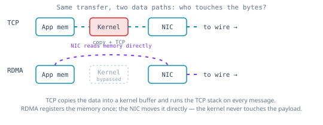
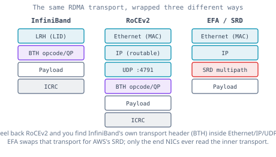
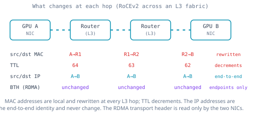

# Anatomy of an RDMA Packet: Three Transports, One Journey

The last two articles argued *why* RDMA exists and *which* fabric to run it over. This one gets its hands dirty. We are going to follow a single gradient update as it leaves one GPU's memory and arrives in another's, and we are going to watch it three times — once over **InfiniBand**, once over **RoCEv2**, and once over **AWS EFA/SRD** — because the most honest way to understand what separates these three technologies is to look at the actual bytes on the wire and ask, at each step, *who is touching this packet and why.*

Keep one question in your head the whole way through: **where is the CPU, and where is the kernel?** Everything that makes RDMA fast comes down to the answer being "nowhere near the data path."

## The thing all three are trying to avoid

Start with the villain, because all three transports are defined by how they kill it. On ordinary TCP/IP, when an application sends data, the bytes take a tour. The application copies them into a kernel socket buffer. The kernel's TCP stack wraps them in headers, tracks sequence numbers, and schedules an acknowledgement. The data is copied again into a buffer the NIC can reach. Only then does the NIC put bits on the wire. On the far side, the same tour runs in reverse: NIC to kernel buffer, TCP processing, copy up into application memory. Two copies and a kernel round-trip on each side, for *every* message [1].

RDMA's entire premise is to delete that tour. The application registers a region of its memory with the NIC *once*, up front. From then on, the NIC can read from and write to that memory **directly** — the operating system is told about the transfer but never touches the data, and the remote CPU is often not involved at all [1]. This is **kernel bypass** (the OS is out of the data path) and **zero-copy** (the data is never copied into intermediate buffers). The NIC does the work a CPU and kernel used to do, in silicon. That single architectural move — pushing the transport logic down into the NIC hardware — is what all three of our transports share. Where they differ is in *what the NIC speaks once it owns the packet.*

## Transport 1: InfiniBand — its own world, top to bottom

InfiniBand does not pretend to be Ethernet. It is a separate network stack with its own physical layer, its own switches, and — crucially for this article — its own addressing and its own packet format [2]. An InfiniBand packet does not carry an Ethernet header or an IP header, because there is no Ethernet and no IP underneath it. Instead it carries a **Local Routing Header (LRH)** that addresses nodes by a 16-bit **Local Identifier (LID)** assigned by the fabric's subnet manager, and a **Base Transport Header (BTH)** that carries the RDMA operation itself — the opcode (Read, Write, Send), the destination queue pair, and the packet sequence number [2].

Because InfiniBand owns the whole stack, there is no translation tax anywhere. The NIC (an IB "Host Channel Adapter") writes a packet addressed by LID; IB switches forward it by LID using forwarding tables the subnet manager computed; the receiving HCA reads the BTH, finds the target queue pair, and drops the payload straight into the registered memory region. The CPU and kernel appear *nowhere* in that sentence — not at the source, not at any switch, not at the destination. And because the fabric is lossless by design (credit-based flow control means a sender never transmits more than the receiver has buffer for [2]), there is no retransmission machinery cluttering the common path. This is why InfiniBand posts the lowest latency of the three: the packet format and the fabric were co-designed for exactly one job.

## Transport 2: RoCEv2 — the InfiniBand packet wearing an Ethernet coat

RoCEv2's clever trick is to keep InfiniBand's *transport* — the same BTH, the same RDMA semantics the application already speaks — but carry it inside standard Ethernet and IP so it can run on the commodity data-center fabric you already own [3]. Peel a RoCEv2 packet apart and you find a layered stack:

- an **Ethernet** header (source and destination MAC),
- an **IP** header (source and destination IP — this is what makes RoCEv2 *routable*, unlike the original RoCEv1),
- a **UDP** header with destination **port 4791**, the well-known port that tells any router "this is RoCEv2" [3],
- the same **InfiniBand Base Transport Header (BTH)** that InfiniBand uses, carrying the RDMA opcode and queue pair,
- the payload, and
- an **ICRC**, an invariant checksum that protects the RDMA fields end to end.

That stack is the whole story of RoCEv2's tradeoff. By wrapping the IB transport in IP and UDP, you get to route RDMA across ordinary L3 Ethernet with ordinary switches and routers [3] — and that is exactly why it is cheaper and more flexible than InfiniBand. But it also means the packet is now subject to everything Ethernet does, including *dropping packets when a buffer fills*. The NIC still bypasses the kernel; the ICRC still protects the RDMA payload; but the fabric underneath is best-effort, and RDMA cannot tolerate loss. That single fact is why RoCEv2 drags **PFC** and **ECN** along with it everywhere — the lossless-Ethernet machinery that the previous article warned is "your problem" as a network engineer. The packet format bought routability; the price was having to engineer losslessness back in by hand.

## What the switches and routers do to the packet

Here is the part that trips up even experienced engineers, and it matters for RoCEv2 specifically because it rides on L3 Ethernet. As that RoCEv2 packet crosses the fabric, **different headers change at different hops**, and the rule is strict:

- At a **Layer 2 switch**, the packet is forwarded by destination MAC. Nothing in the IP or transport header is touched; the switch does not even look at them. The frame goes out a port based on a MAC table [4].
- At a **Layer 3 router** (or an L3 boundary in a leaf-spine fabric), the packet is forwarded by destination IP — and *here* the Ethernet header is rewritten. The router strips the incoming frame, sets the **source MAC** to its own outgoing interface and the **destination MAC** to the next hop, and decrements the IP **TTL** (recomputing the IP checksum) [4]. The source and destination **IP addresses do not change** — they stay fixed end to end (barring NAT) [4].

So the mental model to lock in: **IP addresses are the end-to-end identity and survive the whole journey; MAC addresses are local and get rewritten at every router hop; the RDMA BTH in the middle is never touched by any switch or router at all** — only the two end NICs read it. The fabric moves the envelope; only the endpoints open the letter.

## Transport 3: EFA/SRD — give up on order, win on paths

EFA's packet starts out looking like RoCEv2's — it is Ethernet-based and OS-bypass, carried on AWS's Nitro NICs — but the transport underneath is AWS's own **Scalable Reliable Datagram (SRD)**, and SRD makes a bet the other two refuse to make [5]. InfiniBand and RoCEv2 both deliver a message's packets **in order**, which is what lets them lean on a single lossless path. SRD does the opposite: it **sprays the packets of a single message across many network paths at once** and *expects them to arrive out of order* [5][6], reassembling order in the NIC and handing the application whole messages. 

Why would you deliberately scramble your own packets? Because insisting on in-order delivery is exactly what forces the lossless-single-path design — and the **PFC** that RoCEv2 needs to stay lossless is also what causes head-of-line blocking and congestion spreading at scale. By refusing to require order, SRD sidesteps PFC entirely: it can load-balance across the whole fabric, route around a congested or failed link packet-by-packet, and avoid the head-of-line stalls, giving lower and more consistent *tail* latency than TCP on the same network [5][6]. The reliability (detecting loss, retransmitting) still lives in the NIC hardware, so the kernel is still bypassed — SRD just moved the ordering guarantee *up* to the NIC's reassembly logic instead of demanding it from the fabric. It is the same kernel-bypass idea as the other two, with the one assumption everyone else treated as sacred — in-order delivery — deliberately thrown away.

## So which one is best?

The honest answer is the one every good network engineer gives: *it depends on what you are optimizing for.* But the tradeoffs are concrete, not vague.

- **InfiniBand** wins on raw performance — lowest latency (sub-microsecond), highest per-port bandwidth, native losslessness with no PFC/ECN tuning — because the fabric and the packet format were co-designed for RDMA [2]. You pay for it in money (dedicated IB switches, largely a single vendor) and in operational specialization (a subnet manager, IB-specific expertise). Choose it when you are building a dedicated, tightly-coupled training cluster where every microsecond of synchronization latency multiplies across thousands of GPUs and the budget supports a bespoke fabric.

- **RoCEv2** wins on economics and ecosystem — it runs on the commodity Ethernet fabric you already operate, with multiple switch vendors competing on price, and it shares infrastructure with the rest of the data center [3]. You pay for it in operational complexity: you must engineer losslessness by hand with PFC, ECN, and DCQCN, and get it wrong and the RDMA stack fails in subtle ways. Choose it when you want to leverage existing Ethernet skills and infrastructure, when the cluster is multi-tenant or shares the general-purpose fabric, or when peak latency is less critical than cost and flexibility. The industry has been voting this way: a growing majority of new AI fabric deployments now choose Ethernet-based RDMA over InfiniBand [7].

- **EFA/SRD** wins when your constraint is "I am on AWS." You do not choose EFA against InfiniBand on a spec sheet; you choose it because you are training in the cloud and it is the RDMA fabric AWS offers [5]. Its multipath, out-of-order design is genuinely well-suited to large, elastic cloud clusters where paths fail and congestion shifts, and it avoids the PFC fragility that plagues RoCEv2 at scale. You give up the absolute lowest latency of a dedicated IB fabric in exchange for cloud elasticity and resilience.

A useful way to hold it: **InfiniBand** engineers a perfect network and makes the packet trust it; **RoCEv2** reuses a commodity network and forces it to behave; **EFA/SRD** assumes the network is imperfect and engineers the endpoints to cope. Three philosophies, one goal — move gradients between thousands of GPUs before the GPUs notice they are waiting.

The broader industry is converging on SRD's philosophy, by the way. The **Ultra Ethernet Consortium (UEC)** is standardizing an open transport that embraces exactly this multipath, out-of-order-tolerant approach for AI fabrics [8]. Until that arrives everywhere, though, most RoCEv2 fabrics still depend on an Ethernet that never drops packets, and building one is the subject of [the next article](04-lossless-ethernet-for-rdma.md).

## References

1. *RDMA over Converged Ethernet.* NVIDIA DOCA SDK documentation. https://docs.nvidia.com/doca/sdk/rdma-over-converged-ethernet
2. *Export of RoCEv2 Base Transport Header (BTH) Information Using IPFIX.* IETF draft (InfiniBand/RoCE kernel-bypass and BTH overview). https://www.ietf.org/archive/id/draft-lin-opsawg-ipfix-rocev2-00.html
3. *Cumulus RoCEv2 Configuration Guide* (RoCEv2 encapsulation: Ethernet/IP/UDP port 4791 over the IB transport). VAST Data KB. https://kb.vastdata.com/docs/cumulus-rocev2-configuration-guide
4. *How MAC addresses are changed by routers for forwarding* (IP unchanged end-to-end, MAC rewritten and TTL decremented at each L3 hop). Cisco Community. https://community.cisco.com/t5/switching/how-mac-addresses-are-changed-by-routers-for-forwarding/td-p/1220743
5. Shalev, L. et al. *A Cloud-Optimized Transport Protocol for Elastic and Scalable HPC* (Scalable Reliable Datagram). IEEE Micro, 2020. https://www.amazon.science/publications/a-cloud-optimized-transport-protocol-for-elastic-and-scalable-hpc
6. *PERF05-BP05: Choose network protocols to improve performance* (EFA/SRD multipath, out-of-order, lower tail latency). AWS Well-Architected Framework. https://docs.aws.amazon.com/wellarchitected/2023-04-10/framework/perf_select_network_protocols.html
7. *InfiniBand Is Losing the Fabric War* (majority of new AI deployments choosing Ethernet-based fabrics). NTC Tech. https://dev.to/ntctech/infiniband-is-losing-the-fabric-war-heres-what-that-changes-for-your-architecture-15em
8. *The Future of AI & HPC Networking: Ultra Ethernet vs InfiniBand, RoCE and TCP.* STORDIS. https://stordis.com/ultra-ethernet-vs-infiniband-roce-and-tcp/
