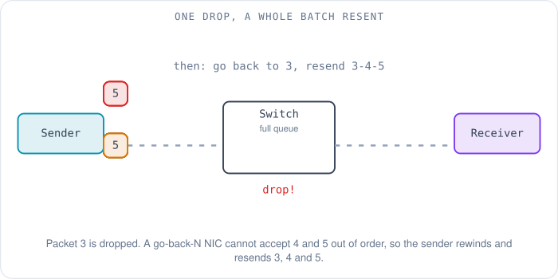
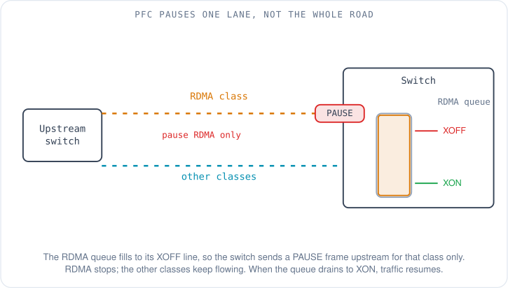
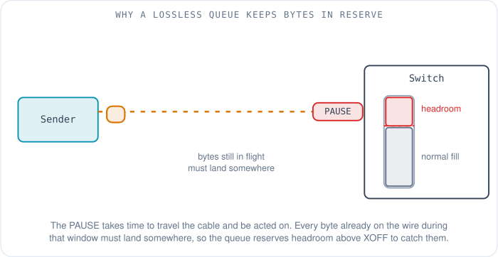
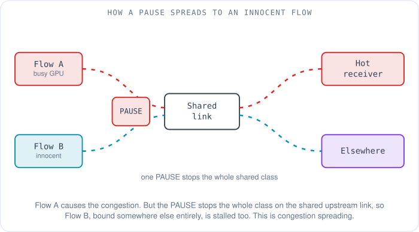
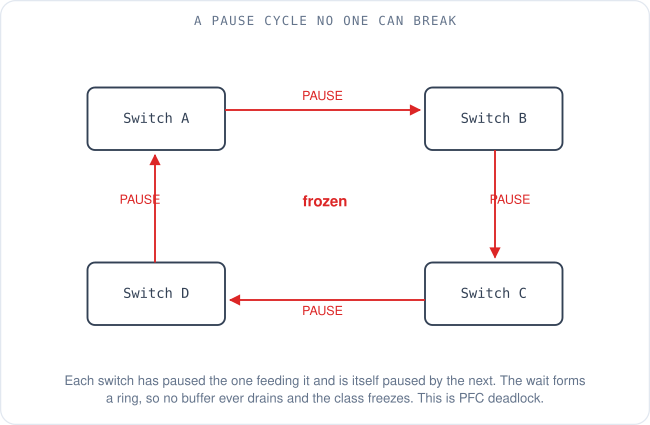
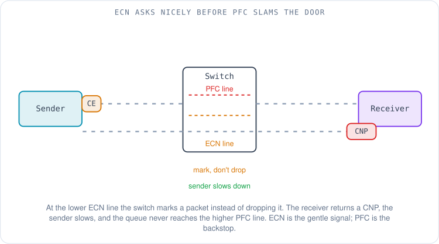

# Lossless Ethernet for RDMA: How to Stop a Network From Dropping Packets

A training job that had been humming along at full tilt suddenly crawls. The GPUs are still busy, the switches show plenty of free bandwidth, the links are not saturated — and yet a step that used to finish in a few hundred milliseconds now takes seconds. Someone eventually finds the cause buried in a NIC counter: a handful of packets were dropped on one congested port, out of trillions sent. Not a cut cable, not a dead switch. A handful of drops. And they brought a cluster of expensive accelerators to its knees.

That is the problem this article is about. In [the last article](03-rdma-packet-anatomy.md) we followed a single gradient update across the wire as a RoCEv2 packet — InfiniBand's transport wrapped in Ethernet, IP and a UDP header. We noted, almost in passing, that the fabric underneath RoCEv2 is ordinary best-effort Ethernet, and that ordinary Ethernet drops packets when a queue overflows. This article is the consequence of that sentence. We are going to find out why those few drops hurt so much, and then build — layer by careful layer — the machinery that stops them: a *lossless* Ethernet, where a switch would rather pause a sender than throw a packet away. Each layer exists only because the previous one left a problem behind, so we will meet the problems in the order the engineers who built this actually met them.

## Why does one dropped packet cost so much?

To see why a drop is catastrophic, you have to remember where RoCEv2's transport came from. **RoCEv2 (RDMA over Converged Ethernet, version 2)** reuses InfiniBand's transport logic — the part of the protocol that tracks what has been sent and what has arrived — and InfiniBand was built for a fabric that *never drops packets*. On InfiniBand, credit-based flow control means a sender is simply never allowed to transmit more than the receiver has buffer space for, so loss is designed out of existence [1]. The transport that RoCE inherited was written for that world. It did not need a clever, fast loss-recovery mechanism, because loss was not supposed to happen.

So when a RoCE NIC does lose a packet, its recovery is blunt. Many RoCE NICs use **go-back-N**: the receiver will not accept any packet that arrives after a gap, so when packet 3 goes missing, packets 4 and 5 — which may already have arrived safely — are discarded, and the sender rewinds and retransmits everything from 3 onward [2]. One lost packet does not cost you one packet; it costs you that packet and everything sent after it until the sender notices and starts over.

Now scale that up. In a large training job, thousands of GPUs finish their local computation at nearly the same instant and all try to exchange gradients at once — a burst of enormous, synchronized flows. That burst is exactly when a switch queue is most likely to overflow, which is exactly when ordinary Ethernet drops. And because the GPUs are running a *collective* operation where everyone waits for everyone, the slowest straggler sets the pace. A single go-back-N storm on one flow stalls one GPU, and one stalled GPU stalls the step, and the whole cluster idles waiting for it. The economics are brutal: the accelerators are the expensive part, and loss leaves them waiting on a network that is otherwise nearly empty.

The fix has to attack the root cause. If the transport cannot tolerate loss, then the fabric must not lose. We need an Ethernet that, when a queue is about to overflow, tells the device feeding it to *stop for a moment* instead of dropping what it cannot hold.

## PFC: pausing one lane instead of the whole road

The first layer is a pause button. **PFC (Priority Flow Control, standardized as IEEE 802.1Qbb)** lets a switch send a special PAUSE frame back to the device upstream of it, saying "stop sending for a short while." The upstream device holds its traffic, the congested queue drains, and nothing had to be dropped [3].

The word *priority* is the clever part. Ethernet carries eight traffic classes (priorities 0 through 7), and PFC can pause them independently. If it could only pause the entire link, pausing to protect RDMA would also freeze every other kind of traffic sharing that wire — storage, management, ordinary TCP. Instead, PFC pauses one class at a time. You put RDMA in its own class, enable PFC on that class alone, and when the RDMA queue fills you pause *only RDMA* on the link upstream. The other seven lanes keep moving [3].

A switch does not pause the instant a queue has anything in it; that would throttle traffic needlessly. It watches two water lines on the queue. When the queue fills past the upper line — call it **XOFF** — the switch fires a PAUSE upstream. As the queue drains back down past a lower line — **XON** — it sends the all-clear and traffic resumes. The gap between the two lines keeps the switch from flapping between stop and go on every packet.

### The bytes already on the wire: headroom

PFC has a subtlety that trips up anyone configuring it for the first time, and it is pure physics. When the switch decides to send PAUSE, that frame is not teleported to the sender. It travels back down the cable, the sender's NIC has to notice it and react, and in all the time that takes, bytes the sender had *already* committed to the wire keep arriving. The switch asked everyone to stop, but a train's worth of packets is still in the tunnel. Every one of them has to land somewhere, or the drop we were trying to prevent happens anyway.

So a lossless queue reserves space above its XOFF line — **headroom** — sized to catch exactly those in-flight bytes. You can estimate how much with grade-school arithmetic once you state the assumptions. Take a 100 Gb/s link, which moves 100 billion bits — about 12.5 gigabytes — per second, or roughly 12.5 bytes per nanosecond. Suppose the sender sits 100 metres away down the cable. Light in fibre travels at about 5 nanoseconds per metre, so the PAUSE needs about 500 ns to reach the sender, and bytes already sent need up to another 500 ns to arrive — call it 1,000 ns round-trip, before adding the sender's own reaction time. At 12.5 bytes per nanosecond, that window alone is about 12.5 kilobytes of data per link that must have a home. Make the link faster or the cable longer and the number grows in direct proportion. That reserved slice of buffer is not waste; it is the margin that makes "lossless" true.

## PFC solved one problem and created four

A pause button that stops a sender rather than dropping its packets sounds like the whole answer. It is not. Pausing a sender has consequences that ripple outward, and every large RoCE deployment has been bitten by them. Microsoft documented these failure modes vividly in their SIGCOMM 2016 paper on running RDMA over commodity Ethernet at scale, which is the best public account of what goes wrong [4].

The gentlest problem is **head-of-line blocking**. A PAUSE stops an entire traffic class on a link, not an individual flow. If one flow in the RDMA class is causing the congestion, the pause stops *every* RDMA flow on that link — including flows that were behaving perfectly and heading somewhere else entirely. The congestion caused by one noisy GPU becomes a stall for an innocent bystander that merely shared a link with it.

That spreading is worse than it first looks, because the pause propagates. The upstream device, now paused, fills its own queue, crosses *its* XOFF line, and sends a PAUSE further upstream. Congestion at one hot spot travels backward through the fabric, hop by hop, pausing links that are nowhere near the original trouble. This is **congestion spreading**, and it means a single hot receiver can quietly throttle traffic across a surprising fraction of the network.

Then there is the **pause storm**. If a NIC misbehaves — a firmware bug, a stuck receive queue — it can emit a relentless stream of PAUSE frames. The link upstream obediently stops and stays stopped, and because pauses propagate, the dead silence spreads outward from the broken NIC. One faulty device can take down connectivity for a whole swath of the fabric. The defence is a **PFC watchdog**: logic on each switch that notices a queue has been paused for too long with no progress and, as a last resort, starts dropping that queue's traffic to break the spell — trading the lossless guarantee for the survival of everything else.

The most feared problem is **deadlock**. PFC makes one switch wait for another to drain. Arrange the waiting in a circle — switch A paused by B, B paused by C, C paused by D, D paused by A — and every switch is waiting for the next one around the ring, so none of them can ever drain. The traffic class simply freezes, and clearing the flows does not thaw it. Microsoft reported this is not merely theoretical: it happened in production [4].

Deadlock needs a cyclic *buffer* dependency to form, which is why the physical topology matters. A clean [fat-tree, the subject of the next article](05-hpc-topology.md), where traffic goes up to a common ancestor and back down, does not naturally create these cycles; more exotic wiring, or routing that lets traffic bounce sideways, can. The lesson that stuck from this era is blunt: PFC is a powerful backstop, but you do not want it firing often. It should be the fire alarm, not the thermostat. Which means we need a thermostat.

## ECN and DCQCN: a gentler word before the pause

The thermostat is **ECN (Explicit Congestion Notification, defined in RFC 3168)**. Instead of waiting until a queue is nearly full and slamming the pause button, ECN lets a switch set a single bit in a passing packet's IP header the moment its queue starts to build — a quiet "I'm getting busy" marked right on the traffic, with nothing dropped and nothing paused [5]. The marked packet continues to its destination exactly as it would have.

On its own, a mark on an arriving packet does nothing useful — the receiver is not the one sending too fast. So ECN is paired with a response loop. When the receiver sees a marked packet, it sends a small **CNP (Congestion Notification Packet)** back to the sender. The sender's NIC takes the CNP as a signal to ease off, reducing its transmit rate; when the CNPs stop coming, it gradually ramps back up. That whole control loop — mark, notify, slow down, recover — is **DCQCN (Data Center Quantized Congestion Notification)**, developed jointly by Microsoft and Mellanox and published at SIGCOMM 2015 [6]. It is the mechanism that keeps RoCE queues shallow enough that PFC rarely has to act.

The relationship between the two signals is the single most important thing to get right, and it is a matter of where you draw the water lines. The **ECN marking threshold is set below the PFC pause threshold on the same queue**. As a queue fills, it crosses the lower ECN line *first*, so the gentle rate-slowing signal fires early and the senders back off before the queue ever reaches the higher PFC line. ECN is the signal you want to do the real work; PFC is the hard backstop for a burst so sudden that the slow control loop could not react in time. Get the order wrong — PFC line below ECN — and you pause constantly while the gentle signal never gets a chance, inheriting all of PFC's side effects for nothing.

## Putting it together on real switches and NICs

With the pieces understood, the configuration is almost a formality — it is just naming the class, drawing the thresholds, and making sure nothing in the path forgot to participate.

First, RDMA traffic has to be recognizable so switches can steer it into its own lossless class. It is marked with a **DSCP (Differentiated Services Code Point)** value — a few bits in the IP header reserved for exactly this kind of classification. The conventional choice on NVIDIA (formerly Mellanox) hardware is DSCP 26, mapped to priority 3; PFC is enabled on priority 3 and DCQCN runs on it [7]. The specific numbers are a convention, not a law — what matters is that every device in the path agrees on them.

From there the recipe is: enable PFC on that one RDMA priority, and *only* that one; set the ECN marking threshold below the PFC threshold; give the CNPs their own high-priority treatment so the "slow down" message is never itself stuck behind the congestion it is trying to relieve; and arm the PFC watchdog so a pause storm cannot freeze the fabric forever. The rule that catches people is that **PFC must be enabled on every single port in the RDMA path** — server-facing ports, leaf uplinks, spine ports, all of them. One port that trusts the DSCP marking but was never told to honour PFC becomes a silent hole: during a burst its buffer overflows with nothing to pause the sender, and it drops RDMA packets even though PFC is configured everywhere else in the path [4].

## What healthy looks like, and the ways it breaks

Once it is running, operating a lossless fabric is mostly about reading a few counters and knowing which story they are telling. In steady state, a correctly tuned fabric shows **near-zero RDMA retransmits** — if DCQCN is doing its job, senders slow down before queues reach the pause line. You expect to see **ECN marks appearing under load** (they are the sign the gentle signal is working), **low and bursty PFC pause counts** rather than a continuous stream, and **zero discards in the RDMA class**. A single discard in that class is an alarm, not a statistic.

When it goes wrong, it usually tells one of four stories.

The first is **deadlock**: traffic in the RDMA class stops dead, every port shows its pause counter pinned at maximum, and clearing flows does nothing. That is the frozen ring from earlier, and the fix is structural — remove the cyclic buffer dependency in the topology or routing, and lean on the watchdog to recover the fabric in the meantime.

The second is a **pause storm**: PFC pause-frame counts climbing relentlessly on ports fanning out from one device. Trace it back to the source NIC, because one misbehaving adapter is almost always the origin, and let the watchdog contain the blast radius until it is isolated.

The third is **one port missing PFC**: localized RDMA drops on specific links even though PFC "is configured." The audit is per-port, not global — confirm PFC is on, on the correct priority, on *that* link, because a single gap breaks the end-to-end guarantee.

The fourth is **reordering**, and it is worth dwelling on because the old folklore gets it backwards. If a RoCE flow's packets arrive out of order, go-back-N punishes it exactly as a drop would. The usual culprit named is ECMP — **Equal-Cost Multi-Path**, the standard way a fabric spreads traffic across the several equally-good paths between two points. But standard ECMP hashes *per flow*: it picks a path from fields that are constant for the life of a flow, so every packet of one flow follows the same path and order is preserved. For RoCEv2 the hash entropy comes from the **UDP source port** — the destination port is fixed at 4791, so the sender varies the source port to spread different flows across paths. Plain ECMP does not reorder a flow. Reordering comes from *per-packet* spraying, from adaptive routing that moves a flow mid-stream, or from a path changing under load. If you see out-of-order counters climbing, that is where to look — not at a correctly behaving per-flow hash.

## Where this is all heading: making loss survivable

Step back and the whole edifice looks a little precarious. We took a transport that assumes a perfect network and then spent four layers of mechanism — PFC, headroom, ECN, DCQCN, watchdogs, careful thresholds, per-port audits — forcing a commodity network to pretend it is perfect. It works, and it runs enormous clusters today, but a reasonable person might ask whether the harder problem is the transport, not the fabric.

A growing part of the industry thinks so, and the direction is to make the transport *tolerate* loss and reordering rather than forbid them — which would let the fabric drop the fragile PFC machinery entirely. The academic marker is **IRN (Improved RoCE NIC)**, from a 2018 SIGCOMM paper that argued a NIC with a better, selective loss-recovery scheme does not need PFC at all; the authors showed IRN without PFC beating conventional RoCE with PFC by 6 to 83% across typical scenarios [8]. [AWS's SRD takes the same bet in production](03-rdma-packet-anatomy.md), spraying packets across many paths and reassembling order at the receiving NIC, which lets it skip PFC and route around trouble packet by packet. NVIDIA's Spectrum-X platform leans the same way, pairing RoCE with adaptive routing and congestion control that it reports delivers up to 95% effective bandwidth at scale [9]. And in June 2025 the **Ultra Ethernet Consortium**, founded in 2023 by AMD, Arista, Broadcom, Cisco, Eviden, HPE, Intel, Meta and Microsoft [10], published its 1.0 specification for an open, Ethernet-based transport designed from the start for multipath, out-of-order-tolerant AI traffic, so that losslessness is no longer the load-bearing assumption [11].

So the handful of dropped packets that stalled our training job will, over time, matter less — not because the fabric got more perfect, but because the endpoints learned to shrug off imperfection. For now, though, if you are running RoCEv2, losslessness is still your job, and the layers in this article are how you do it: PFC as the backstop, ECN and DCQCN as the thermostat, headroom for the physics, and a careful eye on the counters that tell you which story the fabric is living through.

Those thousands of GPUs still have to be wired together before any of this traffic can flow. [In the next article](05-hpc-topology.md) we look at how you physically connect them — bisection bandwidth, oversubscription, fat-trees and rail-optimized designs — and why the shape of the network decides how fast the training step can finish.

## References

1. *InfiniBand Credit-Based Link-Level Flow Control* (a sender transmits only when the receiver has advertised buffer space). Crupnicoff, Mellanox, tutorial to IEEE 802.1, 2014. https://www.ieee802.org/1/files/public/docs2014/new-dcb-crupnicoff-ibcreditstutorial-0314.pdf
2. *Revisiting Network Support for RDMA* (go-back-N loss recovery in conventional RoCE NICs). Mittal et al., SIGCOMM 2018. https://arxiv.org/pdf/1806.08159v1
3. *802.1Qbb — Priority-based Flow Control.* IEEE 802.1 Working Group. https://www.ieee802.org/1/pages/802.1bb.html
4. *RDMA over Commodity Ethernet at Scale* (head-of-line blocking, congestion spreading, pause storm, PFC deadlock, DSCP-based PFC). Guo et al., SIGCOMM 2016. https://utadvnetworks.github.io/papers/RoCEatScale.pdf
5. *RFC 3168: The Addition of Explicit Congestion Notification (ECN) to IP.* IETF, 2001. https://www.rfc-editor.org/rfc/rfc3168
6. *Congestion Control for Large-Scale RDMA Deployments* (DCQCN). Zhu et al., SIGCOMM 2015. https://dl.acm.org/doi/abs/10.1145/2829988.2787484
7. *Lossless RoCE Configuration in DSCP-Based QoS Mode* (DSCP 26 mapped to priority 3; PFC and ECN on priority 3). NVIDIA Enterprise Support. https://enterprise-support.nvidia.com/s/article/lossless-roce-configuration-for-mlnx-os-switches-in-dscp-based-qos-mode--advanced-mode-x
8. *Revisiting Network Support for RDMA* (IRN without PFC outperforms RoCE with PFC by 6-83%). Mittal et al., SIGCOMM 2018. https://arxiv.org/html/1806.08159v1
9. *Turbocharging Generative AI Workloads with the NVIDIA Spectrum-X Networking Platform* (RoCE adaptive routing and congestion control; up to 95% effective bandwidth). NVIDIA Developer Blog, 2024. https://developer.nvidia.com/blog/turbocharging-ai-workloads-with-nvidia-spectrum-x-networking-platform
10. *Leading Cloud Service, Semiconductor, and System Providers Unite to Form Ultra Ethernet Consortium* (founding members). Eviden/Atos press release, July 19, 2023. https://atos.net/en/2023/press-release_2023_07_19/leading-cloud-service-semiconductor-and-system-providers-unite-to-form-ultra-ethernet-consortium
11. *Ultra Ethernet Consortium Launches Specification 1.0.* Ultra Ethernet Consortium / Linux Foundation, June 11, 2025. https://www.linuxfoundation.org/press/uec-launches-spec-1.0
