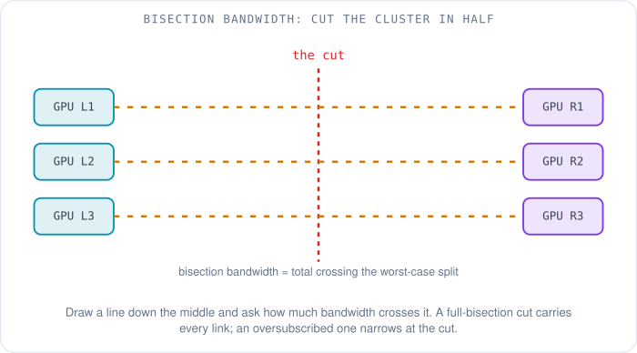
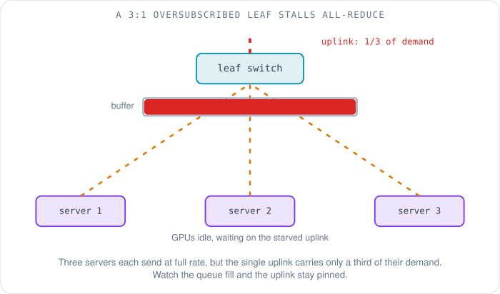
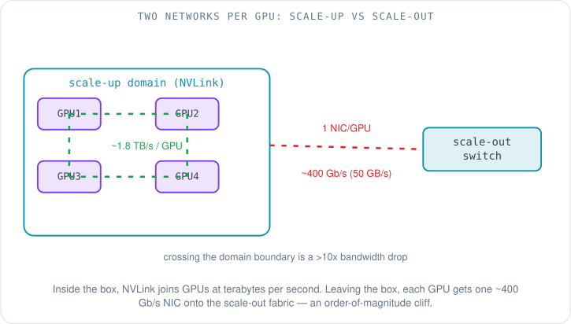
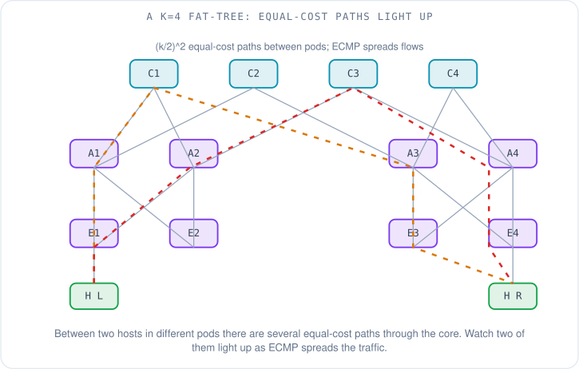
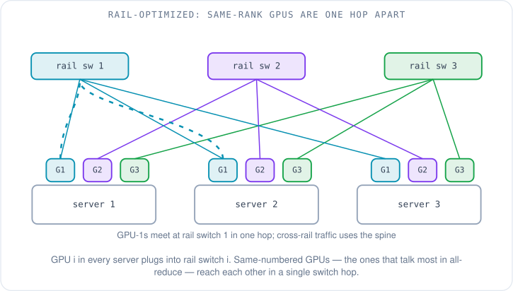
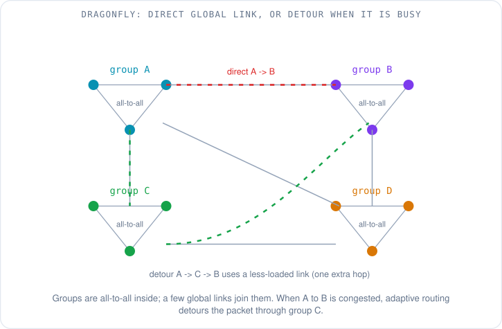

# Wiring 16,000 GPUs So They Can All Talk at Once

Someone hands you sixteen thousand GPUs and one sentence of requirements: every one of them must be able to talk to every other one, at full speed, at the same instant. That is not a cloud web service, where a handful of users hit a handful of servers at any given moment. It is one enormous machine pretending to be a single brain, and the wiring between its pieces decides whether it works at all.

This article is about that wiring. We will start from the one property that makes an AI cluster so demanding, build up the vocabulary a network person needs to reason about it — **bisection bandwidth**, **oversubscription**, the split between a **scale-up** and a **scale-out** network — and then walk through the three shapes real clusters are actually wired into: the **fat-tree**, the **rail-optimized** leaf, and the **dragonfly**. Keep the sixteen thousand GPUs in your head the whole way. Every choice below is an answer to the question "how do I let all of them speak at once without going bankrupt on switches and cable?"

## Why the worst case is the normal case

In an ordinary data center, the network is sized for the average. Thousands of users send small, uncorrelated requests; at any instant only a fraction of the links are busy, and the quiet ones cover for the loud ones. Network engineers lean on that: it is called **statistical multiplexing**, and it is why you can safely sell more bandwidth than you physically have.

A training cluster breaks that assumption completely. The GPUs run in lockstep. They each process a slice of data, compute how the model should change — a set of numbers called the **gradient** — and then every GPU has to share its gradient with every other GPU so they can all agree on one averaged update before the next step begins. That synchronization step, where everyone talks to everyone, is called a **collective**, and the specific all-to-all averaging is **all-reduce**. The traffic is not uncorrelated — it is perfectly correlated. Every GPU wants to send a huge amount of data at the same microsecond, and no GPU can start the next step until the slowest transfer finishes. There is nothing to statistically multiplex, because the worst case *is* the operating case, on every single step, for weeks. (The detail of what that traffic looks like over time is the next article's job — see [AI/ML traffic patterns](06-ai-ml-traffic-patterns.md).)

So the network cannot be sized for the average. It has to be sized for everyone-at-once. That single requirement is what the rest of this article is spending money to satisfy.

## How much bandwidth is "enough"? Cut the cluster in half

There is a clean way to measure whether a network can survive everyone talking at once, and it is exactly as blunt as it sounds: take the cluster, draw a line down the middle so half the GPUs are on each side, and ask how much bandwidth crosses that line. That number is the **bisection bandwidth** — the throughput available across the worst-case split of the machine.

Why the *worst* split? Because an adversarial traffic pattern — and all-reduce is close to one — will arrange for as much data as possible to need to cross from one half to the other. If every GPU on the left is talking to a partner on the right, then the bandwidth across the cut is the ceiling on how fast the whole collective can run. A network has **full bisection bandwidth** when that cut can carry every GPU on one side sending at its full link rate simultaneously — nothing is throttled by the middle of the network. People also call this **non-blocking**: any permutation of who-talks-to-whom can run at line rate at once.

Full bisection bandwidth is expensive, because it means buying enough switches and cable in the core of the network to carry the entire fleet's traffic across the midline with nothing left on the table. The tempting shortcut is **oversubscription**: wire the links facing the servers to carry more aggregate bandwidth than the links facing the core. A **3:1 oversubscribed** leaf switch, for example, has three times as much bandwidth pointing down at its servers as it has pointing up toward the rest of the fabric. For cloud traffic that is a bargain — statistical multiplexing means the uplinks are rarely all needed at once, so you save two-thirds of your core and almost never notice.

Point that same oversubscribed leaf at a training job and it falls over. When all-reduce fires, every server under that leaf tries to send at full rate through an uplink that can only carry a third of their combined demand. The excess piles up in the switch's buffer, the queue fills, and the whole collective slows to the speed of that starved uplink. The GPUs sit idle — the most expensive silicon in the building, waiting on a link you under-provisioned to save money.

This is why training fabrics are built non-blocking, or very close to it, when a cloud fabric for the same number of machines would be happily oversubscribed. The workload removed the engineer's favorite cost-saving lever.

## Two networks per GPU, and they are nothing alike

Before we wire the whole cluster, there is a distinction that trips up almost everyone the first time, because the word "network" is doing two completely different jobs.

A modern GPU server does not hold one GPU. It holds eight, in the common HGX form factor, and inside that box the GPUs are joined by a dedicated, blisteringly fast interconnect — NVIDIA's **NVLink**, switched by **NVSwitch** — that lets them read and write each other's memory as if they were one chip [1]. Newer rack-scale designs push this domain much further: NVIDIA's GB200 NVL72 wires 72 Blackwell GPUs into a *single* NVLink domain, giving each GPU 1.8 TB/s of bidirectional bandwidth and 130 TB/s aggregate across the rack, so the whole rack behaves like one giant accelerator [2]. This tightly-coupled, memory-speed world is the **scale-up** network: make a small group of GPUs act like a bigger single GPU.

Scale-up has a hard ceiling, though. You cannot NVLink a hundred thousand GPUs — the domain is bounded by what copper and a rack can physically do, 8 or 72 today depending on the design. Everything beyond that boundary is the job of the second network, the **scale-out** fabric: ordinary (if very fast) switched Ethernet or InfiniBand that connects every server's RDMA NIC to every other server's, typically with one 400 Gb/s NIC port per GPU [3]. This is the network this article is really about — the fat-trees and dragonflies live here.

The gap between the two is enormous and it shapes everything. Inside the NVLink domain, a GPU can move about 900 GB/s in each direction (half of that 1.8 TB/s total). The moment traffic has to leave that domain and cross the scale-out fabric, it drops to the 400 Gb/s, or 50 GB/s, that one NIC port can push in each direction [3]: roughly 18 times less. That cliff is why schedulers work so hard to keep tightly-communicating GPUs inside the same scale-up domain, and why the scale-out topology's whole purpose is to make the inevitable domain-crossing traffic as fast and as few-hops as it can be.

## The fat-tree: a huge non-blocking network from small identical switches

So how do you build a scale-out fabric that gives sixteen thousand GPUs full bisection bandwidth? You could buy one impossibly large switch with sixteen thousand ports. No such switch exists, and if it did, it would be a single point of failure for the entire cluster. The answer the industry settled on is older than AI: build the big non-blocking network out of many small, identical, cheap switches, arranged so that bandwidth never narrows as you climb toward the core.

The idea traces back to Charles Clos, who in 1953 showed how to build a non-blocking telephone switch out of smaller switching stages [4]. Charles Leiserson gave it the "fat-tree" name in 1985 — a tree whose branches get *fatter* (carry more bandwidth) the closer they are to the root, so the top never becomes a bottleneck [5]. And in 2008, Al-Fares, Loukissas, and Vahdat showed how to build exactly this out of cheap commodity Ethernet switches for the data center, which is the form every hyperscaler uses today [6].

Here is the arithmetic, because the numbers grow faster than intuition suggests. Take switches with **k** ports each and use them at every layer. An edge switch spends half its ports facing down at servers and half facing up at the fabric: k/2 down, k/2 up. Stack three such layers — edge, aggregation, core — and the number of servers the whole fat-tree can hold is **k³/4**, built from **(k/2)²** core switches [6]. The numbers climb fast. A fabric of 48-port switches holds 48³/4 = 27,648 servers. A fabric of 64-port switches holds 64³/4 = **65,536** servers. Because the count grows with the cube of the port count, doubling the switch size multiplies the cluster size by eight.

The property that makes it non-blocking is that between any two servers in different pods there are **(k/2)²** equal-cost paths through the core — many separate routes of the same length. The fabric spreads traffic across them with **ECMP (Equal-Cost Multi-Path)**, which hashes each flow onto one of the available paths so that, on average, load spreads evenly. (The deeper reasons Clos fabrics replaced the old three-tier tree are in [why Clos was needed](../clos/01-why-clos-needed.md).)

ECMP is also the fat-tree's soft spot, and it matters more for AI than for anything else. ECMP hashes *whole flows*, betting that with thousands of small, diverse flows the hashing averages out. AI training violates that bet badly: it produces a few, enormous, long-lived **elephant flows** — a handful of GPU-to-GPU transfers each running at the full line rate of the NIC, with very little diversity for the hash to work with [7]. When two of these giants hash onto the same physical link, that link saturates while a parallel equal-cost link sits idle, and the collective slows to the congested path. Meta's account of its RoCE training fabric shows how stubborn this is [7]. Plain ECMP performed poorly because there were too few distinct flows to hash, so Meta first pinned flows to fixed paths instead. That broke down whenever a job filled only part of a rack or a link failed: traffic piled onto a few uplinks and training slowed by more than 30%. What eventually helped was giving the hash more to work with: the collective library spreads each transfer across more queue pairs, and the switches also hash on the queue-pair number, which made all-reduce up to 40% faster. The lesson: a fat-tree gives you the paths, but on training traffic you cannot leave load-balancing to a naive hash.

## Rail-optimized wiring: put the common conversation one hop away

A plain fat-tree treats every GPU-to-GPU pair the same. Training traffic is not uniform, though, and there is a clever way to exploit its structure. It is called **rail-optimized** design, and NVIDIA's DGX SuperPOD reference architecture is the canonical public example [8].

The trick rests on how collective libraries number GPUs. NVIDIA's **NCCL (NVIDIA Collective Communications Library)** — the software that actually runs all-reduce — assigns every GPU a rank, and in many collective patterns the heavy traffic is between the *same-numbered* GPU across different servers: GPU 3 in server A talks to GPU 3 in server B, GPU 3 in server C, and so on. A **rail** is the set of all the same-numbered GPUs across every server, plus the leaf switch they share. Rail-optimized wiring plugs GPU number *i* in every server into rail switch *i*. The payoff: any two same-numbered GPUs — the ones that talk the most — are now exactly **one switch hop apart**, never needing to climb to the spine at all. In a DGX SuperPOD, each group of 32 nodes is rail-aligned so that per-rail traffic reaches the other 31 nodes in a single hop; only traffic that crosses between rails has to traverse the spine [8].

Pushed to its logical end, this raises an obvious question: if the within-rail traffic is what dominates, do you even need the full spine that connects rails to each other? Research on **rail-only** networks has explored exactly that — dropping the cross-rail spine and relying on the scale-up NVLink domain to bridge between rails when needed. One 2023 study reported it could match training performance while cutting network cost by 38% to 77% and network power by a similar margin, by removing switches a conventional design would have bought [9]. Whether a given cluster can afford to specialize that hard depends on how uniform its traffic really is, but the direction of travel is clear: the more you know about the workload, the less generic — and less expensive — the fabric needs to be.

## The dragonfly: trade cable for cleverness

Fat-trees have a cost that grows uncomfortably with scale. Full bisection bandwidth means a lot of switches and a *lot* of cable, much of it long optical runs to the core, and at a hundred thousand GPUs the optics and fiber start to dominate the bill. The **dragonfly** topology, introduced by Kim, Dally, Scott, and Abts in 2008, attacks that cost from a different angle: spend less on cable, spend more on routing cleverness [10].

A dragonfly organizes the cluster into **groups**. Inside a group, the switches are richly connected — effectively all-to-all, so any switch can reach any other in the group in one hop. Then the groups are connected to each other by a comparatively small number of **global links**. The design keeps paths short: a packet travels one hop to reach the switch in its group that owns the right global link, one global hop across to the destination group, and one hop inside that group to the destination — so a minimally-routed packet crosses **at most one global channel**, giving a near-constant network diameter regardless of how large the cluster grows [10]. HPE's **Slingshot** interconnect, which wires the Frontier and El Capitan exascale supercomputers, is a production dragonfly built on exactly this principle, reaching any node in at most three switch-to-switch hops [11].

Simplified drawings, including the one below, show exactly one global link between each pair of groups. Real designs vary that number, and how richly the groups are connected is a design knob rather than a fixed rule [10]. But the tension the drawing points at is real — global bandwidth between any two groups is comparatively scarce, so a direct global link can become a bottleneck when traffic between two groups spikes.

Dragonfly's answer is **adaptive routing**: instead of always taking the direct global link, a switch watches congestion and, when the direct path to the destination group is busy, deliberately detours the packet *through an intermediate group* — group A to group C to group B — spending an extra hop to use a less-loaded link [10]. This is a genuinely harder thing to do than a fat-tree's static ECMP hash, because the switch making the decision has to reason about the state of a global channel attached to a *different* switch, and getting it wrong causes routing oscillations that are miserable to debug [10]. The payoff is that a dragonfly can stay fast under lopsided traffic that would stall a design relying on fixed paths.

## What each shape actually costs

None of these topologies is "best." Each spends a different resource to buy the same thing — the ability to move gradients between thousands of GPUs before the GPUs notice they are idle — and the right choice depends on scale, budget, and how much the operator trusts their routing.

| | Fat-tree | Rail-optimized fat-tree | Dragonfly |
|---|---|---|---|
| Bisection bandwidth | Full / non-blocking | Full, biased toward intra-rail | Near-full, leans on adaptive routing |
| Hops between distant GPUs | A few (grows slowly with size) | One hop for same-rank; spine for cross-rail | At most three switch hops |
| Cable and optics | High | High, but cross-rail traffic minimized | Lower — fewer long global runs |
| Switch count | High | High | Lower |
| Routing | ECMP (simple; fragile on elephant flows) | ECMP within rails + topology-aware scheduling | Adaptive routing (powerful; complex) |
| Failure domain | A pod is isolated | A rail is isolated | A group's loss cuts global bandwidth broadly |
| Where it fits | The default up to tens of thousands of GPUs | GPU clusters whose traffic matches NCCL rails | Very large systems where cable cost dominates |

A rough way to hold the three: the **fat-tree** buys bandwidth everywhere and keeps the routing simple; the **rail-optimized** fat-tree reads the workload and makes the common conversation nearly free; the **dragonfly** keeps the cable bill down and pays for it with routing intelligence. Whichever you pick, the operational demands rhyme — the fabric still has to be lossless (PFC and ECN for RoCEv2, credit-based flow control for InfiniBand; see [lossless Ethernet for RDMA](04-lossless-ethernet-for-rdma.md)), the congestion still has to be watched, and a failed link still has to be found fast, because every one of those GPUs is waiting on the slowest path.

We have now wired the machine. The obvious next question is what actually travels across all this fiber once a training job starts — the rhythm of the step, the shape of a collective, why these flows are such merciless elephants. That is exactly where the next article goes: [the traffic patterns of AI training](06-ai-ml-traffic-patterns.md).

## References

1. *NVLink & NVLink Switch.* NVIDIA. https://www.nvidia.com/en-us/data-center/nvlink/
2. *GB200 NVL72.* NVIDIA (72-GPU NVLink domain, 1.8 TB/s per GPU, 130 TB/s aggregate). https://www.nvidia.com/en-us/data-center/gb200-nvl72/
3. *Next Generation Scalable Infrastructure for AI Leadership — Network Fabrics (DGX H100 SuperPOD, 400G compute fabric).* NVIDIA, 2024. https://docs.nvidia.com/dgx-superpod/reference-architecture-scalable-infrastructure-h100/latest/network-fabrics.html
4. Clos, C. *A Study of Non-Blocking Switching Networks.* Bell System Technical Journal, 1953. https://ieeexplore.ieee.org/document/6770468
5. Leiserson, C. E. *Fat-Trees: Universal Networks for Hardware-Efficient Supercomputing.* IEEE Transactions on Computers, 1985. https://ieeexplore.ieee.org/document/1676939
6. Al-Fares, M., Loukissas, A., Vahdat, A. *A Scalable, Commodity Data Center Network Architecture.* ACM SIGCOMM, 2008. https://dl.acm.org/doi/10.1145/1402958.1402967
7. Gangidi, A., Zeng, J. H. et al. *RDMA over Ethernet for Distributed AI Training at Meta Scale.* ACM SIGCOMM, 2024 (Clos AI Zones, 400G, elephant flows, ECMP collisions, path pinning). https://engineering.fb.com/2024/08/05/data-center-engineering/roce-network-distributed-ai-training-at-scale/
8. *DGX SuperPOD Reference Architecture — Rail-Optimized Compute Fabric.* NVIDIA (32-node rail alignment, one-hop same-rail traffic). https://docs.nvidia.com/dgx-superpod/reference-architecture-scalable-infrastructure-h100/latest/network-fabrics.html
9. Wang, W. et al. *A Low-Cost High-Performance Network for Training LLMs with Trillion Parameters* (rail-only networks). 2023. https://arxiv.org/abs/2307.12169
10. Kim, J., Dally, W. J., Scott, S., Abts, D. *Technology-Driven, Highly-Scalable Dragonfly Topology.* ISCA, 2008 (at most one global channel; indirect adaptive routing). https://dl.acm.org/doi/10.1109/ISCA.2008.19
11. De Sensi, D. et al. *An In-Depth Analysis of the Slingshot Interconnect* (dragonfly, three switch-to-switch hops, adaptive routing; Frontier/El Capitan). SC20. https://arxiv.org/abs/2008.08886
