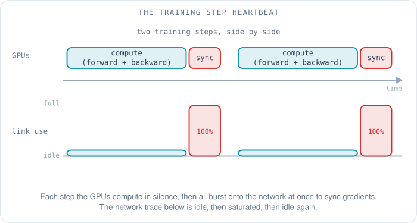
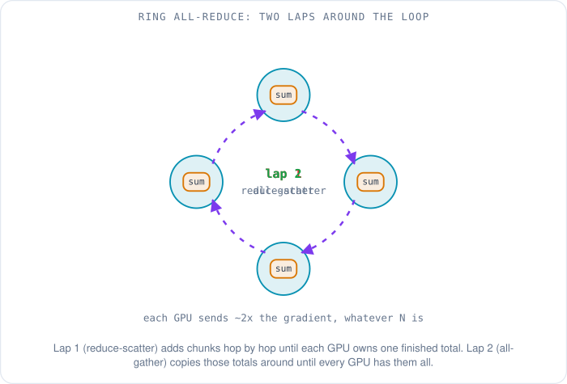
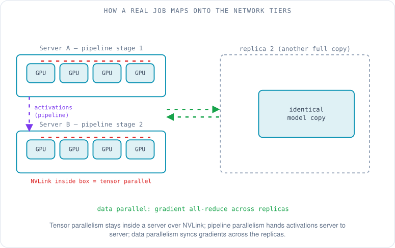
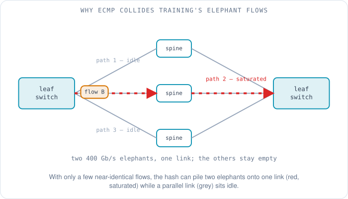
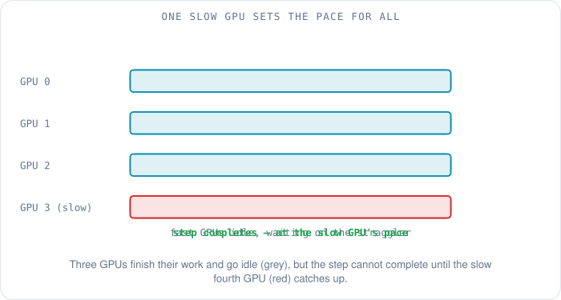

# The Heartbeat of a Training Cluster: How AI Traffic Moves

Picture a room with four thousand GPUs in it, and listen. For most of each training step, the room is silent — every GPU has its head down, grinding through arithmetic on its own slice of the problem, touching the network not at all. Then, all at once, the silence breaks: every GPU in the room starts talking to every other GPU, a sudden roar of traffic as they compare notes. Moments later the roar stops dead, and the room goes quiet again, back to grinding. Then it happens again. And again. This pattern — compute in silence, a synchronized burst of communication, silence again — repeats thousands of times a day, for weeks, without a pause.

That rhythm is the heartbeat of a training cluster, and if you understand it you understand almost everything about why AI networks look the way they do. This article is about what that traffic actually *is*: why the bursts happen, what shape they take on the wire, and why they break the assumptions that ordinary data-center networks were built on. The earlier articles in this series explained how to make the fabric lossless ([lossless Ethernet for RDMA](04-lossless-ethernet-for-rdma.md)) and how to wire thousands of GPUs together ([HPC topology](05-hpc-topology.md)). This one explains what you are actually carrying across all that expensive plumbing — and why it is the strangest traffic in the building.

## Why do the GPUs all talk at the same instant?

Start with the simplest way to split a training job across many GPUs, because it explains the heartbeat. It is called **data parallelism**: every GPU holds a complete copy of the model, and each one is handed a different batch of training examples. They all run the same two phases in lockstep. First the **forward pass** — feed the examples through the model and see what it predicts. Then the **backward pass** — measure how wrong the prediction was and compute, for every one of the model's billions of parameters, a **gradient**: the tiny nudge that would make this GPU's answer a little less wrong.

Here is the catch that creates the burst. Each GPU computed its gradients from its *own* batch, so every GPU disagrees slightly about which way each parameter should move. If they each just applied their own nudges, the four thousand copies of the model would drift apart and you would no longer be training one model — you would be training four thousand different ones. So before anyone takes a step, they have to agree. Every GPU has to end up holding the *average* of everybody's gradients. Only then do they all apply the same update, stay identical, and begin the next step together.

That agreement step is where the whole room talks at once. It is a **collective operation** — an exchange that every GPU in the group participates in together, as opposed to one machine sending to one other machine. The specific collective that averages gradients is called **all-reduce**: "reduce" because it combines everyone's values with an operation (here, a sum, which is then divided by the number of GPUs to get the average), and "all" because every GPU ends up with the result, not just one. Because the forward and backward passes finish at roughly the same time on every GPU, the all-reduce fires on every GPU at roughly the same instant. That is the burst. That is why the traffic is synchronized.

The silence matters as much as the burst. While the GPUs compute, the network sits idle; during the all-reduce, every link floods at once. A network engineer sizing this fabric cannot think in averages, the way they would for web traffic, because the average is a lie — it is a blend of "nothing" and "everything" that never actually occurs. The fabric has to be built for the peak, because the peak is the operating condition, on every single step.

## How do you average gradients without a traffic jam?

The obvious way to average everyone's gradients is to pick one GPU, have everyone send their gradients to it, let it add them up, and have it send the result back out. That is called a **parameter server**, and it was genuinely how early distributed training worked. It also falls apart at scale for a reason the previous articles in this series already set up: every other GPU sends to the same destination at the same instant, and all that traffic converges on one machine's links. Network engineers call that **incast** — many senders slamming one receiver — and it turns the central GPU into a bottleneck that only gets worse as you add workers.

The fix that took over the industry around 2017 is the **ring all-reduce**, an idea borrowed from the supercomputing world and brought to deep learning by Baidu's engineers [1]. Arrange the GPUs in a logical ring, so each one has a left neighbor it receives from and a right neighbor it sends to. Nobody ever sends to a central node; every GPU only ever talks to the next one around the loop. The clever part is doing it in two laps.

Split each GPU's gradient into as many chunks as there are GPUs. In the first lap — called **reduce-scatter** — the GPUs pass chunks around the ring, and at each hop every GPU adds the chunk it receives to its own matching chunk. After one full lap, the sums are complete but *scattered*: each GPU holds the finished total for exactly one chunk, and nobody holds the whole thing. The second lap — called **all-gather** — passes those finished chunks around the ring again, this time just copying rather than adding, until every GPU has collected every finished chunk. Two laps, and the whole room has the complete average, without any single link ever carrying more than its neighbor's share.

The reason the ring is worth this trouble is bandwidth, and the math is worth doing because it explains a design choice you will meet everywhere. Call the number of GPUs *N* and the size of the gradient *G*. In each lap a GPU sends *N*−1 chunks, and each chunk is *G*/*N* bytes, so each lap moves *G*·(*N*−1)/*N* bytes per GPU. Two laps make it **2(*N*−1)/*N* times the gradient size** that each GPU sends over the whole all-reduce [2], [3]. Look at what that fraction does as the cluster grows: 2(*N*−1)/*N* approaches 2 and stays there. Whether you have 8 GPUs or 8,000, each GPU moves roughly twice its gradient and no more. The per-GPU communication cost does not grow with the cluster. That is the property that lets training scale to thousands of GPUs at all — the bandwidth bill per GPU is flat.

The ring is not free of trouble, though, and the trouble is the other half of the story. The gradient has to travel the whole way around the ring, so the *number of hops* — and therefore the latency — grows with *N*. On a few thousand GPUs that latency term starts to dominate, which is why NVIDIA's collective library, **NCCL** (the NVIDIA Collective Communications Library, the software that actually runs these operations on real clusters), also has **tree** algorithms, where values combine up a tree and broadcast back down in a number of hops that grows with the logarithm of *N* rather than *N* itself [4]. Rings win on bandwidth; trees win on latency; NCCL picks between them based on how many GPUs and how big the message is. The point to carry forward is that even the "simple" case of averaging gradients is a real network-design problem with a real tradeoff in it.

## What happens when the model itself does not fit on one GPU?

Data parallelism assumes every GPU can hold a whole copy of the model. For today's large models that assumption breaks — a model with hundreds of billions of parameters, plus the optimizer state and activations that training needs alongside it, does not fit in a single GPU's memory. So the model gets split up too, and *how* you split it creates several more traffic patterns layered on top of the data-parallel heartbeat. There are three main ways to cut a model apart, and real jobs use all three at once.

The first is **tensor parallelism**: take a single layer and split its matrix multiply across several GPUs, so each one does part of the arithmetic for the same layer. The pieces have to be stitched back together before the next layer can run, which means an all-reduce — in the Megatron-LM design, two all-reduces in the forward pass and two more in the backward pass, *for every transformer layer* [5]. That is an enormous amount of communication, far more than the once-per-step gradient all-reduce, so tensor parallelism is only sane when the GPUs sharing a layer are connected by something extremely fast. In practice that means keeping them inside a single server, wired together by NVLink rather than the data-center fabric. Tensor parallelism is the reason the inside of an AI server is as densely interconnected as it is.

The second is **pipeline parallelism**: instead of splitting each layer, give different GPUs (or different servers) different *layers*. The first server runs the first chunk of layers, hands its output — the **activations** — to the second server, which runs the next chunk, and so on, the way an assembly line passes a car from station to station. The traffic here is modest and point-to-point: each stage sends activations only to the next stage. The cost is not bandwidth but idleness. When the pipeline first fills and when it drains, downstream stages have nothing to do yet and upstream stages have nothing left to do — gaps called **bubbles** where expensive GPUs sit waiting. Much of the cleverness in pipeline scheduling is about making those bubbles as small as possible.

The third attacks the memory problem from a different angle. **Sharded data parallelism** — the idea behind Microsoft's ZeRO and PyTorch's **FSDP** (Fully Sharded Data Parallel) — keeps the data-parallel setup but refuses to store a whole copy of the model on every GPU [6], [7]. Instead each GPU permanently holds only a *slice* of the parameters. Just before a layer runs, the GPUs all-gather the full set of weights for that layer, use them, then throw the gathered copy away to reclaim the memory. After the backward pass they reduce-scatter the gradients so each GPU ends up with the averaged gradient for only its own slice. It is the same two collectives as the ring all-reduce, but now they fire *per layer, every step*, as the price of not having to store the whole model anywhere.

There is a fourth pattern worth naming because it is becoming common and its traffic is unlike the others. A **Mixture-of-Experts** (MoE) model does not run every input through the whole network; it has many "expert" sub-networks and routes each token to just a couple of them. When the experts live on different GPUs — **expert parallelism** — every token has to be shipped to wherever its chosen experts are, and the results shipped back. Because any token can go to any expert, the result is an **all-to-all**: every GPU splits its tokens into pieces and sends each piece to a different GPU, all at once [8]. All-to-all is the most demanding pattern on the fabric, because unlike the ring it genuinely does load every path between every pair of GPUs.

The thing to hold onto is that a real training job is not one of these — it is all of them composed. Tensor parallelism inside each server over NVLink, pipeline parallelism across a handful of servers, data or sharded-data parallelism across the replicas [9], and maybe expert parallelism on top. Each layer of parallelism maps onto a different tier of the network, from the NVLink inside a box to the leaf-and-spine fabric between racks, and each generates its own kind of traffic. The network has to serve all of them at once.

## Why is this traffic so hard on the network?

Step back from the collectives and look at the shape of what is actually flowing, because it violates nearly every assumption a traditional data-center network makes. Ordinary data centers carry a vast number of small, short, varied connections — millions of web requests, each a few kilobytes, each to a different place. AI training carries the opposite: a *small number* of *enormous*, *long-lived* flows. When one GPU streams gradients to its ring neighbor, that is one connection moving gigabytes, running flat out at the link's full rate — 400 gigabits a second on a modern NIC — for as long as the burst lasts. Network engineers call these **elephant flows**, and training traffic is almost nothing but elephants.

That sounds like it should be easy — few flows, so surely easy to place? — and it is exactly backwards. Data-center fabrics spread traffic across their many parallel paths using **ECMP** (Equal-Cost Multi-Path), which hashes each flow's headers (source and destination addresses and ports) to pick one of the available paths. ECMP relies on having *lots* of flows with *varied* headers, so that the hashing spreads them evenly by the law of large numbers. Training traffic gives it neither. There are only a handful of flows, and because they all come from the same small set of GPUs doing the same collective, their headers barely vary. With so few flows to hash, ECMP can easily assign two elephants to the same physical link — saturating it — while another link sits completely idle. Alibaba, describing the network it built for large-model training, named this directly: LLM training produces a small number of periodic, bursty 400 Gb/s flows, and this "predisposes ECMP to hash polarization, causing issues such as uneven traffic distribution" [10]. The traffic is hard precisely *because* it is so uniform.

Two more properties make it harder still. The traffic is **symmetric**: in a collective, every GPU sends about as much as it receives, so every link is busy in both directions at once. There is none of the download-heavy asymmetry of consumer traffic that lets you size uplinks smaller than downlinks. And the traffic is **bursty and synchronized** in the way the opening of this article described — the whole fabric goes from idle to saturated in microseconds when the all-reduce fires. A network tuned for the smooth statistical average of web traffic has no idea what to do with a load that is either zero or a hundred percent and nothing in between.

## Why can one slow GPU stall thousands of others?

Now add the cruelest property of all, and it follows directly from the synchronization. A training step is not finished until the all-reduce is finished, and the all-reduce is not finished until the *slowest* participant has done its part. Every GPU waits for the last one. This is the **straggler** problem: if a single GPU runs slow, or a single optic is marginal, or one link keeps flapping and forcing retransmissions, that one weak component sets the pace for the entire cluster. The other thousands of GPUs finish their work and then sit idle, burning power and money, waiting on the laggard. The job runs at the speed of its worst link, not its average link.

This is why reliability and tail latency matter so much more here than in ordinary networking, and the numbers from real runs are sobering. When Meta trained Llama 3 — its 405-billion-parameter model — on a cluster of 16,384 H100 GPUs over 54 days, the run hit 466 interruptions, of which 419 were unexpected; 78% of the unexpected ones were traced to hardware, with GPUs and their memory the single largest cause [11]. That is an unplanned interruption roughly every three hours, on one of the most carefully engineered clusters in existence. At that scale a component failing is not an exception to plan around — it is a constant, and the fabric and the software stack have to assume that at any moment some GPU is the straggler and some link is misbehaving. The reason the team still kept over 90% of their time doing useful training was relentless engineering against exactly this failure mode [11].

## Where does the rest of the traffic come from?

Not everything on an AI network is collectives. Because interruptions are constant, training jobs **checkpoint** — periodically they write the entire model state to storage, so that after a failure they can resume from the last checkpoint instead of starting over. A checkpoint is not just the parameters; it includes the optimizer state, which for a common optimizer is a couple of extra values per parameter. The arithmetic is worth doing with assumptions stated plainly. Take a 70-billion-parameter model. Store each parameter in two bytes (the `bf16` format typically used in training), and that is 140 GB for the weights alone. Add optimizer state — often a 32-bit copy of the weights plus two more 32-bit values per parameter, which is another 12 bytes per parameter, or about 840 GB. The checkpoint is on the order of a terabyte, written every so often throughout the run.

That traffic looks nothing like a collective. It is a bulk transfer to a storage system, it tolerates a little delay, and it does not need the whole cluster synchronized. For that reason it usually runs on a *separate* network — a conventional "front-end" fabric for storage and management — kept off the specialized "back-end" fabric that carries the collectives, so a slow checkpoint write can never get in the way of a gradient all-reduce. One cluster, two networks, carrying two completely different kinds of traffic.

## Putting a number on the heartbeat

To make the whole picture concrete, walk one all-reduce through with real arithmetic and stated assumptions. Take that 70-billion-parameter model and, to keep the arithmetic simple, pretend every GPU holds a full copy and syncs its whole gradient with plain data parallelism, in `bf16` (two bytes per value). Real jobs split this work across the parallelism schemes above, but the sketch shows the scale of the problem. The gradient is 70 billion × 2 bytes = 140 GB. From the ring all-reduce math above, each GPU sends about twice that over the course of one all-reduce — call it 280 GB on the wire per GPU, independent of how many GPUs there are. On a 400 Gb/s NIC, which moves 50 gigabytes per second, pushing 280 GB takes on the order of 5.6 seconds if the link runs perfectly flat out and nothing else interferes.

That number should alarm you, because a training step's *compute* can be far shorter than 5.6 seconds — which would mean the GPUs spend most of each step waiting on the network, exactly the bottleneck this whole series exists to explain. The escape is a technique the frameworks lean on heavily: **overlapping communication with computation**. The gradients for the last layers of the model are ready first, as soon as the backward pass reaches them, so their all-reduce can start *while* the backward pass is still working on the earlier layers. Done well, most of the communication hides underneath compute that was going to happen anyway, and the step time is set by whichever of the two is longer rather than their sum. The real figures depend on model, framework and fabric — this is an order-of-magnitude sketch to show why that overlap is not a nice-to-have but the thing standing between you and a cluster that is idle most of the time.

## What the traffic looks like, in one table

| Traffic | Pattern | Shape | Where it lives |
|---|---|---|---|
| Gradient sync (data parallel) | all-reduce (ring or tree) | synchronized burst, every step | back-end fabric |
| Tensor parallelism | all-reduce, several per layer | constant, very high volume | inside the server, over NVLink |
| Pipeline parallelism | point-to-point activations | modest, stage to stage | back-end fabric |
| Sharded data (ZeRO/FSDP) | all-gather + reduce-scatter per layer | synchronized, per layer | back-end fabric |
| Mixture-of-Experts | all-to-all | heaviest, every path loaded | back-end fabric |
| Checkpoints | bulk write to storage | large, delay-tolerant | separate front-end fabric |

Every row is an elephant except the activations, every back-end row is synchronized, and every one of them is waiting on its slowest participant. That is the traffic the lossless fabric and the full-bisection topology from the earlier articles were built to carry — and now you can see why those designs had to be as uncompromising as they are.

So the heartbeat we started with is really many rhythms at once: a per-step gradient all-reduce beating across the replicas, a furious per-layer pulse of tensor-parallel all-reduces inside each server, activations trickling down the pipeline, and the occasional terabyte-sized thud of a checkpoint on a network of its own. All of it is in service of one goal — keep thousands of GPUs moving in lockstep so none of them has to wait.

Everything so far has been about *building* a model: thousands of GPUs grinding for weeks to turn trillions of words into a set of weights. But the model is only interesting once someone uses it. [What happens when you ask a chatbot a question](07-what-happens-when-you-ask-a-chatbot.md) follows a single question from a keyboard to the GPUs and back, and [inside inference](09-inside-inference.md) takes apart the very different traffic that serving a trained model creates. The room full of GPUs is about to stop training and start answering.

## References

1. *Bringing HPC Techniques to Deep Learning* (ring all-reduce for deep learning). Andrew Gibiansky, 2017. https://www.gibiansky.com/blog/machine-learning/baidu-allreduce/index.html
2. *nccl-tests: Performance* (algorithm bandwidth and the 2(N-1)/N bus-bandwidth factor for ring all-reduce). NVIDIA. https://github.com/NVIDIA/nccl-tests/blob/master/doc/PERFORMANCE.md
3. *Communication-Efficient Distributed Training via Ring-Based Coded Approximate All-Reduce* (normalized per-worker communication 2(N-1)/N). arXiv:2609.23898. https://arxiv.org/abs/2609.23898
4. *Massively Scale Your Deep Learning Training with NCCL 2.4* (rings achieve full bandwidth but latency scales linearly with N; trees scale logarithmically). NVIDIA Developer Blog, 2019. https://developer.nvidia.com/blog/massively-scale-deep-learning-training-nccl-2-4/
5. Shoeybi, M. et al. *Megatron-LM: Training Multi-Billion Parameter Language Models Using Model Parallelism* (tensor parallelism; all-reduces per transformer layer). arXiv:1909.08053, 2019. https://arxiv.org/abs/1909.08053
6. Rajbhandari, S. et al. *ZeRO: Memory Optimizations Toward Training Trillion Parameter Models* (sharded parameters, optimizer and gradients). arXiv:1910.02054, 2020. https://arxiv.org/abs/1910.02054
7. *Getting Started with Fully Sharded Data Parallel (FSDP)* (all-gather weights before use, reduce-scatter gradients after). PyTorch documentation. https://docs.pytorch.org/tutorials/intermediate/FSDP_tutorial.html
8. Lepikhin, D. et al. *GShard: Scaling Giant Models with Conditional Computation and Automatic Sharding* (the AllToAll operator that dispatches tokens to experts). arXiv:2006.16668, 2020. https://arxiv.org/abs/2006.16668
9. Narayanan, D. et al. *Efficient Large-Scale Language Model Training on GPU Clusters Using Megatron-LM* (composing tensor, pipeline and data parallelism at scale). arXiv:2104.04473, 2021. https://arxiv.org/abs/2104.04473
10. Qian, K. et al. *Alibaba HPN: A Data Center Network for Large Language Model Training* (few periodic bursty 400 Gb/s flows; ECMP hash polarization). ACM SIGCOMM 2024. https://dl.acm.org/doi/10.1145/3651890.3672265
11. *The Llama 3 Herd of Models* (16,384 H100 GPUs, 54 days, 466 interruptions, hardware as leading cause, >90% effective training time). Meta AI, arXiv:2407.21783, 2024. https://arxiv.org/abs/2407.21783
