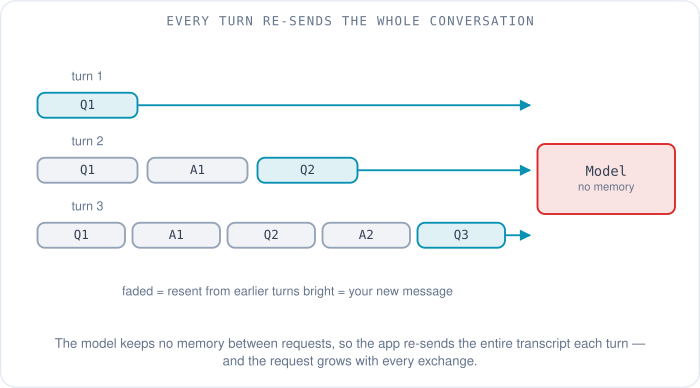
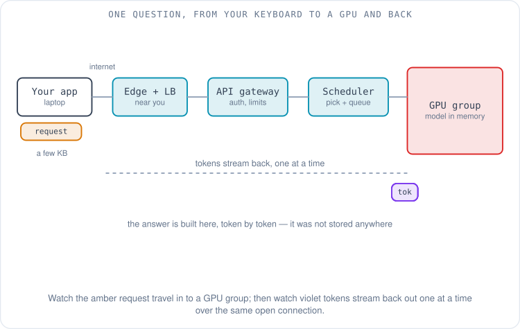
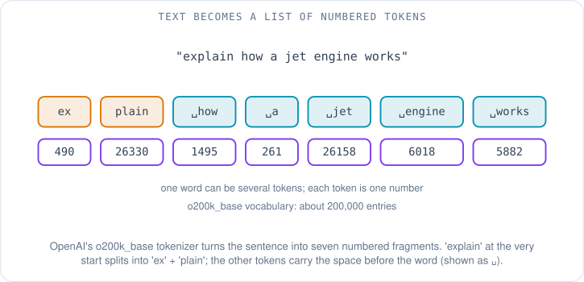
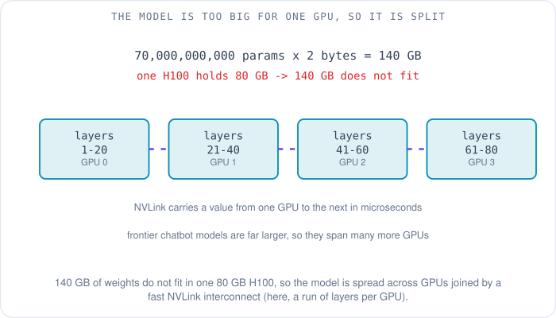
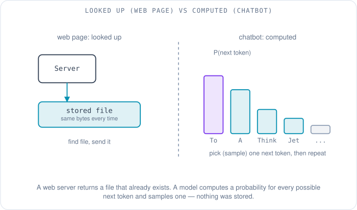
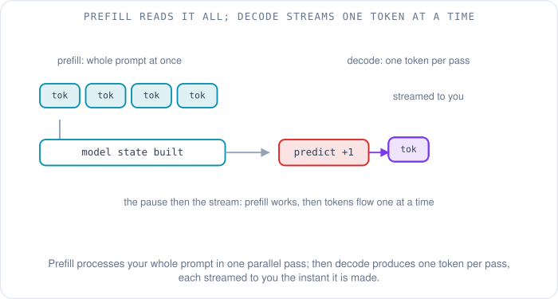

# What Happens When You Ask a Chatbot a Question

You type a question into a chatbot — "explain how a jet engine works, like I'm twelve" — and press Enter. A few hundred milliseconds later words begin to appear, one small burst at a time, as if someone on the other end were typing a reply they already had in mind. It is a convincing illusion, and it hides one of the largest machines humanity has ever assembled.

This article follows that question from your keyboard to a graphics processor in a data center and back, the same way an [earlier article](../fundamentals/09-when-you-type-a-url.md) followed the request you make when you type a URL into a browser. That walk is worth keeping in mind as a contrast, because the two journeys start out identical and then diverge at the one step that matters most. When you load a web page, the server finds a file that already exists and sends it to you. When you ask a chatbot a question, there is no file. The answer does not exist anywhere until the moment you ask — it is *computed*, token by token, by a model doing arithmetic on billions of numbers. Everything strange about chatbots follows from that single difference, and by the end you will know exactly where the answer comes from, where the model lives, and what is and is not stored.

Keep one question in your head the whole way: **where does the answer actually come from — is it looked up, or is it made?**

## The part that is exactly like loading a web page

Press Enter and, for the first few steps, nothing is special about AI at all. The chatbot app — a browser tab or a phone app — gathers your message and packages it as an **HTTPS request**, the same encrypted web request a browser makes for any secure site. To send it, your device first needs the numeric address of the provider's servers, so it does a **DNS** lookup (the internet's phone book, turning `api.openai.com` or `api.anthropic.com` into an IP address), opens a **TCP** connection (the handshake that establishes a reliable byte stream), and wraps that connection in **TLS** (the encryption layer that makes it HTTPS). All three are explained step by step in the [URL walkthrough](../fundamentals/09-when-you-type-a-url.md#step-3-dns-resolution); nothing about them changes for a chatbot.

There is one difference in *what* gets packaged, and it is important. The model has no memory of your previous messages — none at all. Each request to the provider is answered by a server that has never seen you before and will forget you the instant it is done. So the app cannot just send your new question; it has to send the **entire conversation so far** — your first message, the model's reply, your follow-up, and now this one — as a list of messages in a block of **JSON** (a simple text format of labelled fields that APIs use to exchange structured data). The illusion that the chatbot "remembers" the conversation is maintained entirely by your app re-sending the whole transcript every single turn. We will come back to what that costs.

So your question — a few kilobytes of JSON — crosses the public internet inside an encrypted connection and arrives at the provider's front door.

## The front door: edge, gateway, and safety checks

Your request does not land directly on a graphics processor. It arrives first at the provider's **edge network** — a global layer of servers, often fronted by a content delivery network, whose job is to accept your connection as close to you geographically as possible and carry it over the provider's own fast backbone the rest of the way. The same idea serves ordinary websites: terminate the connection near the user, then take the fast internal road.

From the edge, the request reaches an **API gateway**, the reception desk of the whole system. The gateway authenticates the request (checking the API key or session token that proves who is paying for this call), enforces **rate limits** (so one user cannot flood the service), and routes the request onward. Somewhere around here the provider also runs **safety checks** — automated classifiers that screen the incoming text, and later the outgoing text, for content the provider has decided not to produce. If a request trips one of those checks it can be refused here, before any expensive computation happens.

Only once a request clears the front desk does it enter the part of the building that costs real money.

## Finding a free GPU: the scheduler and the queue

Inside the data center sit thousands of **GPUs** — graphics processors, the chips originally built to draw video-game frames that turned out to be ideal for the massively parallel arithmetic a neural network needs. (The [first article in this series](00-the-network-was-the-bottleneck.md) tells the story of how a gaming chip became the engine of AI.) A single model is served by a *group* of these GPUs working together, and a large provider runs many such groups across many data centers.

A **scheduler** decides which group handles your request. It is trying to solve a hard packing problem in real time: send your request to a group that already has the right model loaded, that is near you, and that has spare capacity this instant. When every suitable group is busy — and at peak times they are — your request waits in a **queue**. That queue is a large part of why a chatbot sometimes answers instantly and sometimes makes you wait, and why providers show "at capacity" messages when demand spikes. There is no equivalent step when you load a web page: a static file can be served by any of a thousand interchangeable web servers, but your request has to reach a GPU group holding this specific multi-hundred-gigabyte model.

The diagram above is the whole trip in one picture — hold onto it; the rest of the article zooms into its boxes.

## Turning your words into numbers: tokenization

A neural network does not operate on letters. Before the model can do anything, your text is run through a **tokenizer**, which chops it into **tokens** — chunks of text, each mapped to a number from a fixed vocabulary. Vocabularies run to hundreds of thousands of entries; `o200k_base`, one of the vocabularies shipped with OpenAI's open-source tokenizer library, has about 200,000 [1]. A token is usually not a whole word and not a single letter; it is a frequent *fragment*. Common words are one token each, but rarer words get split along fragments the vocabulary has seen often. OpenAI's tokenizer documentation explains the idea with *encoding*, which a byte-pair tokenizer may split into `encod` and `ing`, because `ing` is such a common ending that it earns its own entry [1]. Today's large vocabularies keep *encoding* whole, but the same splitting still happens to rarer words and to words in unusual positions.

So "explain how a jet engine works" does not enter the model as a sentence. Run through `o200k_base`, it becomes seven integers, `[490, 26330, 1495, 261, 26158, 6018, 5882]`, standing for `ex`, `plain`, ` how`, ` a`, ` jet`, ` engine` and ` works`. Two details are worth noticing. Most tokens carry the space in front of the word, and *explain* at the very start of the text, with no space before it, splits into two fragments, while ` explain` in the middle of a sentence is a single token. Everything the model does from here is arithmetic on numbers like these. The reverse happens on the way out: the numbers the model produces are turned back into text fragments and stitched into the words you read.

This matters for more than trivia. It is why models sometimes miscount the letters in a word (they never saw the letters, only the fragment-number), and it is the unit providers bill by and measure context limits in — "128,000 tokens of context" means roughly 96,000 English words of conversation the model can take in at once, using OpenAI's rule of thumb that a token is about three-quarters of a word [2].

## The model is a file of numbers

Here is the thing that surprises people most. The "model" — GPT, Claude, Gemini, Llama, Nova, any of them — is, physically, a gigantic file of numbers called **weights** (also called **parameters**). These are the numbers the model learned during training, and they are frozen: serving your request does not change them. A model's size is quoted as a parameter count — "a 70-billion-parameter model" literally means a file holding 70 billion numbers.

Those numbers have to be loaded into the GPU's own memory to be used, and this is where simple arithmetic tells the whole story. Each parameter is commonly stored in **two bytes** (a compact 16-bit number) [3]. So a 70-billion-parameter model needs:

> 70,000,000,000 parameters × 2 bytes = 140,000,000,000 bytes ≈ **140 GB** just to hold the weights.

An NVIDIA H100, the workhorse data-center GPU of the last few years, holds 80 GB of memory [4]. 140 GB does not fit in 80 GB. Newer GPUs hold more, but the largest models outgrow them too, so the model is **split across multiple GPUs**. One way is to give each GPU a run of whole layers, as in the diagram below; another, more common inside a single server, is to give every GPU a slice of every layer. Either way, the GPUs are wired together with a very fast interconnect (NVIDIA calls theirs **NVLink**) so that a value computed on one can be handed to the next in microseconds [4]. The frontier models that power the big chatbots are far larger than 70 billion parameters, so they are split across many GPUs in a server, sometimes across several servers. This is the physical reason an AI data center looks the way it does, and the reason the [network between the GPUs](06-ai-ml-traffic-patterns.md) is such a central concern for the rest of this series.

## The answer is computed, not looked up

Now the heart of it. With your tokens as input and the weights loaded, the model does one specific thing: it computes, for every one of the ~100,000 tokens in its vocabulary, a probability that this token is the one that should come *next*. Not the answer — just the single next token. The output is a probability distribution: maybe `To` at 24%, `A` at 18%, `Think` at 9%, and a long tail of less likely options.

The server then **samples** one token from that distribution, appends it to the sequence, and feeds the whole thing back in to predict the token after that. Then again, and again, one token per pass, until the model produces a special "stop" token. The reply you read is that chain of individually-predicted tokens. There was never a stored answer; there was a sequence of ~100,000-way guesses, each one shaped by the billions of weights and by every token that came before it. This is the exact mechanism — predict the next token, append, repeat — that the [opening article](00-the-network-was-the-bottleneck.md) describes as the quiet trick behind generative AI.

This single fact resolves the question we started with, and explains the chatbot's two most-noticed quirks:

- **Ask the same question twice and you get differently-worded answers.** Because a token is *sampled* from a distribution rather than always taking the single most likely one, two runs take slightly different paths. A web server returning the same file twice gives you byte-for-byte the same bytes; a model answering twice rolls the dice again.
- **"Where are the answers stored?"** They are not. What is stored are the weights — and the weights hold *patterns* distilled from the training data, not the data itself. During training the model saw an enormous amount of text and adjusted its billions of numbers until it got good at predicting what comes next; the knowledge is compressed into those numbers as statistical regularities, not filed away as retrievable facts. (How that training differs between model families is the subject of the [next article](08-why-so-many-ai-models.md).) Asking a model a question is not a database query. It is closer to asking a person who read a library years ago and kept the understanding but not the pages.

There are two real exceptions worth naming so the picture is honest, because both are easy to mistake for "stored answers":

- **Prompt caching** reuses the *processed form* of text the model has already read — if a long document or system prompt reappears unchanged across requests, the provider can skip re-processing it and save time [5]. It caches the model's intermediate work, not finished answers.
- **Tools and retrieval**: many chatbots can call a web search, open a link, or look something up in a document store, then feed what they find back into the prompt as extra context. When a chatbot cites a fresh news article, it did not "know" it — a tool fetched it and the model read it as input. That fetched text is genuinely looked up; the reply built around it is still generated token by token.

## Prefill and decode: why the words appear gradually

The generation step actually runs in two phases, and the split explains the rhythm you see on screen. First, **prefill**: the model reads your entire prompt — the whole conversation you sent — in one parallel pass, building up its internal state. This is compute-heavy but fast, because the whole input is processed at once [6]. Then **decode**: the model generates the reply one token per pass, each pass depending on all the tokens before it, so decode is inherently sequential [7].

That is why there is a short pause after you hit Enter (prefill working through your prompt) and then a steady stream of words (decode producing one token at a time). The connection you opened stays open, and each token is pushed to you the instant it is made, using **server-sent events** — a web mechanism for a server to stream a sequence of updates over one long-lived HTTP connection. The words appear gradually because they are *made* gradually; the streaming is just honest about it. This article stays at the surface of inference on purpose — the [final article in the series](09-inside-inference.md) opens up prefill, decode, and the memory tricks that make them fast.

## Where does all this physically live?

So where, as of October 2026, does a company actually run its model and keep its data? In large data centers full of GPU and AI-accelerator servers, either owned by the AI company or — more often — rented from cloud providers, frequently both at once. The arrangements are matters of public record, and the pattern across providers is more informative than any single deal:

- **Anthropic** states that it trains and runs Claude across three kinds of hardware — AWS Trainium, Google TPUs, and NVIDIA GPUs — matching each workload to the chips that suit it, with AWS as its primary cloud and training partner; Claude is offered to customers through AWS Bedrock, Google Cloud's Vertex AI, and Microsoft Azure's Foundry [8].
- **OpenAI** has long run on Microsoft Azure, and in October 2025 it contracted to buy another $250 billion of Azure services, while Microsoft gave up its right of first refusal to be OpenAI's compute provider [9]. Through its **Stargate** project with Oracle and SoftBank it is also building dedicated data-center capacity in the United States [10], and in 2026 it has been renting more AI servers from cloud providers rather than building all of that capacity itself [11].
- **Google** trains and serves Gemini on its own **TPUs** (Tensor Processing Units, chips Google designs for neural-network math) in its own infrastructure [12], and describes them as the hardware behind Gemini "from massive-scale training to high-throughput, low-latency inference" [13].
- **Meta** builds its own GPU clusters, such as the two 24,576-GPU clusters it described in 2024 for training Llama 3 [14].

Two things stand out. First, no major provider depends on a single building or a single chip vendor; capacity is spread across many sites and several kinds of accelerator, because demand is enormous and no one supplier can meet it. Second — and this is the honest limit of what can be said — the internals of the biggest models (exact parameter counts, precise architectures) are generally **not disclosed** for the leading closed models. Where you see confident numbers for those, treat them as estimates, not facts.

As for what is stored where: the **model weights** sit on fast storage in the data center and are loaded into GPU memory to serve requests; your **conversation history** — the transcript your app keeps re-sending — lives in the service's own databases, governed by its retention and privacy policy; and short-lived **caches** (like the prompt cache above) hold intermediate work for minutes, not forever. The answer the model gave you was never stored as an answer at all; if you want it again, the model generates it again.

## The two networks your question touches

Step back and look at the traffic. Your question is tiny — a few kilobytes crossing the public internet, no different in size from loading a modest web page. But inside the data center, two very different networks go to work. A **front-end network** carries your request from the edge through the gateway and scheduler to the right GPU group — ordinary data-center networking, the kind that serves any web service. And a **back-end GPU network** connects the GPUs that hold the model to each other: because the model is split across GPUs, producing *every single token* requires those GPUs to exchange intermediate results, which is why that back-end fabric is built for enormous, synchronized, low-latency bursts. That back-end network — its [traffic patterns](06-ai-ml-traffic-patterns.md) and its [topology](05-hpc-topology.md) — is the subject this whole series circles around, and it is doing its heaviest work in the milliseconds between you pressing Enter and the first word appearing.

## The whole journey, in order

To mirror the layered recap of the [URL article](../fundamentals/09-when-you-type-a-url.md), here is the chatbot request end to end:

| Step | What happens | Like a web page? |
|---|---|---|
| **Package** | App bundles the whole conversation as JSON (the model remembers nothing) | Mostly — but it re-sends the full transcript every turn |
| **DNS + TCP + TLS** | Resolve the provider's address, open a connection, encrypt it | Identical |
| **Edge + gateway** | Terminate near you; authenticate, rate-limit, safety-check | Similar to any API behind a CDN |
| **Schedule** | Pick a GPU group holding this model; maybe queue | New — static files need no such step |
| **Tokenize** | Text becomes a list of vocabulary numbers | New |
| **Load weights** | The model file (billions of numbers) sits in GPU memory, split across GPUs | New |
| **Prefill** | Read the whole prompt in one parallel pass | New |
| **Decode** | Predict one token, sample, append, repeat until "stop" | New — the answer is computed, not fetched |
| **Stream** | Each token pushed back over the open connection as it is made | Partly — streaming exists on the web, but here it is one token at a time |
| **Store** | Weights on storage; conversation in a database; caches briefly | The answer itself is not stored |

The web-page journey ends when the server finds your file and sends it. The chatbot journey has no file to find — which is why the interesting half of the trip happens *after* the request arrives, inside a machine of thousands of GPUs, computing an answer that did not exist a moment ago.

That raises an obvious next question. If every chatbot runs on the same basic recipe — tokens in, weights, next-token prediction, tokens out — why are there so many different models, and why do GPT, Claude, Gemini, Llama and Nova behave so differently? That is where [the next article](08-why-so-many-ai-models.md) goes.

## References

1. *tiktoken* (OpenAI's open-source byte-pair-encoding tokenizer; the "encod" + "ing" example; the o200k_base vocabulary). OpenAI, GitHub. https://github.com/openai/tiktoken/blob/main/README.md
2. *What are tokens and how to count them?* (a token is about three-quarters of an English word). OpenAI Help Center. https://help.openai.com/en/articles/4936856-what-are-tokens-and-how-to-count-them
3. *Prefill vs. decode in LLM inference* (weights commonly stored at two bytes per parameter). Parasail, 2026. https://www.parasail.io/blog/prefill-vs-decode-llm-inference
4. *NVIDIA H100 Tensor Core GPU Datasheet* (80 GB of GPU memory per device; NVLink interconnect between GPUs). NVIDIA. https://resources.nvidia.com/en-us-tensor-core/nvidia-tensor-core-gpu-datasheet
5. *Prompt caching* (reuse of the processed form of repeated prompt text to reduce latency and cost). Anthropic API documentation. https://docs.anthropic.com/en/docs/build-with-claude/prompt-caching
6. *Arrow: Adaptive Scheduling Mechanisms for Disaggregated LLM Inference* (prefill reads the prompt; decode generates tokens autoregressively, one per iteration). arXiv:2505.11916. https://arxiv.org/html/2505.11916
7. *Efficient LLM Inference by Piggybacking Decodes with Chunked Prefills* (two distinct phases: compute-bound prefill, memory-bound sequential decode). arXiv:2308.16369. https://arxiv.org/html/2308.16369v1
8. *Anthropic expands partnership with Google and Broadcom for multiple gigawatts of next-generation compute* (Claude trained and run on AWS Trainium, Google TPUs and NVIDIA GPUs; AWS the primary cloud and training partner; offered via AWS Bedrock, Google Vertex AI, Azure Foundry). Anthropic, April 6, 2026. https://www.anthropic.com/news/google-broadcom-partnership-compute
9. *The next chapter of the Microsoft–OpenAI partnership* (OpenAI contracts an incremental $250B of Azure services; no right of first refusal on compute). Microsoft, October 28, 2025. https://blogs.microsoft.com/blog/2025/10/28/the-next-chapter-of-the-microsoft-openai-partnership/
10. *Stargate advances with 4.5 GW partnership with Oracle* (OpenAI's dedicated US data-center buildout with Oracle and SoftBank). OpenAI, 2025. https://openai.com/index/stargate-advances-with-partnership-with-oracle/
11. *OpenAI reorganizes leadership amid data center strategy readjustment* (OpenAI renting more AI servers from cloud providers instead of building all its capacity). DatacenterDynamics, March 18, 2026. https://www.datacenterdynamics.com/en/news/openai-reorganizes-leadership-amid-data-center-strategy-readjustment/
12. *Everything to know about Gemini, Google's new AI model* ("We trained Gemini at scale on our AI-optimized infrastructure using Google's Tensor Processing Units"). Google, December 2023. https://blog.google/innovation-and-ai/technology/ai/gemini-collection/
13. *Inside the Ironwood TPU codesigned AI stack* (TPUs as the hardware behind Gemini for training and inference). Google Cloud, November 2025. https://cloud.google.com/blog/products/compute/inside-the-ironwood-tpu-codesigned-ai-stack
14. *Building Meta's GenAI Infrastructure* (two 24,576-GPU clusters used for Llama 3). Meta Engineering, March 2024. https://engineering.fb.com/2024/03/12/data-center-engineering/building-metas-genai-infrastructure/
