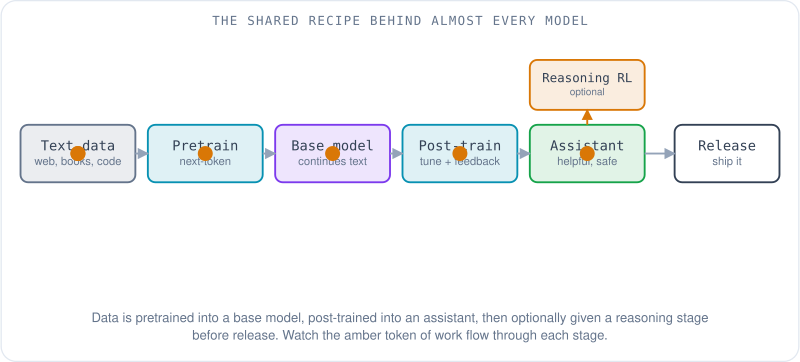
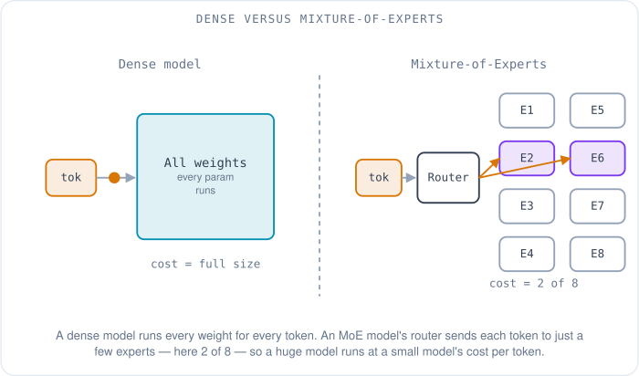
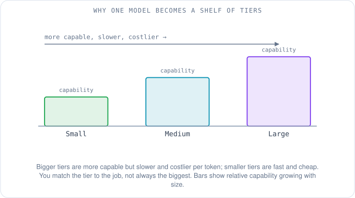
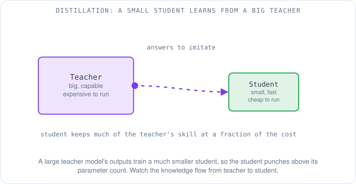

# Why There Are So Many AI Models

You open a chat app to ask a question and the first thing it wants is a decision you did not come to make. A dropdown: a fast one, a smart one, a "thinking" one, a cheap one, a dated one, a "mini" one. Across the industry it is the same picture — OpenAI lists GPT models in several sizes and reasoning levels, Anthropic lists a range of Claude models, Google lists Gemini models, Meta publishes Llama, Amazon publishes Nova, and a dozen open-weight labs publish their own. The names change every few months. A reasonable person stares at the list and asks the honest question: *why are there so many, and how are they actually different?*

The reassuring part is that underneath the names, almost all of these models are built from the **same recipe**. They differ because of the choices each lab makes at a handful of specific forks in that recipe — how big, trained on what, tuned how, run where. Once you can see the forks, the dropdown stops being a wall of marketing words and becomes a short list of real engineering tradeoffs. This article walks the recipe, points out every fork, and then explains why a single company ends up shipping a whole shelf of models rather than one.

A note before we start: this is a tour of how the models are built, not a ranking. There is no "best model" here, and no favorites. The useful question is never "which model is best" but "best for *what*" — and that answer falls out of the forks once you understand them.

## The recipe almost everyone follows

Start with what is shared, because it is most of the story. Nearly every model in that dropdown is a **Transformer** — the architecture from the 2017 paper *Attention Is All You Need*, the one that let a model process a whole sequence of text in parallel instead of word by word. We spent a whole article on why that mattered, so here it is in one line: the Transformer is what made it possible to train a language model across thousands of GPUs at once, and [the first article in this series](00-the-network-was-the-bottleneck.md) tells that story in full. Take it as given from here.

The Transformer is the engine. The recipe is what you do with it, and it has two big stages.

The first stage is **pretraining**. You take an enormous pile of text — much of the public internet, books, code — and you train the model on one deceptively simple task, over and over: *predict the next token*. A **token** is a chunk of text, roughly a word or part of a word; a sentence is a few dozen tokens. Show the model the start of a sentence, let it guess the next token, tell it how wrong it was, and nudge its billions of internal numbers a hair in the right direction. Do that trillions of times and you get a **base model**: something that is startlingly good at continuing text, because continuing text well requires absorbing grammar, facts, reasoning patterns, and the shape of code. But a base model is not yet an assistant. Ask it a question and it might answer, or it might write three more questions, because all it has ever been rewarded for is plausible continuation. It has knowledge but no manners.

The second stage, **post-training**, is where a base model is turned into something that behaves like a helpful assistant — and it is the first place the labs genuinely diverge. The usual first step is **instruction tuning** (also called supervised fine-tuning): you show the model thousands of examples of a request paired with a good response, so it learns the *format* of being helpful — answer the question, follow the instruction, stop when done. Then comes a feedback step that teaches the model which answers people actually prefer, and here the field has invented several recipes:

- **RLHF** (Reinforcement Learning from Human Feedback), the method OpenAI described in its 2022 InstructGPT paper. People rank the model's answers, those rankings train a separate "reward model," and the main model is then tuned to produce answers the reward model scores highly. The striking result in that paper: a 1.3-billion-parameter model tuned this way was preferred by human raters over the original 175-billion-parameter model that was 100 times larger [1]. Alignment, not raw size, made it useful.
- **Constitutional AI**, Anthropic's variant, replaces most of the human labeling with the model critiquing and revising its own answers against a written list of principles — a "constitution" — so the feedback comes from AI judging AI against stated rules [2].
- **DPO** (Direct Preference Optimization), a 2023 method used in Meta's Llama post-training, reaches a similar end without the separate reward model and the reinforcement-learning machinery — it tunes the model directly on the "this answer was preferred over that one" pairs, which is simpler and cheaper to run [3].

These are not competing religions; a given model often uses a mix. The point is that *the same base model, post-trained differently, becomes a noticeably different assistant* — more cautious or more direct, more verbose or more terse, more willing to refuse. The personality you feel when you chat is mostly made here, not during pretraining.

There is one more optional stage that explains the "thinking" option in the dropdown. A **reasoning model** gets an extra round of reinforcement learning that rewards it for working a problem out step by step — producing a long internal **chain of thought** before it commits to an answer. OpenAI's o1, announced in September 2024, was "trained with reinforcement learning to perform complex reasoning" and "thinks before it answers" [4]. DeepSeek then showed, in a paper later published in *Nature*, that this reasoning behavior can be induced through reinforcement learning alone, without hand-written reasoning examples to copy [5]. A reasoning model is not a different species — it is the same recipe with one more RL stage bolted on, and it trades latency and cost (it generates a lot of hidden thinking tokens) for accuracy on hard math, code, and logic.

That is the whole recipe: data in, pretrain to a base model, post-train into an assistant, optionally add a reasoning stage, release. Every model in the dropdown walked this path. They differ because of the choices made at each step — so let us look at the forks.

## Where the labs make different choices

The recipe is shared; the knobs are not. A handful of decisions, each made differently by each lab, account for nearly all the visible difference between models.

**Training data and its cutoff.** Everyone trains on a large text corpus, but *which* text, in which languages, with how much code and math, and filtered how — those are closely held choices that shape what a model is good at. Every model also has a **knowledge cutoff**: the date after which it simply has not read anything. Ask about an event the week after the cutoff and the model has no idea, which is why "as of my last update..." happens and why models are paired with web search to patch the gap.

**Size.** Models come in different numbers of **parameters** — the internal numbers adjusted during training. More parameters generally means more capability and more cost to run, because every generated token does arithmetic against those parameters. The scale is real: Meta's openly published Llama 3 flagship is a dense Transformer with **405 billion parameters**, trained on about **15.6 trillion tokens** using up to **16,000 H100 GPUs** [6]. That is a figure we can state precisely only because Meta published it; most closed models do not disclose their size at all, which we will come back to.

**Dense versus Mixture-of-Experts.** This is one of the sharpest architectural forks. In a **dense** model, every parameter is used for every token — all 405 billion of Llama 3's weights participate in generating each token. A **Mixture-of-Experts (MoE)** model instead splits much of the network into many "expert" sub-networks and adds a small router that, for each token, picks only a few experts to run [7]. The model can hold a huge number of total parameters while only *activating* a small slice per token, so each token costs about as much arithmetic as a much smaller model, although every expert still has to sit in memory. DeepSeek-V3 is the clearest published example: **671 billion total parameters, but only about 37 billion activated per token**, which is why its technical report could claim a full training run of 2.788 million GPU-hours — cheap for a model that size [8]. Watch the router in the diagram below: the token lights up only two of eight experts.

**Context length.** The **context window** is how much text the model can consider at once — your prompt plus everything it has written so far, measured in tokens. A model with a short window forgets the top of a long document by the time it reaches the bottom; one with a long window can hold an entire codebase or a book in view. This is a deliberate design and training choice, and it varies widely across models, which is why "summarize this 300-page PDF" works on some and fails on others.

**Modalities.** A **modality** is a kind of input or output — text, images, audio, video. A text-only model reads and writes words; a **multimodal** model can also take an image or a video frame and reason about it. The first generation of Amazon's Nova family is a clean illustration of the fork drawn inside one product line: Nova Micro is text-to-text, while Nova Lite, Pro, and Premier accept text, images, and video and produce text [9]. Same family, different modalities, chosen per tier.

**Safety and personality.** As we saw, post-training is where a lab decides how cautious, how direct, and how willing-to-refuse a model is. Two models with near-identical knowledge can feel completely different to talk to because their makers made different calls here.

**The hardware they train on.** Finally, the models are trained on different silicon — NVIDIA GPUs most commonly, but also Google's TPUs and AWS's Trainium chips. This mostly affects the lab's cost and supply, not the model you talk to, but it is part of why the field is not a monoculture: different companies optimized for different accelerators.

## Why one company ships a whole shelf of models

Even after all those forks, you might expect each lab to settle on *one* model. Instead they ship many at once. There are four good reasons, and none of them is marketing.

The first is **size tiers**. A lab typically trains (or derives) several sizes of the same generation and names them something like large / medium / small, or Pro / Lite / Micro, or standard / mini. The large one is the most capable and the slowest and most expensive to run; the small one is faster and cheaper and good enough for easy tasks. You are not meant to always pick the biggest — you are meant to match the model to the job, which is the whole reason the tiers exist.

The second is **distillation**, and it is why those small tiers are better than their size suggests. **Distillation** trains a small "student" model to imitate the outputs of a big "teacher" model, transferring much of the teacher's skill into a cheaper-to-run package. It is a named strategy, not a side effect: Amazon describes Nova Premier explicitly as the "teacher for model distillation" used to produce smaller, faster Nova models [10]. A distilled small model punches above its parameter count because it was taught by something much larger.

The third is **specialists**. Not every model is a general chat model. Labs ship models tuned specifically for writing code, for turning text into a vector for search (embeddings), for generating or understanding images, for speech-to-text and text-to-speech. A code-completion model and a chat model may share ancestry but are optimized for different jobs, so they are shipped separately.

The fourth, less glamorous, is **generations and compatibility**. When a lab releases a new generation it usually keeps the previous one running for a while, because applications were built against it and switching models can change their behavior. So the shelf accumulates: this year's models next to last year's, plus the specialists, plus the size tiers of each. That is how a single company's dropdown gets long.

Here is a compact map of the shelf, **as of October 2026**. It names *categories* rather than exact version numbers, because the version numbers change almost monthly and any list of them is stale by the time you read it — the pattern is what lasts. Each row is drawn from the company's own model pages.

| Provider | How they ship | Weights |
|---|---|---|
| OpenAI | GPT models in size tiers with reasoning built in: GPT-5 pairs a fast model with a deeper "thinking" model and a router that picks between them [11], plus the open-weight gpt-oss models [12] | API for flagship models; open weights for gpt-oss |
| Anthropic | A Claude family in size tiers (Opus, Sonnet, Haiku and newer names) [13], post-trained with Constitutional AI [2] | API-only |
| Google | Gemini, a family of multimodal models in size tiers trained on Google's own TPUs [14], plus the open-weight Gemma models [15] | API for Gemini; open weights for Gemma |
| Meta | The openly published Llama family across sizes [16], post-trained with methods including DPO [3][6] | Open weights |
| Amazon | Nova: a first generation (Micro, Lite, Pro, Premier) and Nova 2 (Lite, Pro, Sonic for speech, Omni for mixed media in and out) [9][17] | API (on Amazon Bedrock) |
| DeepSeek, Mistral and other labs | Open-weight model families, often MoE, published for download [8][18] | Mostly open weights |

Treat the specific lineups as snapshots. The structure — tiers, a reasoning line, specialists, open versus closed — is what stays true.

## Open weights versus "you only get an API"

That last column is its own fork, and a consequential one. Some labs **release the weights** — the trained parameters themselves — so you can download the model and run it on your own hardware. Meta's Llama and DeepSeek's models are the headline examples [6][8], and OpenAI and Google now publish smaller open-weight families alongside their flagships [12][15]. Other models are reachable **only through an API**: you send text to the company's servers, they run the model, they send text back. Anthropic's Claude models and the flagship GPT and Gemini models work this way [11][13][14].

The difference is not about quality — there are excellent models on both sides — it is about control. With open weights you can run the model offline, keep your data entirely on your own machines, fine-tune it on your own data, and pay only for the hardware; in exchange you have to *own* that hardware and the engineering to run it, which for a 400-billion-parameter model is a serious cluster. With an API you get none of the operational burden — no GPUs to buy, instant access to the newest version — but your data leaves your building, you cannot change the model's weights, and you pay per token for as long as you use it. A hospital with strict data rules and a startup that wants the best model today with zero ops will rationally choose opposite columns.

## So how do you actually choose?

Put the forks together and choosing a model stops being mysterious. You are trading off a few axes against each other: **quality** (bigger, or a reasoning model, for hard problems), **speed and cost** (a smaller tier for easy, high-volume work), **context length** (how much text it must hold at once), **modality** (does it need to see images or video), and **data privacy** (open weights you run yourself versus an API). A few concrete cases:

- A general **chat assistant** for a product: a mid-tier general model is usually the sweet spot — capable enough to be useful, cheap and fast enough to serve at volume. Reach for the flagship only on the queries that genuinely need it.
- **Code completion inside an editor**: speed matters more than raw brilliance, because a suggestion that arrives after you have typed the line is useless. A small, fast, code-tuned model wins here.
- **Summarizing thousands of support tickets** overnight: a cheap small tier, run in a batch, where cost per ticket dominates and a second of latency per ticket is irrelevant.
- **Running on a phone**, offline and private: a small open-weight model that fits in the device's memory, chosen precisely because it does *not* need a data center.

Notice that none of these answers is "the best model." Each is "the model whose forks match the job."

## Where this meets the network

There is a reason this question belongs in a series about data-center fabrics. Every fork above has a physical cost that lands on the network. Bigger models and bigger training runs mean more GPUs synchronizing more gradients across the fabric — the all-reduce traffic and the topologies that carry it are exactly what [the topology article](05-hpc-topology.md) and [the traffic-patterns article](06-ai-ml-traffic-patterns.md) are about. MoE adds its own twist: routing tokens to experts that may live on different GPUs turns the router into a network operation, so "activate 2 of 8 experts" is partly a question about the wires between them. And once a model is trained, *serving* all these sizes and shapes efficiently to millions of users is its own hard problem — batching requests, caching, splitting a giant model across machines — which is the subject of the next and final article in this series, [a closer look inside inference](09-inside-inference.md).

So: why are there so many models? Because there is one recipe and many honest choices inside it — how big, trained on what, tuned how, which modalities, open or closed — and because a single lab, serving many different jobs at many different price points, naturally ships a whole shelf rather than one model. The dropdown is not clutter. It is a menu, and now you can read it.

## References

1. *Training language models to follow instructions with human feedback* (InstructGPT; RLHF; 1.3B preferred over 175B). Ouyang et al., 2022. https://arxiv.org/abs/2203.02155
2. *Constitutional AI: Harmlessness from AI Feedback* (AI feedback against a written "constitution"). Bai et al., Anthropic, 2022. https://arxiv.org/abs/2212.08073
3. *Direct Preference Optimization: Your Language Model Is Secretly a Reward Model* (DPO; no separate reward model). Rafailov et al., 2023. https://arxiv.org/abs/2305.18290
4. *Learning to reason with LLMs* (OpenAI o1; reinforcement learning for chain-of-thought reasoning). OpenAI, September 2024. https://openai.com/index/learning-to-reason-with-llms/
5. *DeepSeek-R1: Incentivizing Reasoning Capability in LLMs via Reinforcement Learning.* DeepSeek-AI, 2025 (published in Nature). https://arxiv.org/abs/2501.12948
6. *The Llama 3 Herd of Models* (405B dense parameters, ~15.6T tokens, 16K H100 GPUs; DPO in post-training). Meta, 2024. https://arxiv.org/abs/2407.21783
7. *Outrageously Large Neural Networks: The Sparsely-Gated Mixture-of-Experts Layer* (a router selects a few experts per token). Shazeer et al., 2017. https://arxiv.org/abs/1701.06538
8. *DeepSeek-V3 Technical Report* (671B total / ~37B activated parameters; 2.788M H800 GPU-hours). DeepSeek-AI, 2024. https://arxiv.org/abs/2412.19437
9. *Introducing Amazon Nova foundation models* (Micro text-to-text; Lite, Pro, Premier multimodal). Amazon, December 2024. https://aws.amazon.com/blogs/aws/introducing-amazon-nova-frontier-intelligence-and-industry-leading-price-performance/
10. *Amazon Nova Premier: our most capable model and teacher for model distillation.* AWS, 2025. https://aws.amazon.com/blogs/aws/amazon-nova-premier-our-most-capable-model-for-complex-tasks-and-teacher-for-model-distillation/
11. *Models* (OpenAI's current model list). OpenAI API documentation. https://platform.openai.com/docs/models
12. *openai/gpt-oss* (open-weight gpt-oss-120b and gpt-oss-20b, Apache 2.0 license). OpenAI, GitHub, 2025. https://github.com/openai/gpt-oss
13. *Models overview* (Anthropic's current Claude models). Anthropic documentation. https://docs.anthropic.com/en/docs/about-claude/models/overview
14. *Everything to know about Gemini, Google's new AI model* (trained on Google's Tensor Processing Units). Google, December 2023. https://blog.google/innovation-and-ai/technology/ai/gemini-collection/
15. *Gemma* (Google's family of open-weight models built from Gemini research). Google AI for Developers. https://ai.google.dev/gemma/docs
16. *Llama* (Meta's openly available models). Meta. https://www.llama.com/
17. *Meet new Amazon Nova AI models* (Nova 2 Lite, Pro, Sonic and Omni). Amazon, December 2025. https://www.aboutamazon.com/news/aws/aws-agentic-ai-amazon-bedrock-nova-models
18. *Models* (Mistral's current models, including open-weight releases). Mistral AI documentation. https://docs.mistral.ai/getting-started/models/
