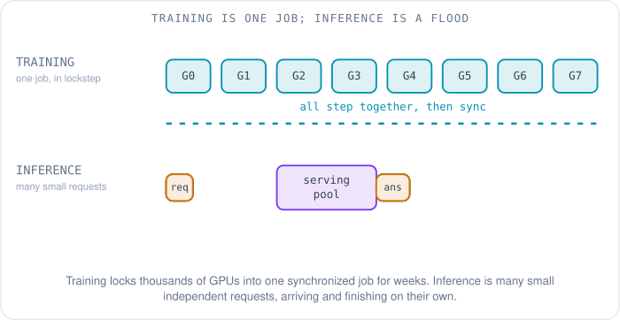
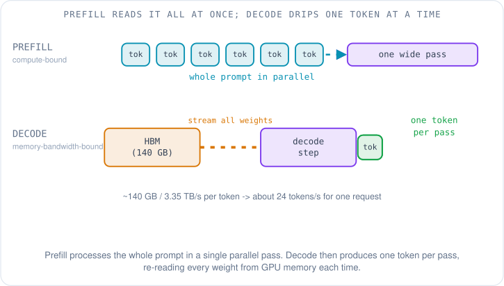
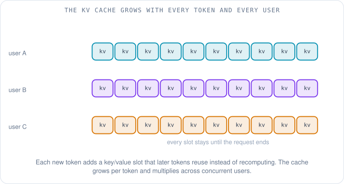
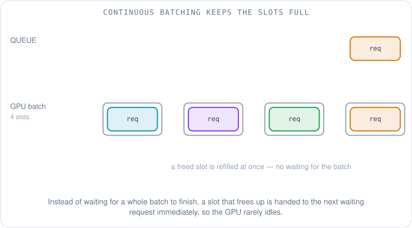
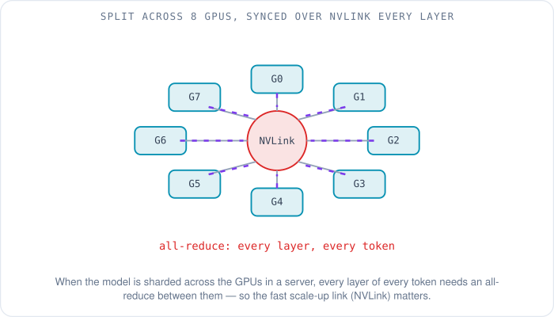
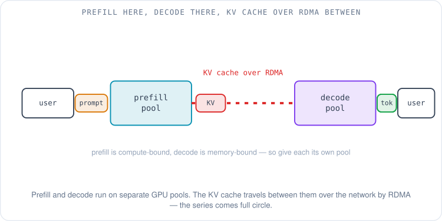

# Inside Inference: How a Trained Model Answers Millions of People

A model finishes training the way a student finishes school. For weeks or months, thousands of GPUs were locked together in one enormous synchronized job, reading the internet and nudging billions of numbers into shape. Then the job ends, the weights are frozen, and the model graduates. Now the real work starts — because a trained model that nobody uses is just a very expensive file on disk. The job it graduated into is answering questions, millions of them at once, from people who each want their reply *now*.

That job has a name, and it is the one word in modern AI that gets used constantly and explained almost never: **inference**. Inference is what a model does every time you type something and it writes something back. The previous article in this series, [what happens when you ask a chatbot](07-what-happens-when-you-ask-a-chatbot.md), followed one question from your keyboard to a GPU and back. This article is the part it deferred: what inference actually is, why it is strange and expensive, and — because this is a networking series — why serving a large model at scale drags the network right back into the center of the story.

Keep one contrast in your head the whole way through. Training is **one job**: every GPU is working on the same task, and they all stop and synchronize at the end of each step (the earlier articles called this the all-reduce heartbeat). Inference is the opposite: a **flood of small, independent requests**, each from a different person, each arriving and finishing on its own schedule, and each one impatient. Training optimizes for throughput over weeks. Inference optimizes for keeping thousands of impatient strangers from noticing a delay.

## What is inference, concretely?

When a model answers you, it is not looking anything up. There is no database of answers inside it. The model is a giant function — a fixed pile of numbers called **weights** (the values training spent all those GPU-weeks tuning) — and inference is the act of running your input through that function to produce an output. For a language model the output is built one piece at a time. The model reads everything so far, scores every possible next **token** (a token is a chunk of text, roughly a word or part of one), picks one, appends it, and repeats. The answer is *generated*, left to right, token by token — never retrieved. That is why the same question can produce slightly different wordings, and why a model can answer things no one ever wrote down: it is composing, not recalling.

That "one token at a time" is not a small detail. It is the fact that shapes every hard problem below. Generating a hundred-word reply means running the model about 130 times in sequence (at roughly three-quarters of a word per token), each run depending on the one before it. You cannot skip ahead, because the model needs to see the token it just produced before it can produce the next. Training got to process whole sequences in parallel; generation is stubbornly serial.

## Why one request runs in two very different gears

Here is the part that surprises people the first time they see it: a single inference request runs in two phases that stress completely different parts of the GPU.

The first phase is **prefill**. The model reads your entire prompt — every token of it — in a single pass, building up its internal understanding of what you asked. Because all the prompt's tokens are available at once, the GPU can process them in parallel, exactly the way training does. Prefill is a flood of matrix multiplication, and it is limited by how fast the GPU can do arithmetic. It is **compute-bound**.

The second phase is **decode**. Now the model generates the answer, one token per pass. And each pass has a brutal requirement: to produce even a single token, the GPU must read *every weight in the model* out of its memory. A 70-billion-parameter model stored at two bytes per weight is 70 billion × 2 = 140 GB of numbers, and all 140 GB have to stream from the GPU's memory into its compute cores for each token produced. The arithmetic per token is tiny; the memory traffic is enormous. Decode is **memory-bandwidth-bound**.

That distinction is worth making concrete, because it explains the entire economics of serving models. Take NVIDIA's H100 SXM, a common inference GPU: its HBM3 memory moves about 3.35 terabytes per second [1]. If one decode step must read 140 GB of weights, then the fastest that single request could possibly go is 3.35 TB/s ÷ 140 GB ≈ **24 tokens per second** — and that is a hard ceiling set by memory bandwidth alone, before any other overhead. Twenty-four tokens per second is readable, but it would mean one expensive GPU serving one person at a time. The GPU's compute units, meanwhile, sit almost idle during decode, waiting on memory.

So you have a GPU that is barely working during the phase that dominates most replies. The fix is the single most important idea in model serving: **batching**. If you are going to drag all 140 GB of weights across the memory bus anyway, do it once for *many* requests at the same time. Read each weight once, apply it to thirty users' tokens, and you have served thirty people for roughly the memory cost of serving one. Batching is how a GPU that tops out at 24 tokens per second for one user delivers thousands of tokens per second across a crowd. The whole art of inference serving is keeping that batch as full as possible — which turns out to be hard, because of what each request is secretly carrying.

## The thing every request carries: the KV cache

Remember that decode re-runs the model for every new token. A naive implementation would also re-process the entire conversation so far on every step — reading all previous tokens again just to generate the next one. For a long conversation that is quadratically wasteful. The standard fix is the **KV cache** (key–value cache), and it is the single biggest consumer of GPU memory in a serving system.

When the model processes a token, its attention mechanism computes two vectors for that token — a **key** and a **value** — that later tokens will refer back to. The KV cache simply saves those keys and values so they never have to be recomputed. Each new token reads the whole cache (every earlier token's keys and values) and then adds its own entry to it. That is the trick that makes generation linear instead of quadratic: you pay to compute each token's key and value exactly once, then reuse them for the rest of the reply.

The catch is size. The cache grows by one slot per token, per layer — and it grows for *every request in the batch simultaneously*. The size follows a simple formula: KV bytes per token = 2 × layers × (attention heads × head dimension) × bytes per number, where the leading 2 covers the key and the value [2]. Work it through for Llama 3 70B, whose published configuration has 80 layers and, thanks to **grouped-query attention** (several query heads sharing one key/value head), only 8 key/value heads of dimension 128 [3]. At 2 bytes per number that is 2 × 80 × (8 × 128) × 2 = 327,680 bytes, about a third of a megabyte for every token. An 8,000-token conversation therefore carries about 2.6 GB of cache, and a hundred such conversations on one server carry 260 GB, more than the model's own 140 GB of weights. Memory you spend on the cache is memory you cannot spend on a bigger batch — so the cache directly fights the batching you need for throughput.

That tension is why a 2023 paper from Berkeley, which introduced **PagedAttention** and the vLLM serving system, mattered so much [4]. The authors noticed that serving systems were wasting over half their KV-cache memory to fragmentation — reserving a big contiguous block for each request's maximum possible length, most of which went unused. Their fix borrows the oldest trick in operating systems: paging. Instead of one contiguous block per request, store the cache in small fixed-size pages scattered anywhere in memory, and keep a per-request table mapping logical positions to physical pages — exactly how virtual memory works [4]. Near-zero waste, and pages can even be *shared* between requests that start with the same prompt. vLLM reported two-to-four times the throughput of the previous best systems at the same latency [4]. The lesson generalizes: a huge amount of inference engineering is really memory management wearing a machine-learning hat.

## Filling the batch without making anyone wait: continuous batching

Batching raises an awkward scheduling question. Requests do not arrive together and do not finish together — one person asks for a one-line answer, the next wants three paragraphs. If you form a batch and wait for *all* of its requests to finish before starting the next batch (the obvious approach, called **static batching**), then the short requests sit idle in their slots waiting for the longest one, and new arrivals wait for the whole batch to clear. The GPU runs half-empty.

The answer, introduced by the **Orca** system at OSDI 2022, is **continuous batching** (also called iteration-level scheduling) [5]. Instead of scheduling whole requests, the server schedules at the granularity of a single token-generation step. After every step it checks: did any request just finish? If so, free its slot and pull a waiting request straight in. Requests join and leave the batch continuously, so a freed slot is refilled immediately rather than at the end of some fixed batch. Orca reported throughput improvements of more than an order of magnitude over the previous generation of servers at the same latency [5]. Essentially every modern inference engine does this now.

Once you are batching continuously, you need to measure the right things, because "requests per second" hides what users actually feel. Serving teams watch three numbers. **Time to first token (TTFT)** is how long you wait after hitting enter before anything appears — dominated by prefill. **Time between tokens** is how fast the words then stream out — the decode speed, bounded by that memory-bandwidth ceiling. And **throughput** is total tokens per second across all users, which sets how many GPUs you need and therefore the cost. These pull against each other: a bigger batch raises throughput but can hurt time-to-first-token, because a new request may wait for a slot. Tuning a serving system is largely about trading these three off.

## Making it cheaper: fewer bits, a smaller helper, a shared prefix

Because decode is bottlenecked on moving weights through memory, the most direct way to speed it up is to make the weights smaller. **Quantization** stores each weight in fewer bits — 8-bit integers, or even 4-bit, instead of 16-bit floating point. Halving the bits roughly halves the bytes you must stream per token, which both speeds up decode and frees memory for a bigger batch and a bigger KV cache. The trade-off is a small, usually acceptable loss of numerical precision; the GPTQ method, for example, compressed 175-billion-parameter models to 3 or 4 bits per weight with little loss of accuracy [6], and a great deal of engineering goes into quantizing in ways the model barely notices.

A cleverer trick attacks the serial nature of decode head-on. **Speculative decoding**, introduced by Leviathan and colleagues at Google and published at ICML 2023, runs a small, cheap "draft" model to guess the next several tokens, then lets the big model verify all of those guesses *in a single parallel pass* [7]. Because checking several tokens at once is as cheap for the big model as generating one (verification is compute, and the big model has compute to spare during decode), every accepted guess is a token the big model did not have to generate serially. When the draft model is right most of the time, you get the big model's exact output at two to three times the speed, with no change to what it produces [7].

A third saving comes from noticing that prompts repeat. Many requests share a long common beginning — the same system instructions, the same document pasted in by many users, the same few back-and-forth turns of a conversation. **Prefix caching** keeps the KV cache for a shared prefix around and reuses it across requests, so the expensive prefill over those shared tokens happens once instead of thousands of times. PagedAttention's shareable pages make this natural: the shared prefix is just pages that several requests' page tables all point at [4].

## When the model does not fit on one GPU

Everything so far assumed the model fit in a single GPU's memory. The largest models do not. A model with hundreds of billions of parameters needs more memory than any one GPU has, so it must be split — and *how* you split it decides what the network has to carry.

The usual split inside a single server is **tensor parallelism**: each layer's weight matrices are sliced across the GPUs in the box, so all of them work on every token together, each computing a piece of the result. But a sliced matrix multiply is only correct once the pieces are summed back together — which means an **all-reduce** (the same collective operation that defines distributed training, where every GPU combines its partial result with all the others) after essentially every layer, for every token. That is a lot of synchronization on the critical path of each token, so it only works if the GPUs are connected by something extraordinarily fast. Inside an H100 server that something is **NVLink**, NVIDIA's GPU-to-GPU interconnect, which moves about 900 GB/s bidirectionally per GPU — roughly seven times a PCIe Gen5 link [8]. This is the **scale-up** network (the fat, short links inside one server), as opposed to the **scale-out** network between servers that the rest of this series has been about. Tensor parallelism lives or dies on scale-up bandwidth.

A different kind of large model splits more naturally across *servers*. A **Mixture-of-Experts (MoE)** model does not activate all its weights for every token; it contains many "expert" sub-networks and a router that sends each token to just a few of them. That means you can place different experts on different servers, and only the tokens routed to a given expert need to reach it. The cost is a new traffic pattern: an **all-to-all** exchange, where every GPU sends each of its tokens to whichever servers hold the experts that token needs, and gets results back. DeepSeek's publicly documented V3/R1 inference system is a concrete example — it runs large-scale cross-node expert parallelism so each expert sees a big enough batch of tokens to be efficient, and that design leans on fast inter-node all-to-all communication [9]. Tensor parallelism floods the links inside a box; expert parallelism floods the links between boxes.

## The series comes full circle: the KV cache goes on the wire

Now put the two phases back together with everything we have learned, and a tension appears. Prefill is compute-bound and bursty; decode is memory-bound and long-running. If you run both on the same GPU, they interfere — a long prefill for one user stalls the steady token stream for everyone else sharing that GPU. So a wave of recent systems does something that sounds radical: it runs prefill and decode on *entirely separate pools of GPUs*. This is **disaggregated serving**, and it is where this networking series closes its loop.

The idea was developed in quick succession by several groups: Microsoft's **Splitwise** (ISCA 2024) [10], **DistServe** from Peking University and UC San Diego (OSDI 2024) [11], and **Mooncake**, the platform behind Moonshot AI's Kimi assistant (FAST 2025) [12]. They all share one move: send the prompt to a prefill pool optimized for compute, then hand the request to a decode pool optimized for memory bandwidth, letting you size and tune each pool independently. But handing off a request means handing off its KV cache — the model's entire working memory of the conversation so far — from the GPU that built it to the GPU that will continue it. For the 70B model above that is about 2.6 GB for an 8,000-token conversation, and it has to arrive before the decode GPU can continue the reply, so every millisecond the transfer takes is a millisecond the user waits.

Moving a couple of gigabytes between GPUs, fast, with the CPU out of the way, is exactly the problem [RDMA](01-why-rdma.md) was built for — the kernel-bypass, zero-copy remote memory transfer this series opened with. Disaggregated serving carries the KV cache between pools over the GPU fabric, the same fabric and the same [packet-on-the-wire mechanics](03-rdma-packet-anatomy.md) we traced for a training gradient, now carrying a conversation's memory instead. NVIDIA's **Dynamo** serving framework names "rapid KV cache transfer between prefill and decode GPU workers" as a core requirement, relies on GPUDirect RDMA for its GPU-to-GPU communication, and moves that data with its **NIXL** transfer library [13], [14]. The network that training needed to move gradients is the same network inference now needs to move working memory — a neat demonstration that the fabric, not the GPU, keeps turning out to be the shared dependency.

## The fleet view

Zoom out one more level. A production service is not one copy of the model; it is many identical **replicas** behind a router, the way any web service scales. But inference routing has a twist a web load balancer does not: it pays to send a request to the replica that already holds the right pages in its KV cache. If a replica recently served a request with the same long system prompt, or the same earlier turns of your conversation, routing your next message there lets it reuse that cached prefix instead of prefilling it again — the router becomes a cache-aware scheduler [12]. On top of that sits autoscaling: add replicas when the request flood rises, release them when it ebbs, because idle GPUs at these prices are the most expensive thing in the building.

Here is a compact map of the moving parts.

| Piece | What it is | Why it exists |
|---|---|---|
| Prefill | one parallel pass over the prompt | compute-bound; sets time to first token |
| Decode | one token per pass, weights streamed each time | memory-bandwidth-bound; sets token speed |
| KV cache | saved keys/values for earlier tokens | avoids recomputation; grows per token, per user |
| Continuous batching | refill a slot the instant it frees | keeps the GPU busy without making requests wait |
| Quantization / speculation / prefix cache | fewer bits, a draft model, reused prefixes | cut the memory and serial costs of decode |
| Tensor / expert parallelism | split the model within or across servers | fit models too big for one GPU |
| Disaggregated serving | prefill and decode on separate pools | stop the two phases interfering; moves KV over RDMA |

## Where this leaves the series

We opened this series with a claim that sounded almost contrarian: that [the network, not the GPU, was the thing holding AI back](00-the-network-was-the-bottleneck.md). Across the articles that followed, that claim kept proving itself for *training* — the gradients had to move between thousands of GPUs fast enough that nobody sat idle, and the whole apparatus of RDMA, lossless Ethernet and purpose-built topologies grew up to make that possible.

Inference closes the loop by making the same claim for the other half of a model's life. A trained model is not a static answer sheet; it is a function run millions of times a second, and at scale its working memory — the KV cache — now travels between GPUs over the network for every conversation that gets handed off. The network began as the thing carrying a model's education between GPUs. It ends as the thing carrying the memory of every conversation.

## References

1. *NVIDIA H100 Tensor Core GPU* (H100 SXM: 80 GB HBM3, ~3.35 TB/s memory bandwidth). NVIDIA. https://www.nvidia.com/en-us/data-center/h100/
2. *Mastering LLM Techniques: Inference Optimization* (KV cache size per token = 2 × layers × heads × head dimension × bytes). NVIDIA Developer Blog. https://developer.nvidia.com/blog/mastering-llm-techniques-inference-optimization/
3. *The Llama 3 Herd of Models* (Llama 3 70B: 80 layers, 64 attention heads, 8 key/value heads, model dimension 8,192). Meta, arXiv:2407.21783, 2024. https://arxiv.org/abs/2407.21783
4. Kwon, W. et al. *Efficient Memory Management for Large Language Model Serving with PagedAttention* (vLLM; near-zero KV waste; 2–4× throughput). SOSP 2023. https://dl.acm.org/doi/abs/10.1145/3600006.3613165
5. Yu, G.-I. et al. *Orca: A Distributed Serving System for Transformer-Based Generative Models* (iteration-level / continuous batching). OSDI 2022. https://www.usenix.org/conference/osdi22/presentation/yu
6. Frantar, E. et al. *GPTQ: Accurate Post-Training Quantization for Generative Pre-trained Transformers* (175B models at 3–4 bits per weight with little accuracy loss). ICLR 2023. https://arxiv.org/abs/2210.17323
7. Leviathan, Y., Kalman, M., Matias, Y. *Fast Inference from Transformers via Speculative Decoding* (small draft model, big model verifies in parallel; 2–3× speedup). ICML 2023. https://proceedings.mlr.press/v202/leviathan23a/leviathan23a.pdf
8. *NVIDIA Hopper Architecture* (fourth-generation NVLink: ~900 GB/s bidirectional per GPU, >7× PCIe Gen5). NVIDIA. https://www.nvidia.com/en-us/data-center/technologies/hopper-architecture/
9. *DeepSeek-V3/R1 Inference System Overview* (large-scale cross-node expert parallelism and all-to-all communication). DeepSeek open-infra-index, 2025. https://github.com/deepseek-ai/open-infra-index/blob/main/202502OpenSourceWeek/day_6_one_more_thing_deepseekV3R1_inference_system_overview.md
10. Patel, P. et al. *Splitwise: Efficient Generative LLM Inference Using Phase Splitting* (prefill and decode on separate machines). ISCA 2024. https://www.microsoft.com/en-us/research/wp-content/uploads/2023/12/Splitwise_ISCA24.pdf
11. Zhong, Y. et al. *DistServe: Disaggregating Prefill and Decoding for Goodput-optimized Large Language Model Serving.* OSDI 2024. https://www.usenix.org/conference/osdi24/presentation/zhong-yinmin
12. Qin, R. et al. *Mooncake: A KVCache-centric Disaggregated Architecture for LLM Serving* (prefill/decode clusters, cache-aware scheduling). FAST 2025. https://arxiv.org/abs/2407.00079
13. *Introducing NVIDIA Dynamo, a Low-Latency Distributed Inference Framework for Scaling Reasoning AI Models* (KV-cache transfer between prefill and decode workers; GPUDirect RDMA; NIXL). NVIDIA Developer Blog, 2025. https://developer.nvidia.com/blog/introducing-nvidia-dynamo-a-low-latency-distributed-inference-framework-for-scaling-reasoning-ai-models/
14. *NIXL: NVIDIA Inference Xfer Library.* NVIDIA, GitHub. https://github.com/ai-dynamo/nixl
