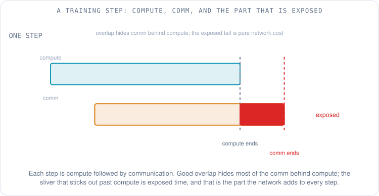
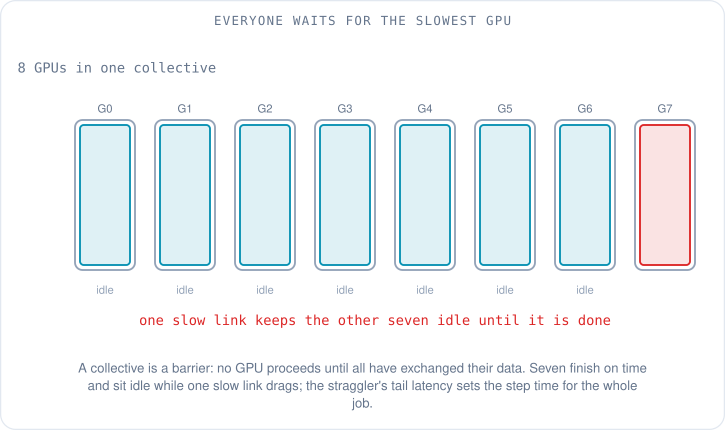
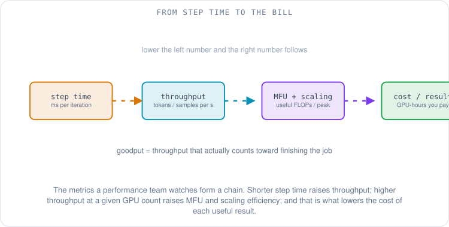
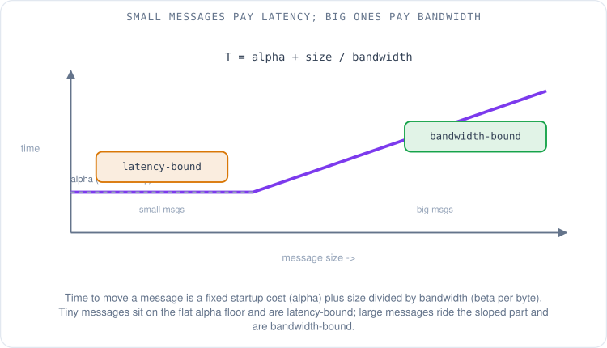
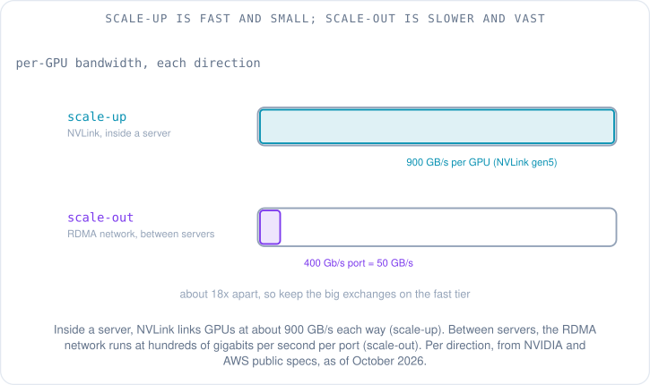
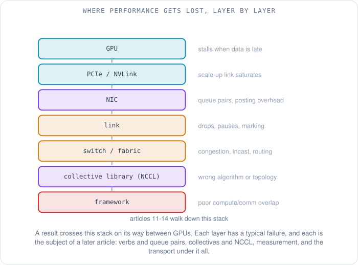

# Why Network Performance Decides What AI Costs

Priya is one week into the ML performance team when the message lands in the channel: a training run is slow. Not broken, not crashed. Slow. The dashboard shows the GPUs pegged near 100% busy, the job is making progress, the loss is going down. And yet the run that was supposed to finish Friday is now tracking to the following Tuesday, and every extra day is thousands of GPU-hours on the bill. She reads down the thread and finds the sentence that everyone on an ML network team eventually hears: "it's probably the network."

She has spent years on networks. She knows BGP, Clos fabrics, ECMP, QoS. But "it's the network" here does not mean a link is down or a route flapped — the dashboards are green. It means something subtler, and until she can say exactly what, she cannot fix it. So this article is the map she draws for herself that first week. What does *performance* even mean for a network that carries machine learning? What are the numbers this team actually watches, and how does a network problem turn into a bigger bill? The next four articles each go deep on one layer; this one is the overview that tells her where to look.

## What is the job actually doing while the GPUs are "busy"?

The first thing to unlearn is that a busy GPU is a productive GPU. A training job runs in **steps** (also called **iterations**): the model looks at a batch of data, computes how wrong it was, and nudges its weights. Thousands of GPUs each do this on their own slice of the work, and then — this is the part that matters — they have to agree. Every GPU's nudge has to be combined with every other GPU's nudge before the next step can start. That agreement is a burst of network traffic called a **collective** ([article 06](06-ai-ml-traffic-patterns.md) covers the all-reduce math behind it; here it is enough to know it is a big, synchronized exchange).

So each step has two phases: **compute** (the GPU doing math on its own) and **communication** (the GPUs exchanging results over the network). If they happened strictly one after the other, the network time would simply add to every step. The trick that makes large training viable is **overlap**: the framework starts sending the early results over the network while the GPU is still computing the later ones, so most of the communication hides behind compute that was going to happen anyway.

What overlap cannot hide is the part of communication that finishes *after* compute does. That leftover sliver is **exposed communication**, and it is the real network cost of the step. A GPU reported as 100% busy can still be waiting on exposed comm at the end of every single step — the utilization counter does not know the difference between useful math and spinning until the data arrives. When someone says "it's the network," what they almost always mean is that the exposed communication per step has grown. The whole job is the step time multiplied by the number of steps, so a few extra milliseconds of exposed comm, repeated millions of times, is the difference between Friday and Tuesday.

## Why does one slow link stall thousands of GPUs?

Here is the part that surprises network engineers coming from the web-serving world, where one slow server just serves a few slow requests. A collective is a **barrier**: no GPU is allowed to move past it until *every* GPU has finished its part of the exchange. They all step together, or they all wait.

That means the step time is set not by the average GPU, not by the median, but by the single slowest one — the **straggler**. If 8,191 GPUs finish their exchange in two milliseconds and one takes six because it sits behind a congested link, all 8,192 take six. The fast ones finish and sit idle, burning money, waiting for the laggard.

This is why an ML performance engineer cares about **tail latency** far more than average latency. On a web service, a 99th-percentile slowpoke affects 1% of users. In a synchronous collective across thousands of GPUs, the 99.99th-percentile link is the one that decides the step, because with enough participants you hit the tail on *every* step. A fabric that looks wonderful on average and terrible at the tail is, for this workload, a terrible fabric. One flaky optic, one slightly-oversubscribed uplink, one port quietly dropping and triggering retransmits — any of these becomes the straggler, and the straggler becomes the whole cluster's pace.

## What numbers does the team actually watch?

Priya's instinct is to ask what the team puts on its dashboards, because those metrics are the shared language. There are a handful, and each answers a different question.

**Step time** (or iteration time) is the stopwatch on one step, usually in milliseconds. It is the most direct pulse of the job: when it goes up, something got slower, and the performance team's whole job is to find out what. **Throughput** rolls that up into work per unit time — **tokens per second** for a language model, or samples per second — which is what people quote when comparing runs.

But throughput alone hides whether you are using the hardware well. A run can post high throughput simply by owning a lot of GPUs while wasting most of each one. The metric that catches this is **MFU (Model FLOPs Utilization)** — the ratio of the useful floating-point math the model actually needed to the theoretical peak the GPUs could have done in that time. The term and its definition come from Google's PaLM paper, which reported training a 540-billion-parameter model at an MFU of about 46% [1]. That number is worth sitting with: even a world-class run leaves more than half the theoretical compute on the floor, and a large part of what it loses is time spent waiting on communication. MFU is the single number that ties "the network is slow" to "we are wasting the expensive part."

**Scaling efficiency** asks a different question: when you add more GPUs, do you get proportionally more work? In **weak scaling** you grow the problem with the machine (more GPUs, bigger total batch) and hope throughput grows linearly. In **strong scaling** you keep the problem fixed and add GPUs to finish faster, which is harder because the communication grows while the per-GPU compute shrinks. Efficiency is how close you get to the straight-line ideal, and the network is usually what bends the line.

Two more complete the vocabulary. **Job completion time** is the end-to-end wall clock for the whole run, the thing the researcher actually feels. And **goodput** is the fraction of time the cluster spends making *preserved, useful* progress, rather than idling, retrying, or redoing work lost to a failure — Google Cloud's framing of goodput as the real measure of ML productivity makes the point that a cluster can be fully "utilized" and still have poor goodput if much of that busyness is wasted [2]. Under all of these sits the one the finance team cares about: **cost per GPU-hour**, which turns every millisecond of exposed communication into dollars.

## Is the network slow because of latency, or bandwidth?

"The network is slow" splits into two very different problems, and telling them apart is the first diagnostic move. The cost of moving one message is well captured by a simple model that parallel-computing researchers have used for decades: a fixed startup cost, plus the size of the message divided by the bandwidth. The classic **LogP** model names the fixed part latency and the per-byte part bandwidth [3]; it is often written as *alpha* (the fixed latency) plus *beta* times the message size (the per-byte time).

The consequence is a curve with two regimes. For a **small** message, the fixed startup cost dominates — you could double the bandwidth and barely move the total, because almost all the time is the fixed *alpha*. Such traffic is **latency-bound**. For a **large** message, the startup cost is lost in the noise and the time is almost entirely size-over-bandwidth; this traffic is **bandwidth-bound**, and the only way to speed it up is more bandwidth or less data.

This matters because the two problems have opposite fixes. If your collective is dominated by many tiny messages — common when a model is split many ways and each piece exchanges little bits often — then buying fatter links does nothing; you need lower latency and fewer, bigger messages. If it is dominated by huge gradient exchanges, latency is irrelevant and bandwidth is everything. Priya learns to always ask which regime a slow collective is in before she proposes a fix, because guessing wrong means spending money on the wrong resource.

## Scale-up or scale-out: which network is even in play?

There is a second split, and it is physical. The GPUs inside a single server (or a single rack) are wired together with an extremely fast, short-reach interconnect — NVIDIA's **NVLink** and NVSwitch — and talking across that is called **scale-up**. The servers are wired to each other through the RDMA network of NICs, links, and switches that the rest of this series is about, and talking across that is **scale-out**.

The reason to keep them straight is that they are an order of magnitude apart in bandwidth. As of October 2026, NVIDIA's fifth-generation NVLink gives each GPU 1,800 GB/s of total bandwidth inside the server, which is 900 GB/s in each direction [4]. Between servers, a common design gives each GPU its own 400 Gb/s network port: an AWS P5 instance, for example, has 3,200 Gbps of networking for its 8 GPUs [5]. A 400 Gb/s port carries 50 GB/s in each direction, so the GPU's path inside the box is about 18 times wider than its path to other boxes.

So a huge amount of performance engineering is about *placement*: keeping the heaviest, chattiest exchanges on the fast scale-up tier and sending only what must cross the building over scale-out. When a model is sharded so that its tightest communication falls across the slow tier instead of the fast one, no amount of fabric tuning will save it. The shape of the job has to match the shape of the network, which is exactly why [topology](05-hpc-topology.md) and [traffic patterns](06-ai-ml-traffic-patterns.md) are their own articles.

## Where, exactly, does performance get lost?

By the end of her first week Priya can draw the map she needed. A result produced on one GPU has to travel a whole stack before it lands on another, and every layer in that stack has a characteristic way of going wrong.

Read from the top: the **GPU** stalls when its data is late. The **PCIe or NVLink** path into and out of the chip can saturate. The **NIC** turns memory into packets, and how the software hands work to it — the queue pairs and the cost of posting each operation — can throttle everything downstream. The **link** itself drops, pauses, or marks packets under load. The **switch and fabric** suffer congestion, incast, and routing mistakes. Above the wire, the **collective library** (NCCL and its kin) can pick the wrong algorithm or the wrong path for the topology it was handed. And at the very top, the **framework** can simply fail to overlap compute and communication, leaving exposed time that no lower layer can recover.

This stack is the index for the rest of the series. [Article 11](11-rdma-verbs-and-queue-pairs.md) opens the NIC and explains verbs and queue pairs — how software actually asks the hardware to move data. [Article 12](12-collective-communication-and-nccl.md) climbs to the collective library and NCCL, where the all-reduce becomes a concrete pattern of messages on the fabric. [Article 13](13-measuring-ml-network-performance.md) is about measurement: how you tell busbw from algbw, and how you prove which layer is the culprit instead of guessing. And [article 14](14-efa-vs-rocev2-performance-and-industry.md) returns to the transport under all of it, comparing EFA and RoCEv2 as design trade-offs and looking at where the industry is heading.

The thing to hold onto is the chain. The accelerators are the expensive part. Synchronous collectives mean the slowest link sets the pace for everyone. Exposed communication is the time the network adds to every step, repeated millions of times. So a performance problem that looks like "the GPUs are a little slow" is really "the network added a few milliseconds to every step, and multiplied by the job it cost a fortune." That is why network performance decides what AI costs — and why the next four articles are worth reading.

## What to remember

- A busy GPU is not a productive GPU; the utilization counter cannot tell useful math from waiting on data.
- A training step is compute plus communication, mostly overlapped. The part that does not overlap — **exposed communication** — is the network's real cost, paid on every step.
- Collectives are barriers, so the **slowest** GPU sets the step time for the whole job. Tail latency matters far more than average latency.
- The team's metrics form a chain: step time, throughput, **MFU** (useful FLOPs over peak), scaling efficiency, job completion time, **goodput**, and finally cost per GPU-hour.
- Small messages are **latency-bound** (fixed startup cost dominates); large ones are **bandwidth-bound**. The fixes are opposite, so diagnose the regime first.
- **Scale-up** (NVLink inside a server) is roughly an order of magnitude faster per link than **scale-out** (the RDMA network between servers); placing the heavy traffic on the right tier is half the battle.
- Performance is lost at many layers — GPU, PCIe/NVLink, NIC, link, switch, collective library, framework — and the next four articles walk down that stack.

Next: [RDMA verbs and queue pairs](11-rdma-verbs-and-queue-pairs.md) — how software actually asks the NIC to move data, and why the way you post work is itself a performance knob.

## References

1. *PaLM: Scaling Language Modeling with Pathways* (defines Model FLOPs Utilization; reports ~46% MFU for a 540B-parameter model). Chowdhery et al., 2022. https://arxiv.org/abs/2204.02311
2. *Goodput metric as measure of ML productivity.* Google Cloud Blog, 2024. https://cloud.google.com/blog/products/ai-machine-learning/goodput-metric-as-measure-of-ml-productivity
3. *LogP: Towards a Realistic Model of Parallel Computation* (communication cost as latency plus per-byte bandwidth). Culler et al., 1993. http://people.cs.uchicago.edu/~ftchong/250C/culler93logp.pdf
4. *NVIDIA NVLink and NVLink Switch* (fifth-generation NVLink: 1,800 GB/s per GPU, as of October 2026). NVIDIA. https://www.nvidia.com/en-us/data-center/nvlink/
5. *Amazon EC2 P5 Instances* (8 GPUs and up to 3,200 Gbps of EFA networking per instance). AWS, as of October 2026. https://aws.amazon.com/ec2/instance-types/p5/
