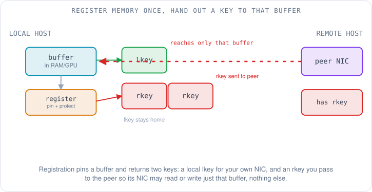
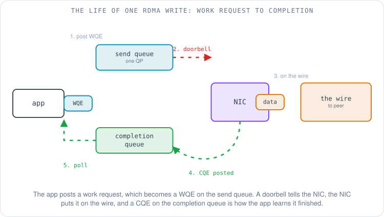
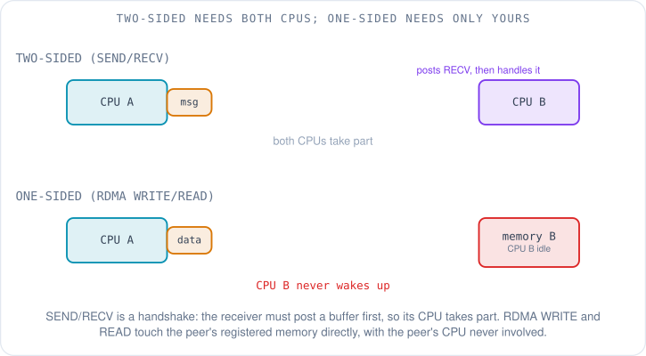
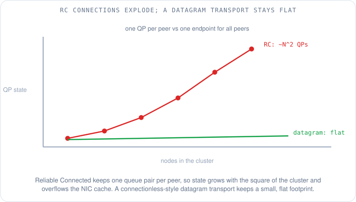
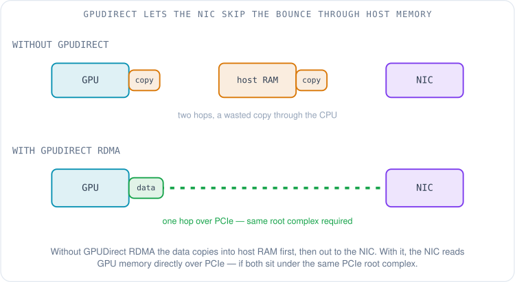
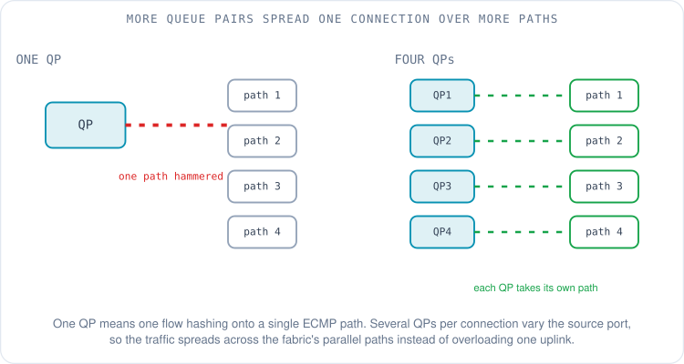

# Queue Pairs, Verbs and Memory Keys: The Vocabulary of RDMA

It is Priya's second week on the machine-learning performance team, and she is staring at a NIC error log that might as well be written in another language. A **NIC** — network interface card, the adapter that connects a server to the fabric — has spat out a wall of lines, and every one of them is thick with abbreviations: `QP 417 moved to error`, `WQE flush`, `CQE with status 12`, `remote access error: bad rkey`. She knows BGP. She knows Clos fabrics and ECMP. She has never once had to care what a `QP` is, because for a network engineer the inside of an application's network stack was always somebody else's problem. On an ML performance team it is her problem, because this vocabulary *is* the performance.

This article is that vocabulary. By the end you will be able to read Priya's log and know exactly what each word means, why it exists, and which ones matter when a training run is slow. We are not going to re-teach what [RDMA is](01-why-rdma.md) or [what an RDMA packet looks like on the wire](03-rdma-packet-anatomy.md); those came earlier in the series. We are going to learn the names of the moving parts, because you cannot tune a machine whose parts you cannot name.

## What are "verbs", and why not just sockets?

The first word to pin down is the one that names the whole interface. **Verbs** is the programming interface to RDMA — the set of operations an application calls to make the NIC do things. The open-source implementation on Linux is **libibverbs**, part of the `rdma-core` package, the userspace libraries and daemons that sit between an application and the RDMA driver [1]. When a program wants to send data over RDMA, it does not call the kernel's `send()`; it calls a verb like `ibv_post_send()`.

The useful analogy is the one Priya already owns: a socket. With ordinary TCP, a program opens a socket, and every byte it sends is copied into the kernel, which owns the connection, runs the protocol, and copies the data out to the NIC. The kernel is on the data path for every single packet. That is fine at a gigabit; it is a disaster at hundreds of gigabits per GPU.

Verbs break that model. The whole point of RDMA, established back in [the first article](01-why-rdma.md), is that after a one-time setup the kernel steps off the data path entirely. The application talks to the NIC directly through mapped memory, and the NIC moves data in and out of application buffers without a copy and without waking the CPU on every transfer. So verbs are socket-like in spirit — open something, post work, get completions — but the resemblance ends at the data path. With a socket the kernel does the work; with verbs the NIC does, and the application's job is to hand it work and collect the results.

## Why must memory be registered first?

Before the NIC can read or write a byte of your memory, you have to tell it about that memory, and this is where Priya's `bad rkey` error comes from. The setup has two steps that always confuse newcomers because sockets never required them: a protection domain, and memory registration.

A **protection domain (PD)** is a container. Every resource an application creates — its queues, its registered memory — belongs to a PD, and the NIC refuses to let a resource in one PD touch memory in another. Think of it as a tenancy boundary inside the NIC, so one application's RDMA cannot stray into another's buffers.

**Memory registration** is the act of handing a specific buffer to the NIC. Two things happen. First, the operating system **pins** the memory — locks those pages so they cannot be swapped out or moved, because the NIC will reach them by physical address and a page that wandered off mid-transfer would be a catastrophe. Second, registration returns two keys.

The **lkey (local key)** is the one your own NIC demands every time you point it at that buffer for a local operation. The **rkey (remote key)** is the interesting one. You send the rkey to a peer, and it is what the peer's NIC must present to read or write that exact buffer by RDMA. The networking analogy that fits is a capability token: possession of the rkey *is* the permission, it is scoped to one registered region and nothing else, and a peer that presents the wrong rkey gets exactly the error in Priya's log — `remote access error: bad rkey`. Registration is not bureaucratic overhead; it is what makes it safe to let a remote machine poke at your memory at all.

## The queue pair and the lifecycle of one transfer

Now the central noun. A **queue pair (QP)** is the fundamental RDMA connection object, and the name is literal: it is a pair of queues, a **send queue** and a **receive queue**. If you want the socket analogy, a QP is the rough equivalent of a connected socket pair — the endpoint through which two peers exchange data. An application posts work onto these queues and the NIC services it.

Paired with the QP is a **completion queue (CQ)**, which is how the application finds out that work is done. The flow of a single transfer ties all of Priya's other mystery words together.

It starts when the application posts a work request. That request becomes a **WQE (work queue element, pronounced "wookie")** — one entry sitting on the send queue describing the operation: what to send, from which buffer, using which keys. The application then rings a **doorbell**, a write to a NIC register that says "there is new work on this queue." The NIC reads the WQE, performs the operation — puts the data on the wire — and when it is finished posts a **CQE (completion queue element, "cookie")** onto the completion queue. The CQE carries the status, and a status other than success is exactly what Priya saw in `CQE with status 12`.

The last choice is how the application learns a CQE has arrived. **Polling** means the CPU spins in a tight loop asking the completion queue "anything yet? anything yet?" — it burns a core but notices completion in nanoseconds, which is why latency-sensitive code does it. The alternative is **event-driven** completion, where the application asks to be woken by an interrupt and the CPU does other work meanwhile, trading a little latency for not pinning a core. A performance engineer meets this trade-off constantly: a benchmark that polls will post lower latency than a real application that cannot afford to spin.

## One-sided and two-sided: who has to be awake?

Not all RDMA operations are equal, and the difference decides whether the remote CPU has to participate at all.

**SEND and RECV** are the **two-sided** operations, and they are a handshake. Before you can SEND to a peer, that peer must already have posted a RECV — a WQE on its receive queue naming a buffer willing to catch the incoming message. The data lands in whichever buffer the receiver chose. Because the receiver had to post that RECV and will take a completion for it, the receiver's CPU is involved. Two-sided RDMA feels the most like message passing: both ends agree to the exchange.

**RDMA WRITE and RDMA READ** are the **one-sided** operations, and they are the ones that feel like magic. Using an rkey the peer handed over earlier, your NIC writes directly into (or reads directly out of) the peer's registered memory. The peer posts nothing. The peer's CPU is never notified and never wakes up. There are also **atomics** — one-sided compare-and-swap and fetch-and-add on a remote memory location — for the rare cases where two machines coordinate on a shared value.

The reason a performance engineer cares is CPU cost. One-sided operations let one machine move data in and out of another with the far CPU completely idle, which is why high-performance systems reach for WRITE and READ wherever they can — the CPU you save is a CPU that can keep feeding the GPUs. The Kalia, Kaminsky and Andersen study at USENIX ATC 2016, which laid out design guidelines for fast RDMA systems, showed how large these effects are: choosing operations well improved the CPU efficiency of a prior high-performance key-value store by 83% [2].

## Why do reliable connections scale so badly?

Here Priya hits the question that actually explains a lot of ML-network design. A queue pair has a *transport type*, set when it is created, and the choice has enormous consequences at scale. The InfiniBand Architecture Specification, maintained by the InfiniBand Trade Association, defines three main ones [3].

**RC (Reliable Connected)** is the familiar, comfortable choice. Like TCP, it guarantees delivery and ordering, and it connects exactly two endpoints. That last part is the trap. A connected transport needs one QP for every peer it talks to. Two nodes, one QP each. But in a training cluster where every GPU may need to talk to every other GPU, the number of QPs on each NIC grows with the number of peers, and across the cluster the total grows with the *square* of the node count.

That square is the problem. Each QP is state the NIC must track, and a NIC has only a small, fast cache for that state. Once the number of active QPs overflows the cache, the NIC starts fetching connection state from host memory on the fly, and performance falls off a cliff — the ATC 2016 guidelines single this out as a central pitfall of RDMA at scale, tracing poor performance directly to NIC cache misses from too much connection state [2]. **UC (Unreliable Connected)** and **UD (Unreliable Datagram)** are the other two IBTA types; UD is connectionless, so one QP can talk to many peers, but it drops the reliability and the large-message support that collective libraries lean on [3].

So the field has spent real effort escaping the N-squared wall. **AWS's SRD (Scalable Reliable Datagram)**, the transport behind [Elastic Fabric Adapter that the packet-anatomy article introduced](03-rdma-packet-anatomy.md), takes the datagram route: it is reliable but deliberately *unordered*, and connectionless in style, so it keeps a small flat footprint instead of a QP per peer. It is exposed to applications through libfabric rather than raw verbs, and AWS documents it as providing built-in OS-bypass and congestion control on the EFA device [4]; the design is laid out in the SRD paper [5]. NVIDIA's answer on InfiniBand is **DCT (Dynamically Connected Transport)**, which keeps RC's reliability and ordering but sets up connections on demand and tears them down when idle, so a node is not holding a QP open to every possible peer at once [6]. Different bets, same enemy: the quadratic cost of per-peer connection state.

## Two APIs: verbs and libfabric

Priya notices the log and the docs sometimes say "verbs" and sometimes say "libfabric", and wonders whether these are rivals. They are two front doors.

**Verbs (libibverbs)** is the InfiniBand-native API, the one whose vocabulary this whole article has been teaching [1]. **libfabric**, also called **OFI (OpenFabrics Interfaces)**, is a second, more abstract API designed to sit over many kinds of hardware through pluggable *providers*: there is a `verbs` provider for InfiniBand and RoCE hardware, and an `efa` provider for AWS's Elastic Fabric Adapter [4]. An application written to libfabric can, in principle, run over any of them by swapping the provider.

This matters because of how the collective library reaches the NIC. **NCCL (the NVIDIA Collective Communications Library)**, the piece that actually drives the network during training, talks to the hardware through a network plugin. On AWS, that plugin is **aws-ofi-nccl**, an open-source plug-in that lets NCCL use libfabric — and therefore EFA — as its network transport [7]. The next article is about NCCL itself; here the thing to hold onto is just the shape of the stack: the framework calls NCCL, NCCL calls a plugin, the plugin calls verbs or libfabric, and that call finally reaches the NIC.

## GPUDirect: let the NIC read GPU memory directly

One more term in Priya's world is about where the data physically lives. In a training cluster the bytes that need to move are in **GPU** memory, not host RAM, and getting them onto the wire efficiently has its own name.

**GPUDirect RDMA** is a technology that lets the NIC read from and write to GPU memory directly over PCIe, without the data making a detour through host memory first [8]. Without it, every transfer pays for an extra copy: GPU to host RAM, then host RAM to NIC, and back again on the far side. With it, the NIC and the GPU exchange data in one hop.

There is a physical catch, and it is why placement and topology show up on a performance engineer's checklist. NVIDIA's documentation is explicit that the two devices must sit under the same upstream **PCIe (Peripheral Component Interconnect Express)** root complex for this to work well [8]. That turns an abstract software feature into a wiring question: which GPU is attached to which NIC, which **NUMA (Non-Uniform Memory Access)** node they share, whether they hang off the same PCIe switch. Get the pairing wrong and the "direct" path quietly falls back to bouncing through host memory, and a benchmark that should have hit line rate comes in far short with no error to explain it.

## The knobs a performance engineer actually turns

With the vocabulary in place, the tuning parameters stop looking like magic incantations. A handful come up again and again.

**MTU (Maximum Transmission Unit)** is the largest packet the fabric will carry in one piece; a larger RDMA MTU means fewer packets for the same data and less per-packet overhead. **Inline data** is a small-message optimization: tiny payloads can be written straight into the WQE and pushed with the doorbell, skipping a separate memory fetch by the NIC and shaving latency off the smallest transfers.

Then there is the tension between **message rate** and **bandwidth**. A stream of tiny messages can exhaust the NIC's ability to process work requests per second long before it fills the link, so a workload can be "slow" while the link sits half empty — the bottleneck is operations per second, not bits per second. Knowing which regime you are in decides what you even try to fix.

The knob that ties this article to everything a network engineer already knows about load balancing is the **number of QPs per connection**. Recall from [the packet-anatomy article](03-rdma-packet-anatomy.md) that a fabric spreads traffic across its many equal-cost paths by hashing each flow's headers, and for RDMA the entropy comes from the UDP source port. One QP is one flow, so it hashes onto one path and hammers a single uplink. Open several QPs for the same logical connection and each gets its own source port, so the traffic spreads across the fabric's parallel paths instead of colliding on one.

NCCL exposes exactly this as a tunable, `NCCL_IB_QPS_PER_CONNECTION`, documented among its environment variables, precisely so a cluster can spread each connection over more ECMP paths [9]. When Priya eventually tunes a run, this is one of the first dials she will reach for — and now she knows *why* it is a dial at all.

## What to remember

- **Verbs (libibverbs/rdma-core)** is the RDMA programming interface; unlike sockets, the kernel leaves the data path and the application talks to the NIC directly [1].
- Memory must be **registered** (pinned) before the NIC can touch it. Registration returns an **lkey** for local use and an **rkey** you hand to a peer; the rkey is a capability token scoped to one buffer.
- A **queue pair (QP)** is a send queue plus a receive queue. You post a **WQE**, ring a **doorbell**, the NIC acts, and a **CQE** on the **completion queue** tells you it finished — found by **polling** (fast, burns a core) or **events** (lazier, cheaper).
- **Two-sided** SEND/RECV needs the remote CPU; **one-sided** RDMA WRITE/READ touches remote memory with the far CPU idle, which is why fast systems prefer it [2].
- **RC** uses one QP per peer, so QP state grows with the square of the cluster and overflows the NIC cache; **SRD** (EFA, via libfabric) and **DCT** (InfiniBand) exist to escape that [2][3][4][6].
- NCCL reaches the NIC through a plugin (**aws-ofi-nccl** on EFA), which calls **verbs** or **libfabric/OFI** [7].
- **GPUDirect RDMA** lets the NIC read GPU memory directly over PCIe, but only when NIC and GPU share a PCIe root complex — so placement and NUMA affinity matter [8].
- Performance knobs: **MTU**, **inline data**, **message rate vs bandwidth**, and **QPs per connection** to spread a flow over more ECMP paths [9].

Priya can now read her error log. [In the next article](12-collective-communication-and-nccl.md) we climb one layer up and meet NCCL properly: how thousands of these queue pairs are marshalled into collective operations like all-reduce, and why one line on a dashboard — "NCCL AllReduce" — can account for a third of a training step.

## References

1. *rdma-core: RDMA core userspace libraries and daemons (libibverbs).* linux-rdma, GitHub. https://github.com/linux-rdma/rdma-core
2. *Design Guidelines for High Performance RDMA Systems.* Kalia, Kaminsky and Andersen, USENIX ATC 2016. https://www.usenix.org/conference/atc16/technical-sessions/presentation/kalia
3. *InfiniBand Architecture Specification* (RC, UC and UD transport service types). InfiniBand Trade Association. https://www.infinibandta.org/ibta-specification/
4. *Elastic Fabric Adapter for AI/ML and HPC workloads on Amazon EC2* (SRD, OS-bypass, Libfabric/OFI, GPUDirect RDMA). AWS EC2 User Guide, as of October 2026. https://docs.aws.amazon.com/AWSEC2/latest/UserGuide/efa.html
5. *A Cloud-Optimized Transport Protocol for Elastic and Scalable HPC* (Scalable Reliable Datagram). Shalev et al., IEEE Micro, 2020. https://ieeexplore.ieee.org/document/9167399
6. *Dynamically Connected Transport (DCT).* NVIDIA DOCA Documentation. https://networking-docs.nvidia.com/doca/archive/3-4-0/dynamically-connected-qps
7. *AWS OFI NCCL: a plug-in to use libfabric as the NCCL network provider on EC2.* aws, GitHub. https://github.com/aws/aws-ofi-nccl
8. *GPUDirect RDMA* (direct NIC-to-GPU path over PCIe; same root complex requirement). NVIDIA CUDA Documentation. https://docs.nvidia.com/cuda/gpudirect-rdma/
9. *NCCL Environment Variables* (NCCL_IB_QPS_PER_CONNECTION). NVIDIA Collective Communications Library documentation. https://docs.nvidia.com/deeplearning/nccl/user-guide/docs/env.html
