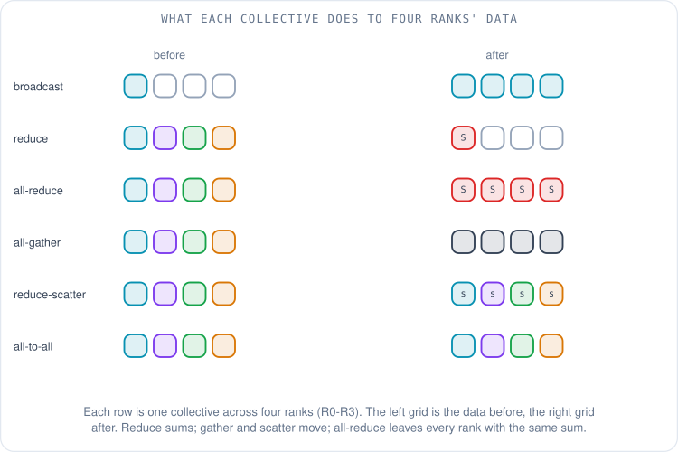
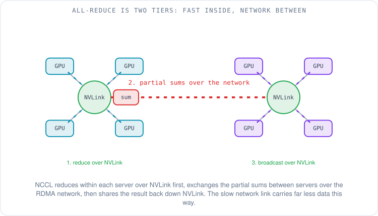
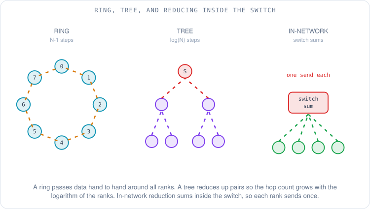
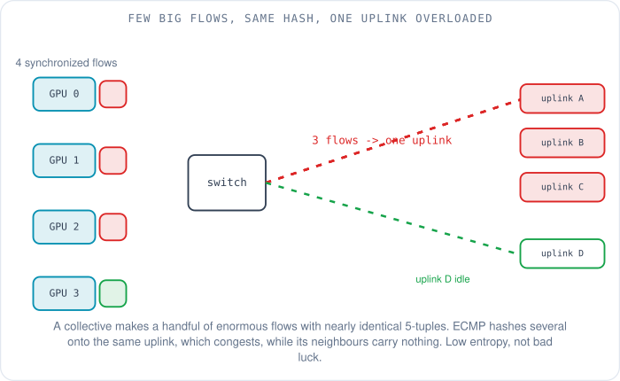
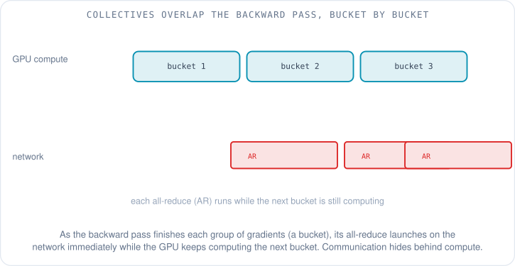
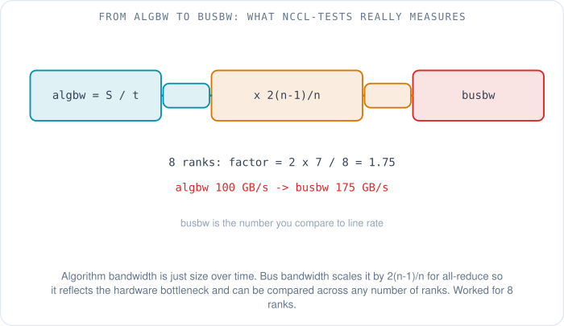

# Collective Communication: How Thousands of GPUs Talk as One

Priya has a new tab open on her screen: a profiler view of a single training step, broken down by where the time went. The bars for matrix multiply and attention she expected. The one she did not expect is nearly a third of the whole step, and it is labelled `NCCL AllReduce`. The GPUs are not computing during that bar. They are talking. A third of the money this cluster costs is being spent on the GPUs waiting for each other to finish a conversation she does not yet understand.

That bar is what this article is about. In [the last article](11-rdma-verbs-and-queue-pairs.md) we learned the vocabulary of a single RDMA connection: queue pairs, memory keys, the lifecycle of one `WRITE`. But a training job does not run one connection. It runs a group operation across every GPU at once, many times in every training step, for the whole run. The library that orchestrates those group operations is what her profiler calls NCCL, and the group operations themselves have a name that goes back decades before anyone trained a neural network. They are called **collectives**. We are going to find out what they are, which ones her job runs, how the library turns them into actual packets on her network, and why those packets have a nasty habit of all landing on the same wire.

## What is a collective, and why does the name sound so old?

A **collective** is a communication operation that involves a whole group of participants at once, rather than just two. The word, and the exact set of operations, comes from **MPI (the Message Passing Interface)**, the standard that scientific computing has used to program clusters since the 1990s [1]. Deep learning did not invent any of this; it inherited a toolbox that supercomputing had already spent twenty years sharpening, and gave it a new and very hungry customer.

The contrast that makes "collective" meaningful is **point-to-point** communication: one sender, one receiver, the `send` and `recv` pair you already met as two-sided RDMA. That is a private conversation. A collective is the whole room doing something together in one coordinated move.

There are only a handful of them, and each is a simple idea once you see what it does to the data. The clearest way to learn them is to watch what each one does to a group of four ranks (a **rank** is just MPI's word for one participant, usually one GPU).

**Broadcast** takes one rank's data and copies it to everyone. **Reduce** is the opposite funnel: every rank contributes a value, they are combined with an operation like sum, and the single result lands on one rank. **All-reduce** is a reduce whose result is then handed back to everyone, so every rank ends up holding the same combined value. **Gather** collects a piece from each rank into one rank; **all-gather** does the same but leaves the full collection on every rank. **Reduce-scatter** sums everyone's contributions and then hands each rank a different slice of the result. **All-to-all** is the busiest of all: every rank sends a distinct piece to every other rank, like everyone in a room swapping a different note with everyone else. And underneath them all, point-to-point `send`/`recv` is still available for the cases that do not fit a group pattern.

The one to hold onto is **all-reduce**, because it is the one on Priya's profiler. Sum everyone's numbers, give everyone the total. That is the single most important operation in distributed training, and the next section is why.

## Where do these show up in training?

Each parallelism strategy leans on a different collective, and the mapping is worth knowing because it tells you, just from how a job is sharded, what its network traffic will look like. We covered the math of these strategies in [the article on AI traffic patterns](06-ai-ml-traffic-patterns.md), so here it is only the one-line mapping.

Plain **data parallelism**, where every GPU holds the whole model and trains on different data, needs an **all-reduce** every step to average the gradients so all the copies stay identical. Sharded approaches like **FSDP (Fully Sharded Data Parallel)** and ZeRO, where the model is split up to save memory, trade that for an **all-gather** to reassemble each layer's weights just in time and a **reduce-scatter** to distribute the summed gradients. **MoE (Mixture of Experts)** models, which route each token to a few specialist sub-networks living on different GPUs, generate **all-to-all** traffic as tokens are shuffled to their experts and back. And **pipeline parallelism**, which puts different layers on different GPUs, is mostly point-to-point `send`/`recv` handing activations down the line. One job often uses several of these at once, which is why its network sees several collective patterns layered together.

## So what is NCCL actually doing?

The library doing the orchestration is **NCCL (the NVIDIA Collective Communications Library, pronounced "nickel")**. For AMD GPUs the equivalent is **RCCL (the ROCm Collective Communications Library)**, which mirrors NCCL's interface closely enough that the ideas transfer. NCCL's job is to take a one-line request from the framework — "all-reduce this buffer" — and figure out how to make it happen fast on *this specific cluster's* hardware.

That is harder than it sounds, because the fastest way to run a collective depends entirely on how the GPUs are wired. So the first thing NCCL does when a job starts is **topology detection**: it discovers which GPUs share fast NVLink inside a server, which sit behind the same PCIe switch, and which can only reach each other over the network [2]. From that map it builds its communication plan.

The plan has a few moving parts, all of which you can see named in NCCL's environment variables when you go looking. NCCL lays the ranks out into **rings** or **trees** — the shapes it will push data around, which the next section explains. It splits the work across multiple parallel **channels** so it can drive several NVLink or network paths at once instead of one. And for each message it picks a **protocol**: NCCL's documented choices are `LL`, `LL128` and `Simple` [3]. The `LL` ("low latency") protocols cut synchronization overhead to win on small messages where latency dominates; `Simple` gives up that overhead saving for full bandwidth on large messages. It is the same latency-bound-versus-bandwidth-bound split that runs through the whole series: small messages pay fixed costs, big ones pay for bytes.

The most important structural decision NCCL makes is to respect the two-tier nature of the hardware. A GPU's link to its neighbour over NVLink inside the server is far faster than its link to a GPU in another server over the network. So NCCL runs a **hierarchical** collective: reduce within each server over NVLink first, exchange only the partial results between servers over the slow network, then broadcast the final result back down NVLink inside each server.

The payoff is that the scarce, slow resource — the network between servers — carries as little data as possible. Instead of every GPU's gradients crossing the network, only one reduced copy per server does. The fast links do the bulk moving; the slow link does the minimum.

## Ring, tree, or let the switch do it?

Inside each tier, NCCL still has to choose *how* the ranks pass data around, and the two classic answers trade latency against bandwidth in opposite directions.

A **ring** arranges the ranks in a circle and passes data hand to hand. For an all-reduce it is bandwidth-optimal: every link is busy the whole time and no rank sends more than it has to. But a ring of N ranks takes on the order of N steps to go all the way around, so its latency grows with the number of ranks. Rings are the right choice for large messages, where you care about total bytes moved per second.

A **tree** pairs ranks up and reduces them upward — two into one, two into one — so the number of hops grows with the *logarithm* of the rank count, not linearly. Far fewer steps, which means far less latency at large scale, at the cost of not keeping every link maximally busy. Trees win for small messages and very large clusters, where the step count of a ring would hurt.

There is a third option that sidesteps the trade-off by changing who does the adding. In **in-network reduction**, the switch itself sums the data as it passes through, so the values never have to fan all the way in to one endpoint and back out. NVIDIA's version for InfiniBand is **SHARP (Scalable Hierarchical Aggregation and Reduction Protocol)**, which offloads the collective's arithmetic into the switch fabric, cutting the amount of data that crosses the network and the time the collective takes [4]. The NVLink-switch equivalent inside a server is **NVLS (NVLink SHARP)**, which NCCL can turn on or off with its own setting [3]. When the hardware supports it, NCCL can use these so each rank effectively sends its contribution once and gets the answer back, rather than participating in every step of a ring or tree.

## How a collective becomes network traffic

Here is where Priya's two worlds collide — the collective she now understands, and the fabric she already knew how to run. When NCCL executes a large all-reduce across many servers, it does not produce the varied, many-sourced traffic a data-centre network is tuned for. It produces a handful of **enormous, synchronized flows**, all starting at nearly the same instant, all roughly the same size, between a small and predictable set of endpoints.

That pattern has a property networks hate: **low entropy**. Recall from [the lossless-Ethernet article](04-lossless-ethernet-for-rdma.md) that a fabric spreads traffic across its many equal paths using **ECMP (Equal-Cost Multi-Path)**, which hashes each flow's 5-tuple — source and destination IP, source and destination port, protocol — to pick a path. ECMP relies on having *many diverse flows* so the hashes spread out evenly. A collective gives it the opposite: few flows, nearly identical headers. Several of those few fat flows hash to the same uplink and pile onto it, congesting it, while its neighbours sit idle. It is not bad luck; it is the direct consequence of low flow diversity.

This is not a hypothetical. Meta, describing the RoCE network behind its large AI clusters at SIGCOMM 2024, called out exactly this: AI training traffic is low-entropy, bursty, and made of elephant flows, and plain ECMP "rendered poor performance for the training workload due to the low flow entropy." Meta went through several routing designs to fix it. The one that worked best for them kept ECMP but gave it more entropy: NCCL splits each connection across several queue pairs, and the switches hash on the queue-pair number, which improved all-reduce performance by up to 40% [5]. The lesson for a perf engineer is that a collective's traffic is pathological for a classic hash-based fabric by its very nature, and taming it is a routing problem, not a tuning afterthought.

## If communication is a third of the step, why isn't it worse?

Because the frameworks are clever about *when* the collective runs. A naive design would finish all the computation, then do all the communication, and the two bars on Priya's profiler would simply add up. Instead, modern frameworks **overlap** them: they start sending gradients that are already computed while the GPU is still computing the rest.

**PyTorch's DistributedDataParallel (DDP)** does this with **gradient bucketing**. Rather than waiting for the entire backward pass to finish, it groups gradients into buckets, and the moment a bucket's worth of gradients is ready it launches that bucket's all-reduce on the network — while the backward pass keeps computing the next bucket [6]. The communication hides behind the computation.

This is why "communication is 30% of the step" does not mean the step would be 30% faster with an infinitely fast network. Much of that communication is overlapped with compute and costs nothing extra. What costs you is the **exposed** part — the communication that could not be hidden because the network was too slow to finish a bucket before the GPU ran out of other work to do. Making the network faster shrinks the exposed part; it does nothing for the part already hidden. That distinction, first raised in [the opening article of this group](10-why-network-performance-decides-ai-cost.md), is the whole game of ML network performance.

## algbw and busbw: reading the number everyone quotes

When Priya goes to measure a collective — which [the next article](13-measuring-ml-network-performance.md) covers in full — the standard tool, `nccl-tests`, will print two bandwidth numbers, and knowing which one to trust saves a lot of confusion.

The first is **algbw (algorithm bandwidth)**, and it is the obvious thing: the size of the operation divided by the time it took, `algbw = S / t` [7]. It tells you how long an operation of a given size will take, but it is misleading as a measure of the hardware, because for a collective the amount of data that actually has to cross the wire is not the same as the buffer size, and it changes with the number of ranks.

The second is **busbw (bus bandwidth)**, which corrects for that. For an all-reduce, `nccl-tests` multiplies algbw by a factor of `2(n-1)/n`, where `n` is the number of ranks [7]. The factor comes from the structure of the operation: moving the data through a ring or tree requires `2(n-1)` transfers per element across `n` links, so the correction turns the raw rate into a figure you can compare directly against the hardware's peak link bandwidth, no matter how many ranks are involved.

Worked through for a common case: with 8 ranks the factor is `2 x 7 / 8 = 1.75`. If `nccl-tests` reports an algbw of 100 GB/s, the busbw is 175 GB/s, and *that* 175 is the number you hold up against the NIC's line rate to ask "are we getting good use of the hardware?" What fraction of line rate counts as healthy is a question to answer only against a cited baseline, which is [article 13](13-measuring-ml-network-performance.md)'s job. Here the point is just which number means what: algbw tells you how long your operation takes; busbw tells you how well the hardware is being used.

## How does NCCL reach the actual NIC?

One last piece connects today's article back to the verbs of the last one. NCCL does not speak to every NIC directly. It reaches the network through a **net plugin** interface, which lets different transports plug in underneath the same collective logic [2]. For standard InfiniBand or RoCE hardware, NCCL has a built-in transport that uses the verbs we met in [article 11](11-rdma-verbs-and-queue-pairs.md). For other fabrics, a plugin provides the path.

On AWS, that plugin is **aws-ofi-nccl**, a public, open-source connector that lets NCCL run its collectives over **EFA (Elastic Fabric Adapter)** by translating NCCL's network calls into **libfabric**, the OFI API that EFA exposes [8]. It is the bridge between the collective world of this article and the transport world of the last: NCCL decides the rings, trees and protocols; the plugin and libfabric carry the resulting messages to the NIC; and underneath, SRD or RoCE moves the bytes. Priya's `AllReduce` bar is all of these layers working in concert — which is also why, when it is slow, there are so many places to look.

So the profiler bar is no longer a mystery. It is a hierarchical all-reduce: NVLink reductions inside each server, a ring or tree or in-network sum across the network between them, split into channels, each message sent with the protocol that suits its size, overlapped with the backward pass, carried to the NIC by a plugin. The next question is the practical one Priya will be asked on her first on-call shift: *is the network actually healthy, and how would you even tell?* [The next article](13-measuring-ml-network-performance.md) is the measurement toolkit — the benchmarks, the counters, and what "good" looks like with a number attached.

## What to remember

- A **collective** is a group communication operation from MPI; the handful that matter are broadcast, reduce, all-reduce, gather, all-gather, reduce-scatter and all-to-all, plus point-to-point `send`/`recv`.
- **All-reduce** (sum everyone's gradients, give everyone the total) is the workhorse of data-parallel training; FSDP/ZeRO use all-gather plus reduce-scatter, MoE uses all-to-all, pipeline uses send/recv.
- **NCCL** (RCCL on AMD) detects the topology and runs collectives **hierarchically**: fast over NVLink inside a server, minimal data over the network between servers.
- **Ring** is bandwidth-optimal but its steps grow with rank count; **tree** trades bandwidth for logarithmic latency; **in-network reduction** (SHARP, NVLS) sums inside the switch so each rank sends once.
- A collective makes **few huge, synchronized, low-entropy flows** that collide under plain ECMP hashing — a routing problem, not a tuning one.
- Frameworks **overlap** communication with compute (PyTorch DDP gradient buckets); only the **exposed**, non-overlapped part is what a faster network fixes.
- **busbw**, not algbw, is the comparable number: for all-reduce it is `algbw x 2(n-1)/n`, scaled so you can hold it against the hardware's line rate.
- NCCL reaches the NIC through a **net plugin**; on AWS that is **aws-ofi-nccl**, which runs NCCL's collectives over EFA via libfabric.

## References

1. *MPI: A Message-Passing Interface Standard, Version 4.1* (collective operations: broadcast, reduce, allreduce, gather, allgather, reduce-scatter, all-to-all). MPI Forum, 2023. https://www.mpi-forum.org/docs/mpi-4.1/mpi41-report.pdf
2. *NCCL: Overview and Usage* (topology detection, rings/trees, channels, net plugins). NVIDIA Collective Communications Library documentation. https://docs.nvidia.com/deeplearning/nccl/user-guide/docs/overview.html
3. *NCCL Environment Variables* (NCCL_PROTO: LL, LL128, Simple; NCCL_ALGO: Ring, Tree). NVIDIA, 2026. https://docs.nvidia.com/deeplearning/nccl/user-guide/docs/env.html
4. *NVIDIA Scalable Hierarchical Aggregation and Reduction Protocol (SHARP)* (in-network aggregation of collectives). NVIDIA Networking documentation. https://docs.nvidia.com/networking/display/sharpv300
5. *RoCE Networks for Distributed AI Training at Scale* (low entropy, elephant flows, ECMP poor performance, flow-collision degradation). Gangidi and Zeng et al., Meta / ACM SIGCOMM 2024. https://engineering.fb.com/2024/08/05/data-center-engineering/roce-network-distributed-ai-training-at-scale/
6. *PyTorch Distributed: Experiences on Accelerating Data Parallel Training* (gradient bucketing, overlapping computation with communication). Li et al., VLDB 2020. https://arxiv.org/abs/2006.15704
7. *Performance Reported by NCCL Tests* (algbw = S/t; busbw = algbw x 2(n-1)/n for AllReduce). NVIDIA nccl-tests, doc/PERFORMANCE.md. https://github.com/NVIDIA/nccl-tests/blob/master/doc/PERFORMANCE.md
8. *aws-ofi-nccl* (NCCL network plugin mapping NCCL to libfabric for EFA). AWS, GitHub. https://github.com/aws/aws-ofi-nccl
