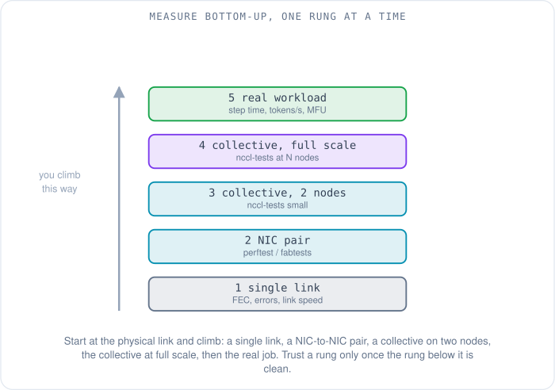
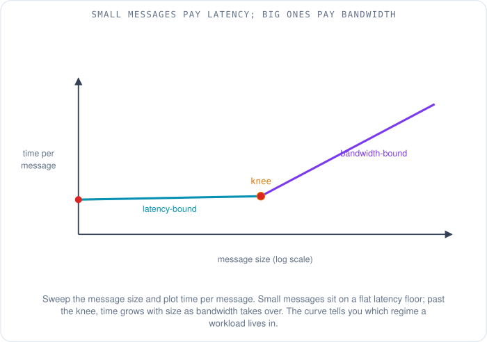
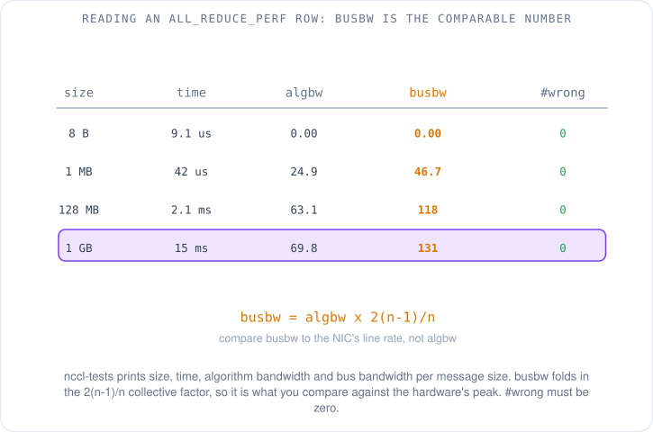
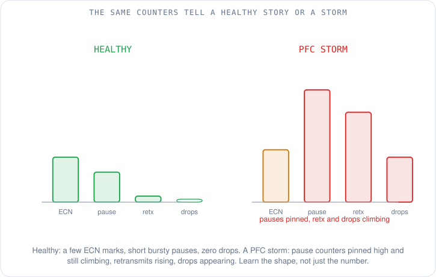
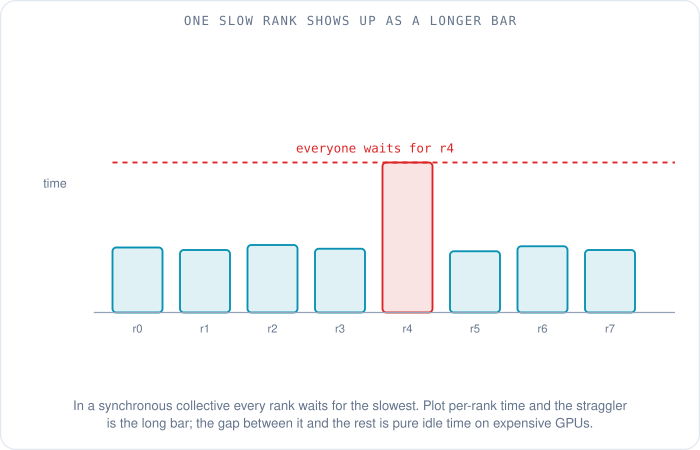
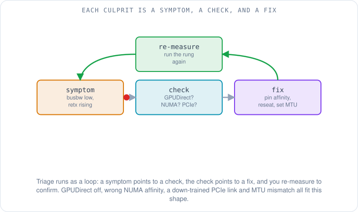

# Measuring an ML Network: Benchmarks, Counters and What Good Looks Like

Priya has been on the ML performance team for three weeks when her manager drops a question on her desk that sounds simple and is not. A big training run is scheduled on a sixty-four-node cluster this weekend, and before it starts someone needs to sign off that the network is healthy. "Is it healthy?" he asks. Priya opens a terminal, looks at a wall of green dashboards, and realizes she has no idea where to even begin. The links are up. The GPUs are idle. Nothing is on fire. None of that tells her whether the fabric will hold up when four hundred and ninety-two of those GPUs start slamming gradients across it at the same instant.

This article is about how she answers that question. Not with a single magic number, but with a ladder of measurements, each one checking a smaller, more fundamental thing than the one above it. By the end she will be able to say not just "healthy" or "not healthy" but *where* the network would break and *why*.

## Why measure bottom-up?

The first instinct is to run the real workload and watch it. That is the most realistic test, and it is also the worst place to start, because when a real training job runs slow the cause could be anything: a bad cable, a misconfigured library, one slow server, the wrong GPU-to-GPU wiring, or nothing to do with the network at all. A failed run at the top of the stack tells you something is wrong without telling you what.

So Priya measures from the bottom up. She checks the smallest, simplest thing first, confirms it is clean, and only then climbs to the next rung. Each rung adds exactly one layer of complexity over the one below it, so when a rung fails she knows the problem is in that layer, because everything beneath it already passed.



The ladder has five rungs. At the bottom is a single physical link: is it running at the right speed with no errors? Next is one pair of network cards talking directly to each other: can two machines move data at line rate with low latency? Then a collective operation on just two nodes: does the communication library work at all? Then that same collective at full scale across all sixty-four nodes: does it still work when thousands of flows start at once? And at the top, the real workload: does the training step actually finish in the time it should? We will climb the ladder one rung at a time.

## Rung one: is the link even healthy?

Before any clever benchmark, Priya checks the physical layer, because a benchmark that runs over a sick link just measures the sickness. She reads the interface counters on each link and looks for three things.

The first is link speed and width. A link that was supposed to come up at 400 gigabits per second but negotiated down to 100 is a classic silent failure, and so is a **PCIe (Peripheral Component Interconnect Express, the bus that connects the network card to the rest of the server)** link that trained at half its lanes. The hardware reports it quietly; nobody gets an alarm; the run is just mysteriously slow.

The second is errors. Every high-speed link uses **FEC (Forward Error Correction, a scheme that adds redundant bits so the receiver can repair a few corrupted ones without asking for a resend)**. A trickle of corrected errors is normal. A rising count of *uncorrected* errors means a marginal cable or optic that will drop packets under load, and a flapping link that keeps going down and up is worse than one that is cleanly dead, because the fabric wastes time reconverging around it each time.

The third is simply whether the link is stable over a few minutes, not just at the instant she looked. A link that is fine now and flaps every ten minutes will not survive a weekend run.

## Rung two: how fast can two cards talk?

With the links clean, Priya tests one pair of machines in isolation. This is where the dedicated microbenchmarks come in, and which one she reaches for depends on how the cards talk to the network.

For hardware using the **verbs** interface, which is the native RDMA programming interface on InfiniBand and on **RoCEv2 (RDMA over Converged Ethernet version 2, RDMA carried inside ordinary Ethernet and UDP)**, the standard tool is **perftest**. It is a small suite where each test is named for the operation it drives: `ib_write_bw` measures the bandwidth of RDMA writes, `ib_write_lat` measures their latency, `ib_send_bw` measures two-sided sends, and there are read and atomic variants too [1]. One machine runs the test as a server, the other connects to it as a client, and the client prints the result.

For **AWS EFA (Elastic Fabric Adapter, Amazon's RDMA-capable network interface for EC2)**, the cards are reached through **libfabric** rather than verbs, so the equivalent tool is the **fabtests** suite that ships with libfabric: `fi_pingpong` for a quick latency check and `fi_rma_bw` for remote-memory bandwidth [2]. Different API, same idea: drive one well-understood operation between two endpoints and read the numbers.

Whichever tool she uses, the output columns mean the same handful of things. There is the message size being tested, the number of iterations, the measured bandwidth in megabytes or gigabits per second, and for latency tests the minimum, median and maximum round-trip time. One detail worth knowing: perftest's latency tests measure the full round trip but report half of it as the one-way latency, which is accurate only when the two directions are symmetric [1].

Here is a small, clearly made-up sample of what a bandwidth run looks like, so the shape is familiar. These numbers are illustrative, not a real measurement:

```
 #bytes   #iterations   BW peak[Gb/s]   BW average[Gb/s]   MsgRate[Mpps]
 2         1000          0.21            0.19               11.80
 8192      1000          92.4            91.8               1.40
 1048576   1000          98.1            97.9               0.012
```

Reading it top to bottom tells the whole story of the link, which brings us to the single most useful thing a microbenchmark can show.

## What does the message-size sweep reveal?

A single bandwidth number is almost meaningless on its own, because the answer depends entirely on how big the messages are. So Priya does not run one size; she sweeps across many, from a few bytes up to tens of megabytes, and plots time per message against size. The curve has two distinct halves, and the bend between them is the most informative feature on the whole chart.



On the left, for small messages, the line is flat. The time to send two bytes and the time to send two hundred are almost identical, because what dominates is the fixed cost of launching the operation at all: the overhead of posting the request, the card reacting, the signal crossing the wire. This is the **latency-bound** regime, and it is where small, chatty communication lives.

On the right, for large messages, the line slopes steadily upward. Here the fixed overhead is a rounding error and the time is set almost entirely by how many bytes have to cross the wire divided by the link's bandwidth. This is the **bandwidth-bound** regime, where the big bulk transfers of a training job live.

The knee between them is where fixed cost stops dominating and bandwidth takes over. Knowing where a given workload sits on this curve tells Priya what to care about: a latency-bound pattern needs lower overhead and more messages in flight, while a bandwidth-bound pattern needs raw link speed and nothing getting in its way. (Where each ML communication pattern falls on this curve, and the simple cost model behind it, is the ground the earlier articles in this series laid; here it is just a tool she reads.)

## Rung three and four: does the collective hold up?

A healthy pair of cards does not prove the cluster will run a training job, because training does not use point-to-point sends. It uses **collectives**, group operations where many GPUs cooperate, and the one that dominates most training is **all-reduce**, where every GPU contributes a value and every GPU ends up with the sum. The library that runs these on NVIDIA hardware is **NCCL (the NVIDIA Collective Communications Library, pronounced "nickel")**. So the next rung tests NCCL itself, using the **nccl-tests** benchmark suite.

The command Priya runs is `all_reduce_perf -b 8 -e 8G -f 2 -g 1`. That reads as: run an all-reduce, sweep the message size beginning (`-b`) at 8 bytes and ending (`-e`) at 8 gigabytes, multiplying (`-f`) the size by 2 each step, with one GPU (`-g`) managed per process, launched across the nodes by MPI or Slurm. It is the message-size sweep from rung two, but now for a real collective across real nodes. She runs it first on two nodes (rung three) to confirm the library works at all, then across all sixty-four (rung four) to see whether it still holds when thousands of synchronized flows hit the fabric together.

The output is a table, and the column that matters takes a moment to understand.



Each row reports the message size, the time the operation took, and two different bandwidth numbers: **algbw** and **busbw**. The algorithm bandwidth, algbw, is the naive one: the message size divided by the time [3]. It is honest but misleading for a collective, because a collective moves each piece of data across several links, and how many depends on how many GPUs are involved. A larger cluster shows a *lower* algbw for the same hardware, purely because of the collective's structure, which makes algbw useless for comparing one cluster to another.

The bus bandwidth, busbw, fixes this. It takes algbw and multiplies it by a correction factor that accounts for the collective's data movement, so that the result reflects how hard the underlying links are actually working. For an all-reduce, nccl-tests derives that factor as `busbw = algbw * 2(n-1)/n`, where `n` is the number of ranks [3]. The beauty of it is that busbw is directly comparable to the hardware's peak link rate no matter how many GPUs you used, which is exactly why it is the number perf engineers quote. (The derivation of that `2(n-1)/n` factor, and what busbw means for the other collectives, is the subject of [the previous article on collective communication](12-collective-communication-and-nccl.md); here we simply read the number it produces.)

Two more columns deserve attention. The time column is only meaningful for small messages, where it measures the fixed latency; for large messages, look at busbw instead [3]. And there is a `#wrong` column that counts results that came back numerically incorrect. It must be zero. A non-zero `#wrong` means data is being corrupted in flight, which is a far more serious problem than being slow.

As for what fraction of line rate counts as "good," the honest answer is that it depends on the hardware, the collective and the scale, and the only defensible way to state a target is to cite the measurement it came from. A widely used benchmark that makes those conditions explicit, model by model, is **MLPerf**, discussed below. Priya resists the urge to memorize a magic percentage.

## Rung five: what does the real job say?

At the top of the ladder is the workload itself, and here the metrics stop being about the network and start being about the business. The first is **step time**, the wall-clock time for one training iteration, which is the number the team actually feels. The second is throughput, measured in tokens per second or samples per second. The third is the one that ties it all together: **MFU (Model FLOPs Utilization)**, the ratio of the floating-point work the model actually performed to the theoretical peak the hardware could have performed in the same time [4]. An MFU of 0.5 means the expensive accelerators spent half their time doing useful math and half their time waiting, often on the network. It is the single best summary of whether the whole system, network included, is being used well.

To compare across organizations rather than just against yesterday, the industry standard is **MLPerf**, the benchmark suite run by the non-profit **MLCommons**. MLPerf Training measures how fast a system can train a fixed set of reference models to a defined target quality [5], and crucially its published results come bundled with the exact system configuration that produced them, so a number always carries its conditions. That last point is the whole discipline in one sentence: a performance number without its conditions is a rumor.

## Which counters tell the real story?

Benchmarks tell Priya what the network *did*. Counters tell her *why*, and they are where a perf engineer spends most of their time. These are running tallies the switches and network cards keep, and reading them is less about any single value than about recognizing the shape of a healthy pattern versus a sick one.



On the switch side, the counters that matter were introduced in depth in [the lossless Ethernet article](04-lossless-ethernet-for-rdma.md) and are worth watching here: link errors and FEC corrections (the physical layer again), **PFC (Priority Flow Control)** pause frames sent and received, **ECN (Explicit Congestion Notification)** marks, and the **CNPs (Congestion Notification Packets)** that carry the "slow down" signal back to senders. In a healthy fabric running **DCQCN (Data Center Quantized Congestion Notification)**, the congestion-control scheme that ties ECN and PFC together, you expect to see some ECN marks appearing under load, pause frames that are short and bursty rather than continuous, and zero packet discards in the RDMA traffic class. (What those mechanisms are and how they interlock is covered in [the article on lossless Ethernet](04-lossless-ethernet-for-rdma.md); here they are symptoms to read.)

The sick pattern is unmistakable once you have seen it. Pause counters climbing relentlessly and pinned near their maximum, retransmits rising, and discards appearing where there should be none, all fanning out from one device, is the signature of a PFC storm. The number is not the point; the trajectory is.

On the EFA side, the card's driver publishes its own counters to the instance, documented publicly: bytes and packets transmitted and received (`tx_bytes`, `rx_bytes`, `tx_pkts`, `rx_pkts`), packets received and then dropped (`rx_drops`), and counters for send operations and retransmissions, all cumulative since the instance started [6]. The same discipline applies: watch whether drops and retransmits are flat or climbing, not just their absolute size.

## How do you catch the one slow node?

The nastiest failure in a synchronous collective is not a dead node; it is a slightly slow one. Because every GPU waits for the slowest before the step can complete, a single straggler running at half speed drags the entire cluster down to half speed, while every dashboard for every other node looks perfectly fine. The waste is enormous and invisible unless you measure the right thing.



The way to catch it is to record per-rank timing: how long each GPU spent in the collective, rank by rank. On a healthy cluster the bars are all about the same height. A straggler is the one bar that towers over the rest, and the gap between it and the others is pure idle time that everyone else spent waiting. Once the slow rank is identified, the cause is usually one of the physical-layer problems from rung one, hiding on that one node.

## A checklist of the usual culprits

When a rung fails, the cause is almost always one of a short list of recurring problems, and each has a symptom, a check, and a fix. Triage is a loop: a symptom points to a check, the check points to a fix, and then you re-measure the rung to confirm it is actually gone.



The common culprits, each as symptom then check then fix:

- **GPUDirect not active.** Bandwidth is far below line rate and the CPU is unexpectedly busy; check whether the card is reading GPU memory directly or bouncing through host memory; fix the driver or placement so direct access is on.
- **Wrong NIC-to-GPU affinity.** A node is slower than its twins; check which GPU is paired with which card across the **NUMA (Non-Uniform Memory Access)** layout; fix by pinning each process to the card closest to its GPU.
- **PCIe link down-trained.** One node trails and its card reports fewer lanes or a lower generation than it should; check the PCIe link status; fix by reseating the card or replacing the riser.
- **MTU mismatch.** Large messages fail or crawl while small ones are fine; check that every device in the path agrees on the **MTU (Maximum Transmission Unit, the largest packet allowed)**; fix the odd one out.
- **ECMP collisions.** Aggregate bandwidth is well below the sum of the links even though every link is healthy; check whether too many flows hashed onto the same uplink under **ECMP (Equal-Cost Multi-Path)**; fix by spreading flows or enabling adaptive routing.
- **A flapping link or a straggler node.** Intermittent slowdowns or one tall bar in the per-rank timing; check link stability and per-rank times; fix the marginal cable, optic, or node.
- **Misconfigured collective library.** Bad busbw with clean links and counters; check the library's environment settings against the topology; fix the configuration and re-run.

The point of writing them this way is that triage becomes mechanical: match the symptom, run the check, apply the fix, re-measure. No guessing.

## What separates a real measurement from a number?

Last, Priya learns the hygiene that separates a trustworthy measurement from a misleading one, and it is the part most people skip. Always discard the first few iterations as warm-up, because the first run is always the slowest while caches fill and connections establish. Always repeat the measurement and report the spread, not just the average: the median (**p50**) and the 99th percentile (**p99**) together, because in a synchronous collective the tail is what hurts, and a good average can hide a terrible p99. Pin the versions of every library and driver, because a silent upgrade can move the numbers. And record the topology and configuration alongside the result, because a number without its conditions, as MLPerf's whole design insists, is not a measurement at all.

So when her manager asks "is the network healthy?", Priya no longer looks at a wall of green. She climbs the ladder: links clean, card pairs at line rate, the collective hitting good busbw on two nodes and then on all sixty-four, the counters showing the healthy pattern and no straggler in the per-rank timing. If every rung passes, she can say yes, and point to exactly which rung would have caught a no.

## What to remember

- Measure **bottom-up**: link, then NIC pair, then collective at small scale, then at full scale, then the real workload. Trust a rung only once the one below it is clean.
- **perftest** (`ib_write_bw`, `ib_write_lat`) tests verbs/RoCE cards; **fabtests** (`fi_pingpong`, `fi_rma_bw`) tests EFA through libfabric. Both drive one known operation between two endpoints.
- A **message-size sweep** has two regimes: small messages are latency-bound (a flat floor), large ones are bandwidth-bound (a rising slope). The knee tells you which your workload lives in.
- In **nccl-tests**, **busbw** is the comparable number because it folds in the collective's data movement (`busbw = algbw * 2(n-1)/n` for all-reduce); `#wrong` must be zero.
- At the top, watch **step time**, **tokens/s** and **MFU**; use **MLPerf** from MLCommons to compare across systems, and remember its results always carry their conditions.
- **Counters** tell you why: ECN marks and short bursty pauses with zero drops is healthy; pauses pinned high with climbing retransmits and drops is a PFC storm. EFA publishes its own driver counters.
- A **straggler** is one tall bar in per-rank timing; it drags a synchronous collective to its own speed while every other dashboard looks fine.
- State no performance number without its **conditions**: warm up, repeat, report p50 and p99, pin versions, record the topology.

Priya can now tell whether a network is healthy and where it would break. The question her team asks next is the one everyone eventually asks: which transport is actually faster, EFA or RoCEv2? [In the next article](14-efa-vs-rocev2-performance-and-industry.md) we take the measurement discipline from here and point it at that comparison, and find that the honest answer is always "for what workload, at what scale, under what conditions."

## References

1. *Performance Tests README* (perftest: ib_write_bw, ib_write_lat, ib_send_bw; latency reported as half the round trip). linux-rdma, GitHub. https://github.com/linux-rdma/perftest
2. *fabtests* (libfabric functional and performance tests: fi_pingpong, fi_rma_bw). OpenFabrics Interfaces Working Group, GitHub. https://github.com/ofiwg/fabtests/blob/master/man/fabtests.7.md
3. *Performance reported by NCCL tests* (algbw, busbw, the 2(n-1)/n all-reduce factor, the #wrong column). NVIDIA nccl-tests, GitHub. https://github.com/NVIDIA/nccl-tests/blob/master/doc/PERFORMANCE.md
4. *PaLM: Scaling Language Modeling with Pathways* (Model FLOPs Utilization: achieved throughput over theoretical peak). Chowdhery et al., 2022. https://arxiv.org/abs/2204.02311
5. *MLPerf Training Benchmark* (measures time to train reference models to a target quality; results carry system configuration). MLCommons. https://mlcommons.org/benchmarks/training/
6. *Monitor an Elastic Fabric Adapter on Amazon EC2* (publicly documented EFA driver counters: tx_bytes, rx_bytes, rx_drops, retransmissions). AWS, as of October 2026. https://docs.aws.amazon.com/AWSEC2/latest/UserGuide/efa-working-monitor.html
