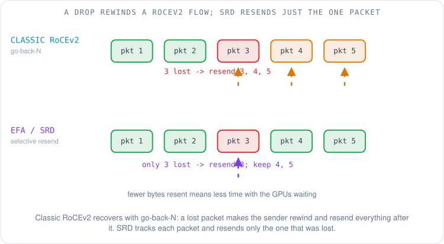
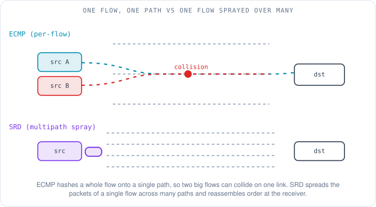
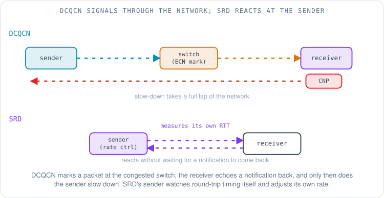
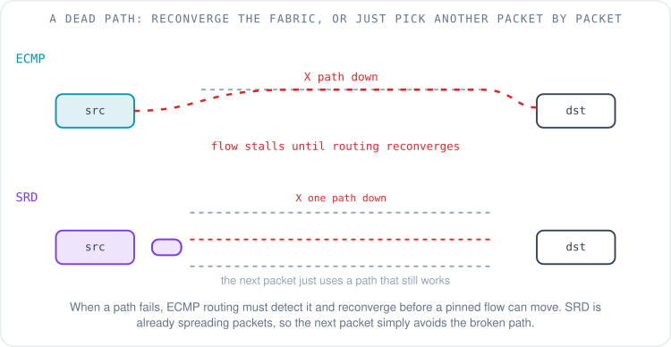
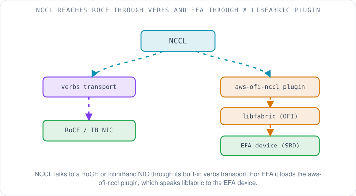
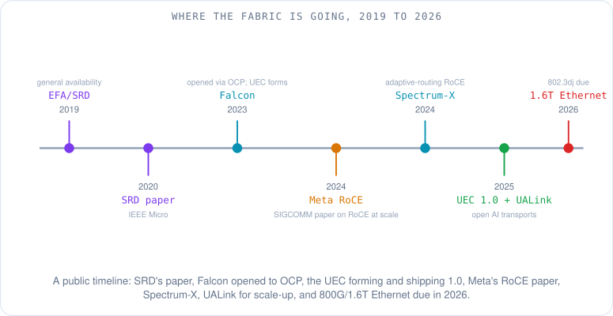

# EFA vs RoCEv2: A Performance Field Guide, and Where the Industry Is Going

Priya's team lead drops a question into the channel on a Friday afternoon: "Procurement wants to know — which is faster for our training clusters, EFA or RoCEv2?" It sounds like it should have a one-word answer. A month ago Priya would have gone looking for one. Now she knows better, because the honest answer is a question right back: faster at *what* workload, at *what* scale, under *what* failure and congestion conditions? Two transports can each win decisively depending on which of those you fix.

This is the last article in the series, and it is the one where everything the earlier articles built gets used at once. We are going to put the two dominant ways of running RDMA over an Ethernet-style fabric side by side — not to crown a winner, but to understand the handful of design choices that decide which one is faster for a given job, and then to look outward at where the whole industry is taking this, because the ground is moving fast.

Two quick definitions before we start, since both are about to appear on every line. **RoCEv2 (RDMA over Converged Ethernet, version 2)** carries InfiniBand's transport logic inside ordinary UDP/IP packets, and classically runs over a *lossless* fabric built with the pause-and-mark machinery from [the lossless Ethernet article](04-lossless-ethernet-for-rdma.md). **EFA (Elastic Fabric Adapter)** is AWS's RDMA network interface; underneath it runs **SRD (Scalable Reliable Datagram)**, a transport AWS designed specifically for a cloud datacenter and described publicly in a 2020 IEEE Micro paper [1]. EFA exposes itself to applications through **libfabric**, the OpenFabrics Interfaces library, rather than through the classic verbs API [2]. Keep those two names — RoCEv2 and EFA/SRD — as the two sides of every comparison that follows.

## Why there is no single "faster"

Performance on these networks is not one number; it is the sum of how a transport behaves in several independent situations. A transport can be brilliant when the fabric is calm and clumsy the instant a packet drops, or the reverse. So instead of asking "which is faster," ask the five questions that actually separate them: how does it recover from loss, how does it use the many paths through the fabric, how does it control congestion, how does it survive a failed link, and how does an application reach it? Answer those, and "which is faster" dissolves into "which set of trade-offs matches my workload." We will take them one at a time.

## Loss recovery: rewind everything, or resend the one packet?

Recall from [the lossless article](04-lossless-ethernet-for-rdma.md) that many classic RoCE NICs recover from a lost packet with **go-back-N**: the receiver refuses anything that arrives after a gap, so one lost packet forces the sender to rewind and retransmit that packet and *everything sent after it* [3]. That design is why RoCE leans so hard on a lossless fabric — the recovery is so blunt that the cheapest fix is to never drop in the first place, which is the whole reason for PFC, ECN and DCQCN.

SRD took the opposite bet. Rather than demand a lossless fabric, it assumes the network *will* drop and reorder, and makes the transport good at coping. SRD tracks packets individually and retransmits only the ones actually lost, with the sender driving recovery quickly instead of waiting on the receiver's gap logic [1]. One drop costs you one packet, not a rewind.

This single choice cascades into everything else. If your transport can shrug off a drop, you no longer *need* the fabric to be lossless, which means you can drop the fragile PFC machinery and all its failure modes — the head-of-line blocking, the congestion spreading, the deadlock. The line is not frozen, though. The same paper that measured go-back-N's cost showed that a RoCE NIC can use selective retransmission instead [3], and some newer NICs support it. So "RoCE means go-back-N" describes older hardware, not the protocol itself; check what your NIC's documentation says before assuming either.

## Path use: one path per flow, or sprayed across many?

The next question is how a transport spreads traffic over the many equal-cost paths a [fat-tree fabric](05-hpc-topology.md) offers between two endpoints. Classic RoCEv2 relies on **ECMP (Equal-Cost Multi-Path)**, the standard way a fabric picks one of several equally-good paths by hashing fixed fields of a flow — for RoCEv2 the entropy comes mostly from the UDP source port, since the destination port is fixed at 4791. Because the hash is per flow, every packet of one flow follows the same path, which keeps packets in order but pins the whole flow to a single link for its lifetime.

That is fine until two big flows hash to the same link. And in ML training that is not a rare accident — it is the normal case. As Meta documented for its production RoCE clusters, AI training traffic has **low entropy**: a small number of very large, synchronized flows, repetitive and predictable, each capable of filling a NIC's line rate [4]. [Article 12 showed](12-collective-communication-and-nccl.md) why a collective produces exactly this pattern. With so few distinct flows, ECMP's hash regularly collides two elephants onto one uplink while other links sit idle. Meta found exactly this: ECMP "rendered poor performance" for training. Its first replacement, pinning traffic to paths by destination, had its own failure mode. When a job only partly filled a rack, traffic piled onto a few uplinks and training slowed by more than 30% [4]. Meta's later fix went back to ECMP but gave it more entropy, by splitting each connection across several queue pairs and hashing on the queue-pair number [4].

SRD attacks this by spraying the packets of a *single* flow across many paths at once, then reassembling order at the receiving NIC [1]. No single link carries the whole flow, so a hash collision cannot pin an elephant to one congested path, and the load spreads evenly by construction. The cost is that packets now arrive out of order and someone has to put them back in order — which is the next question.

## Ordering: in-order on the wire, or reorder above the transport?

Classic RoCE wants packets to arrive in order, because its go-back-N logic treats an out-of-order packet exactly like a loss. That is the deep reason per-flow ECMP and RoCE fit together: the hash keeps a flow on one path, one path keeps it in order, and in-order keeps go-back-N from misfiring. The ordering guarantee is load-bearing.

SRD deliberately gives up in-order delivery on the wire. Because it sprays across paths, packets of one message can and do arrive jumbled, so SRD delivers them to a layer above that restores order before the application sees the data [1]. The trade is explicit: you accept reordering as normal, pay for the buffering and bookkeeping to undo it, and in exchange you get free use of every path. For large bandwidth-bound collective transfers — the dominant traffic in training — that is usually a good trade, because the transfers are big enough that spreading them wins more than reordering costs.

## Congestion control: a lap of the network, or a decision at the sender?

When a queue starts to build, how does the sender learn to slow down? RoCEv2's answer is **DCQCN (Data Center Quantized Congestion Notification)**, the ECN-based loop from [article 4](04-lossless-ethernet-for-rdma.md): a switch marks a bit on a packet as its queue fills, the receiver echoes a small notification back to the sender, and the sender eases its rate [5]. It works, and it runs enormous clusters, but notice the geometry — the "slow down" signal has to travel forward to the receiver and back to the sender, a full lap of the network, before the rate actually changes.

SRD's congestion control lives at the sender instead. As described in the paper, the SRD sender watches round-trip timing on its own packets and adjusts its sending rate from what it measures directly, rather than waiting for a marked packet to make a round trip and come back as a notification [1]. A sender-driven loop can react to its own observations without that extra lap. Stated carefully, because the brief forbids inventing numbers: the public description is of a *design difference* — sender-based rate control measured from RTT versus switch-marked ECN echoed by the receiver — not a published head-to-head latency figure you can quote as a verdict.

## Failure handling: reconverge the fabric, or route around it per packet?

Links fail. The question is how fast traffic recovers. Under per-flow ECMP, a flow is pinned to one path, so when that path breaks the fabric's routing has to *detect* the failure and *reconverge* — recompute paths and rehash the affected flows — before the stranded flow can move. During that window the flow stalls. Meta also found that after an uplink or spine switch failed, ECMP reassigned the affected flows unevenly, and those flows collided with existing ones and slowed the whole job [4].

SRD is already spreading packets across many paths, so a failed path is not a special event that needs reconvergence; it is just one path the sender stops using on the next packet while the others keep carrying traffic [1]. Failover becomes a per-packet non-event rather than a fabric-wide convergence storm. This is the same philosophy as loss recovery — build the transport to tolerate imperfection rather than forcing the fabric to be perfect — applied to topology instead of to drops.

## Interface: verbs, or libfabric — and how NCCL reaches each

The last axis is not about packets at all; it is about how an application gets to the NIC, which matters for performance because it decides what tuning knobs exist. Classic RoCE and InfiniBand expose the **verbs** API ([article 11's](11-rdma-verbs-and-queue-pairs.md) queue pairs, work requests and memory keys), and the collective library **NCCL (NVIDIA Collective Communications Library)** reaches a RoCE or IB NIC through its built-in verbs transport [6]. EFA exposes **libfabric** instead, and NCCL reaches EFA by loading the **aws-ofi-nccl** plugin, an open-source NCCL network plugin that translates NCCL's calls into libfabric operations against the EFA device [7][2].

The practical consequence for a performance engineer is that the knobs differ. On verbs-based RoCE you tune things like the number of queue pairs per connection to spread flows across ECMP paths; on EFA the path-spreading is the transport's job, so that knob is not yours to turn. Knowing which interface you are on tells you which levers you even have.

## What the public numbers actually say

Now the part procurement wanted. The honest way to answer "how fast" is to quote published results *with their conditions attached*, never a bare verdict.

On the EFA side, AWS publishes per-instance network bandwidth. As of October 2026, P4d instances provide up to 400 Gbps of EFA networking, and P5 and P5e instances (NVIDIA H100 and H200) provide up to 3,200 Gbps using second-generation EFA, deployed in EC2 UltraClusters that scale to tens of thousands of GPUs over a petabit-scale non-blocking network [8]. Those are instance *capacities*, not a measured comparison against RoCE — they tell you the ceiling the transport runs under, not how much of it a given collective achieves. The SRD paper also reports the authors' own measurements. Read those as results under the paper's test setup, not as a universal ranking [1].

On the RoCE side, the strongest public evidence is operational. Meta's SIGCOMM 2024 engineering account describes running production distributed training on RoCEv2 backend fabrics with clusters of tens of thousands of GPUs — large enough to train LLAMA 3.1 405B — and is candid about what it took: a dedicated backend fabric, deep-buffer spine switches, a job scheduler that keeps traffic inside one zone where it can, and several rounds of routing changes to handle the low-entropy collision problem [4]. Alibaba's HPN paper at the same conference describes a rail-optimized, dual-plane RoCE design built specifically to avoid ECMP's hash-collision pathologies at LLM-training scale [9]. The lesson from both is not "RoCE is slow" — it is "RoCE at this scale works, and here is the specific engineering it demands."

Put the axes in one place. The table compares *design properties*, and the right-hand column is what each property means for performance — not a score.

| Property | Classic RoCEv2 | EFA / SRD | What it means for performance |
|---|---|---|---|
| Fabric assumption | lossless (needs PFC) | tolerates loss | RoCE inherits PFC's failure modes; SRD avoids them |
| Loss recovery | go-back-N (older NICs) | selective, sender-driven | one drop costs a rewind vs one packet |
| Path use | per-flow ECMP (one path) | multipath spray | few large flows collide on ECMP; spray spreads them |
| Ordering | in-order on the wire | reorder above transport | ECMP must preserve order; SRD pays to restore it |
| Congestion control | DCQCN (ECN, round trip) | sender-based from RTT | round-trip signal vs local decision |
| Failover | routing reconvergence | per-packet path choice | stall-and-rehash vs non-event |
| Interface | verbs | libfabric (+ aws-ofi-nccl) | different tuning knobs |

## Where each tends to fit

Stated as trade-offs, not product advice: a transport that tolerates loss and sprays across paths is built for exactly the traffic ML training produces — a few huge synchronized flows on a fabric where ECMP collisions and occasional drops are the normal weather, at a scale where you would rather the endpoints route around trouble than operate PFC carefully across every port. A lossless RoCE fabric, tuned the way Meta and Alibaba describe, delivers the same goal through fabric engineering instead, and it is the mature, multi-vendor, on-premises-and-cloud option with the deepest operational playbook. Which is "faster" is the wrong frame; which set of trade-offs your scale, your failure budget and your operations team can carry is the right one.

## What the rest of the industry is doing

Step back from the two-horse race and the more interesting story is that almost everyone is converging on the same insight SRD bet on: stop forcing the fabric to be perfect, and build endpoints that tolerate loss, reordering and multipath. Here is the public landscape as of October 2026, each item dated and cited.

The biggest signal is the **Ultra Ethernet Consortium (UEC)**, formed in 2023 by AMD, Arista, Broadcom, Cisco, Eviden, HPE, Intel, Meta and Microsoft, which published its **Specification 1.0 on June 11, 2025** — a complete Ethernet-based communication stack for AI and HPC whose transport is explicitly designed for multipath, does not require in-order delivery, and brings its own modern congestion control [10][11]. In other words, the industry is standardizing the SRD-style bet as an open, multi-vendor Ethernet transport.

**Google's Falcon**, a hardware-assisted reliable transport, was opened to the ecosystem through the **Open Compute Project in October 2023**; it is explicitly built for low latency over lossy Ethernet, uses multipath connections and fast selective retransmission, and carries RDMA as an upper-layer protocol — the same design DNA again [11]. **NVIDIA's Spectrum-X** platform pairs RoCE with adaptive routing and congestion control to get around ECMP's weaknesses, and NVIDIA reports it delivering up to 95% effective bandwidth at scale; NVIDIA's **Quantum** line continues the InfiniBand path for those who want a purpose-built lossless fabric [12]. On the operator side, **Meta runs RoCE** for its large GPU clusters as described above [4], while **Microsoft Azure** gives each GPU in its ND H100 v5 virtual machines a dedicated 400 Gbps NVIDIA Quantum-2 InfiniBand connection [13]. At the very top end, both bets are live in production.

The fabric is also splitting into two layers with different winners. *Scale-out*, between servers, is where EFA, RoCE, UEC and Falcon compete. *Scale-up*, inside a server or rack, is NVLink and NVLink Switch territory — and here the open-standard answer is **UALink**, whose 1.0 specification (UALink_200, 200 Gbps per lane, built on the IEEE P802.3dj PHY) was released publicly in 2025 and connects up to 1,024 accelerators in a pod; its members include AMD, AWS, Google, Meta, Microsoft and others [14].

Underneath all of it the raw speeds keep climbing. **800 Gigabit Ethernet** and **1.6 Terabit Ethernet** are the work of the IEEE 802.3dj Task Force, whose adopted timeline targets completion in 2026 [15]. Faster lanes feed everything above them, and co-packaged optics, which moves the optical engine onto the same package as the switch chip to cut the power spent driving signals across a board, is the next lever. NVIDIA announced co-packaged-optics Spectrum-X and Quantum-X switches in March 2025 [16].

## What a network engineer on an ML performance team should know

That is the whole series. If you came in knowing BGP, Clos and ECMP and only the words "RDMA" and "NCCL," here is the path through everything these five articles covered, as a checklist you can work down.

Start with the concepts, in order: what performance even means for an ML network and why one slow link stalls thousands of GPUs ([article 10](10-why-network-performance-decides-ai-cost.md)); the RDMA vocabulary of queue pairs, verbs and memory keys ([article 11](11-rdma-verbs-and-queue-pairs.md)); how collectives turn into network traffic through NCCL ([article 12](12-collective-communication-and-nccl.md)); and how to measure a fabric bottom-up with the right benchmarks and counters ([article 13](13-measuring-ml-network-performance.md)). Then this article's two transports and the design axes that separate them.

Then the tools: libfabric's fabtests and the verbs perftest suite for point-to-point numbers, nccl-tests for the busbw that actually predicts training speed, and the NIC and switch counters — PFC pauses, ECN marks, retransmits — that tell you which story your fabric is living through.

Then the public papers, all of which this series cited and all of which reward a full read: the SRD paper [1] for the cloud-transport bet, the Meta RoCE paper [4] and Alibaba HPN [9] for RoCE at scale, the DCQCN paper [5] for lossless congestion control, the UEC 1.0 specification [17] for where the open standard is heading, and the NCCL documentation [6] for the layer where all of this meets the GPU.

The honest answer to "which is faster, EFA or RoCEv2" turned out to be a map, not a number — and now Priya, and you, can read it.

## What to remember

- "Which is faster, EFA or RoCEv2?" has no single answer; it depends on workload, scale, and failure and congestion conditions.
- The axes that decide performance are loss recovery, path use, ordering, congestion control, failover, and interface — compare those, not a bare speed.
- Classic RoCEv2 assumes a lossless fabric (go-back-N recovery, per-flow ECMP, in-order, DCQCN) and inherits PFC's failure modes.
- EFA/SRD takes the opposite bet: tolerate loss, spray packets across many paths, reorder above the transport, control rate at the sender, and route around failures per packet.
- Public numbers are conditional: AWS publishes EFA instance bandwidth (P5 up to 3,200 Gbps), Meta and Alibaba publish RoCE-at-scale engineering — none is a universal "X is faster" verdict.
- The whole industry is converging on the loss-tolerant, multipath bet: UEC 1.0 (June 2025), Google Falcon (OCP 2023), NVIDIA Spectrum-X, all echoing SRD's design.
- Scale-up (inside the rack) is a separate layer: NVLink and the open UALink standard, not the scale-out transports.
- Raw speeds keep climbing: IEEE 802.3dj (800G and 1.6T Ethernet) targets completion in 2026, and co-packaged optics is the next step.

This is the final article in the ML network performance series. If you started at [the primer on why network performance decides AI cost](10-why-network-performance-decides-ai-cost.md), you now have the full map — from a single queue pair to the transports racing to wire together the largest machines humans have ever built.

## References

1. *A Cloud-Optimized Transport Protocol for Elastic and Scalable HPC* (SRD: tolerates loss and reordering, multipath spraying, sender-based congestion control). Shalev et al., IEEE Micro, 2020. https://ieeexplore.ieee.org/document/9167399
2. *Elastic Fabric Adapter for AI/ML and HPC workloads on Amazon EC2* (EFA, SRD, libfabric/OFI, NCCL integration). AWS EC2 User Guide, 2026. https://docs.aws.amazon.com/AWSEC2/latest/UserGuide/efa.html
3. *Revisiting Network Support for RDMA* (go-back-N loss recovery in conventional RoCE NICs). Mittal et al., SIGCOMM 2018. https://arxiv.org/pdf/1806.08159v1
4. *RDMA over Ethernet for Distributed AI Training at Meta Scale* (RoCEv2 backend, low-entropy flows, ECMP collisions, path pinning, tens of thousands of GPUs). Gangidi, Zeng et al., Meta Engineering / SIGCOMM 2024. https://engineering.fb.com/2024/08/05/data-center-engineering/roce-network-distributed-ai-training-at-scale/
5. *Congestion Control for Large-Scale RDMA Deployments* (DCQCN). Zhu et al., SIGCOMM 2015. https://dl.acm.org/doi/abs/10.1145/2829988.2787484
6. *NVIDIA Collective Communications Library (NCCL) Documentation* (transports, net plugins). NVIDIA, 2026. https://docs.nvidia.com/deeplearning/nccl/user-guide/docs/index.html
7. *aws-ofi-nccl: AWS OFI NCCL is a plug-in which enables EC2 applications to use libfabric as a network provider for NCCL.* AWS, GitHub. https://github.com/aws/aws-ofi-nccl
8. *Amazon EC2 P5 Instances* (P5/P5e up to 3,200 Gbps EFA, H100/H200, UltraClusters to tens of thousands of GPUs). AWS, 2026. https://aws.amazon.com/ec2/instance-types/p5/
9. *Alibaba HPN: A Data Center Network for Large Language Model Training* (rail-optimized dual-plane RoCE to avoid ECMP collisions). Qian et al., SIGCOMM 2024. https://ennanzhai.github.io/pub/sigcomm24-hpn.pdf
10. *Leading Cloud Service, Semiconductor, and System Providers Unite to Form Ultra Ethernet Consortium* (founding members). Eviden/Atos press release, July 19, 2023. https://atos.net/en/2023/press-release_2023_07_19/leading-cloud-service-semiconductor-and-system-providers-unite-to-form-ultra-ethernet-consortium
11. *Google opens Falcon, a reliable low-latency hardware transport, to the ecosystem* (OCP, October 2023; multipath, selective retransmit over lossy Ethernet, RDMA ULP). Google Cloud. https://cloud.google.com/blog/topics/systems/introducing-falcon-a-reliable-low-latency-hardware-transport
12. *Turbocharging Generative AI Workloads with the NVIDIA Spectrum-X Networking Platform* (RoCE adaptive routing and congestion control; up to 95% effective bandwidth). NVIDIA Developer Blog, 2024. https://developer.nvidia.com/blog/turbocharging-ai-workloads-with-nvidia-spectrum-x-networking-platform
13. *ND-H100-v5 size series* (a dedicated 400 Gbps NVIDIA Quantum-2 InfiniBand connection per GPU, 3.2 Tbps per VM). Microsoft Learn, 2026. https://learn.microsoft.com/en-us/azure/virtual-machines/sizes/gpu-accelerated/ndh100v5-series
14. *UALink Consortium* (UALink_200 1.0 released 2025; 200 Gbps/lane on IEEE P802.3dj PHY; up to 1,024 accelerators per pod; members AMD, AWS, Google, Meta, Microsoft). UALink Consortium, 2025. https://ualinkconsortium.org/
15. *IEEE P802.3dj 200 Gb/s, 400 Gb/s, 800 Gb/s, and 1.6 Tb/s Ethernet Task Force* (1.6T objectives and timeline). IEEE 802.3 Working Group, 2025. https://www.ieee802.org/3/dj/
16. *NVIDIA Announces Spectrum-X Photonics, Co-Packaged Optics Networking Switches to Scale AI Factories to Millions of GPUs.* NVIDIA, March 18, 2025. https://nvidianews.nvidia.com/news/nvidia-spectrum-x-co-packaged-optics-networking-switches-ai-factories
17. *UEC Launches Spec 1.0, Transforming Ethernet for AI and HPC at Scale* (June 11, 2025; multipath, no in-order requirement, new congestion control). Ultra Ethernet Consortium / Linux Foundation. https://www.linuxfoundation.org/press/uec-launches-spec-1.0
